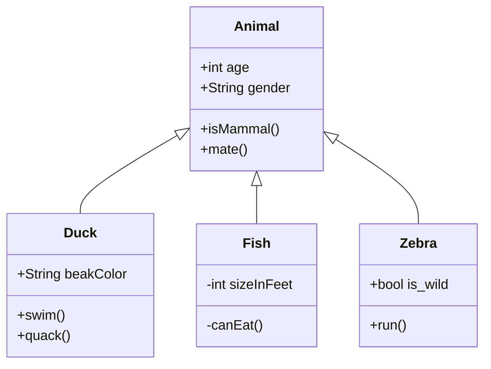

<SYSTEM>Hyperbook Documentation - Version 0.117.1</SYSTEM>

# Getting Started

# Hyperbook

Hyperbook is a quick and easy way to build interactive workbooks, that
support modern standards and run superfast. It works by compiling
markdown to static pages.

Hyperbook makes writing interactive workbooks super simple while providing a
good feature set.

You do not need any coding experience. You only need to create and edit Markdown files.

## Getting Started

You can start working on a Hyperbook in three different ways. Choose the one which suits your style best.

:::::tabs{id="options"}

:::tab{title="VS Code" id="vscode"}

1. Install [VS Code](https://code.visualstudio.com/) or [VS Codium](https://vscodium.com/)
1. Install the Hyperbook Extension for [VS Code](https://marketplace.visualstudio.com/items?itemName=openpatch.hyperbook-studio) or [VS Codium](https://open-vsx.org/extension/openpatch/hyperbook-studio)
1. Download the [hyperbook-anywhere](https://github.com/openpatch/hyperbook-anywhere/archive/refs/heads/main.zip) starter
1. Unzip the file
1. Open the folder in VS Code
1. Run the `Hyperbook: Show side preview` command

:::

:::tab{title="CLI" id="cli"}

You need to have [Node](https://nodejs.org/) version 16 or higher installed on your system.

1. Run `npm create hyperbook` and follow the wizard to create your first Hyperbook.
1. Run `npx hyperbook dev` to start the development server.
1. Visit https://localhost:8080 with your favorite web browser.
1. Modify or add new pages to your Hyperbook by using your favorite editor.

:::

::::tab{title="Web IDE" id="web-ide"}

Most platforms for collaborative version control have an integrated Web IDE like [GitLab](https://docs.gitlab.com/ee/user/project/web_ide/) or [GitHub](https://docs.github.com/en/codespaces/the-githubdev-web-based-editor).

So you can just fork one of our starters and get going:

- GitHub: https://github.com/mikebarkmin/hyperbook-github-pages/fork
- GitLab: https://gitlab.com/mikebarkmin/hyperbook-gitlab-pages/-/forks/new

:::alert{warn}

If you use this approach you will not be able to see a representative preview. In most cases only a normal Markdown preview, which lacks some features of Hyperbook.

:::

::::

:::::

## Deploy

The main goal of writing a Hyperbook is to have an interactive workbook. For this you have to deploy the exported Hyperbook to a host.

Luckily GitHub Pages, GitLab Pages and Vercel are free to use options, which are already setup for you, if you used one of our starters, like [hyperbook-anywhere](https://github.com/openpatch/hyperbook-anywhere).

You just have to push your files to [GitHub](https://github.com) or [GitLab](https://gitlab.com).

If you use the CLI version you can also export your Hyperbook to static HTML files, which can be uploaded anywhere. For this you need to run:

```
npx hyperbook build
```

Then you need to copy the files from `.hyperbook/out` to your desired location.

### Asset downloads and offline builds

The CLI downloads the large assets for Blockflow, Online IDE, SQL IDE,
Excalidraw, OpenSCAD, GeoGebra, Pyodide, and Typst when a build first uses them. These downloads are
verified and cached across projects. The exported book includes local copies.

Before working offline, prefetch the assets needed by your project:

```sh
npx hyperbook assets fetch
npx hyperbook build --offline
npx hyperbook dev --offline
```

Use `npx hyperbook assets fetch --all` to download every optional bundle.
Set `HYPERBOOK_ASSET_CACHE` to choose the cache directory, for example when
restoring a cache in CI. The default is your operating system's user cache
directory. `--offline` reports missing assets and skips the CLI update check;
elements that use external services still need a connection to those services.

:::alert{warn}

Do not forget to set a `basePath` in your hyperbook.json.

:::

## Update

::::tabs{id="options"}

:::tab{title="VS Code" id="vscode"}

Updates should happen automatically.

:::

:::tab{title="CLI" id="cli"}

Update to the latest release of Hyperbook CLI using the following command.

```bash
npm update hyperbook --global
```

:::

:::tab{title="Web IDE" id="web-ide"}

No Integration. No updates.

:::

::::

## Migrate

When a release changes the syntax of an element in a way old pages no longer understand, `migrate` converts your book to the current syntax. It is needed for v0.115.0, which changed the IDEs (PyIDE, Web IDE, p5, OpenSCAD and Typst) to the syntax with several files; the element pages describe what changed and what replaced it.

Run the command in the directory of your book:

```sh
npx hyperbook migrate
```

It rewrites the pages and the snippets they use and pins the `id` of every IDE it changes, so readers keep the code they saved. Only the parts that changed are replaced; the rest of the page stays as it is. What cannot be converted automatically is printed as a note for you to review.

The command refuses to run while your project has uncommitted changes. Commit them first, so you can review the migration with `git diff` and undo it with `git checkout`, or pass `--force` to run anyway. Use `--dry-run` to see what would change without writing anything:

```sh
npx hyperbook migrate --dry-run
```

## Support

We are [happy to hear from you](mailto:contact@openpatch.org), if you need custom support or features for your application.

You can also join our [Matrix Channel](https://matrix.to/#/#hyperbook:matrix.org) or connect with us on [Twitter](https://twitter.com/openpatchorg).

---

Hyperbook is maintained by [OpenPatch](https://openpatch.org), an organization for educational assessments and training. If you need help or create a Hyperbook [get in touch](mailto:contact@openpatch.org).

# Changelog

# Changelog

The entire release archive of hyperbook is available on [NPM](https://www.npmjs.com/package/hyperbook)

:::alert{info}

If you need a new feature, open an [issue](https://github.com/openpatch/hyperbook/issues) and let's discuss.

:::

## v0.115.0

::::tabs

:::tab{title="New :rocket:" id="new"}

**ides**: The IDEs (PyIDE, Web IDE, p5, OpenSCAD and Typst) share one editor with
several files. A code block without `file="…"` is the main file; further files get
a name with `file="…"` and show up as tabs. `::file{path src}` adds files from the
book, such as data files, images, meshes or (with `font`) Typst fonts. Files can be
`readonly` or `hidden`. `files="create,upload,rename,delete"` (or `open` for all)
decides what readers may do with files in every IDE, and clicking a binary file's
tab shows a preview of images, audio, video, PDFs, fonts and 3D models (STL, OBJ).
The download button saves all files as a ZIP. All five IDEs share one layout:
output and editor side by side at the same width, stacked on small screens.

**pyide**: The main file can import the other files, and programs can open data
files. **Test** shows a report: how many tests passed, and each test with its
status (passed, failed, error) and what it printed. A failed `assert`, or a printed
line starting with `Fail` or `Nicht bestanden`, fails a test.

**webide**: `index.html` links its CSS, JavaScript and images like on a web server,
and the page updates while you type.

**p5**: Further JavaScript files are loaded before the sketch. The editor completes
p5's functions, system variables and constants with their parameters and a short
description, and a vector's members after `v.`.

**openscad**: Models can `include` and `use` the other files; uploads show up as
files.

**typst**: Relative `#include`s work, and saving the document works again.

**ides**: p5, PyIDE's turtle and the Web IDE can compare a drawing or page with a
solution, like CSSBattle: with `compare` and a `role="solution"` file, the picture
to draw lies over the reader's own output, at the same size and place, and covers
it at first. A line divides the reader's drawing (left, "Yours") from the target
(right, "Target"); it moves to the middle after the first change and is dragged by
its handle or with a slider. The drawing is scored on every change, without a
button. A panel below shows the score, the target's colours to copy, and switches
between the split view, an overlay of the target and the differences; holding
**Target** shows all of it. A solved task is outlined in green. `pass` sets the
score that counts as solved. In the Web IDE, the page is shown in a frame of the
compared size: 400×300, or what `compare="WxH"` gives.

:::

:::tab{title="Breaking :warning:" id="breaking"}

**ides**: The old syntax is gone: `src="…"` on the directives, PyIDE's
```` ```python test ```` blocks (now `file="test_1.py" role="test" hidden`), the Web
IDE's fixed template and `html template` blocks, p5's `editor=true` (now
`mode="editor"`), and the `@file`, `@source` and `@font` lines of OpenSCAD and
Typst. Run `npx hyperbook migrate` to convert a book, snippets included. It also
pins the `id` of every IDE it changes, so readers keep the code they saved. Saved
code moves into a new store table the first time a reader opens the updated book;
nothing is lost. Web IDE code saved before is not carried over.

:::

::::

## v0.114.2

::::tabs

:::tab{title="Improved :+1:" id="improved"}

**online-ide**: `@file` in an online-ide directive now hands each file to the
IDE in the form it expects, chosen by the file's extension. Images keep their
`image` type, other binaries and shaders (`.frag`, `.vert`, `.glsl`) become
`asset`, and text files such as `.json` reach the IDE as plain text workspace
files instead of a data URL, so a program reading them sees the file's content
and not base64 data.

:::

::::

## v0.114.1

::::tabs

:::tab{title="Improved :+1:" id="improved"}

**online-ide**: Update to v2.2.1-hyperbook.32. Shader assets (`.frag`, `.vert`
and `.glsl`) open as editable source with GLSL highlighting. Shader edits
survive browser reloads and are used on the next run instead of an older cached
shader.

:::

::::

## v0.114.0

::::tabs

:::tab{title="New :rocket:" id="new"}

**pyide**: `import turtle` is now Python's own turtle module (from Python 3.14),
drawing on the canvas of the page. Turtle programs behave as they do with Python
installed on a computer. This fixes several bugs of the previous implementation:
lines drawn after a large `dot()` no longer disappear, `clear()` works reliably,
and functions registered with `onkey()`, `onscreenclick()` and `ontimer()` are
now called. New: `undo()`, `clone()`, `teleport()`, `onclick()`, `ondrag()` and
`onrelease()` on turtles, `begin_poly()`/`get_poly()`, `setworldcoordinates()`,
image shapes, Tk colour names such as `"SpringGreen2"`, and the `fill()` and
`no_animation()` context managers. In browsers that can pause Python (for
example Chrome and Edge), a program now runs in step with its drawing, so
`print()` and `input()` happen at the right moment.

**pyide**: Stop a running program without reloading the page. Stop now cancels
the program where it waits — in a game loop, at `input()`, or while the turtle
draws — so learners keep their place on the page, and pages no longer need the
`Cross-Origin-Embedder-Policy` and `Cross-Origin-Opener-Policy` headers for it.
Only a program that ignores the stop is ended by reloading the page; the page
then scrolls back to the same IDE and shows "Execution stopped." in its output.

:::

:::tab{title="Improved :+1:" id="improved"}

**pyide**: Show indentation guides in the editor. Thin vertical lines mark
where each indented block begins and ends, so learners can see which `if`, loop
or function a line belongs to. The guide of the block around the cursor is drawn
stronger, and the guides follow the indentation the code actually uses, so two
spaces, four spaces and tabs all line up.

:::

::::

## v0.113.5

::::tabs

:::tab{title="Improved :+1:" id="improved"}

**online-ide**: Update to v2.2.1-hyperbook.31. Scratch for Java programs now
support library version 6.2.0 (including 6.0.0–6.1.3 compatibility), and
`SaveData` is persisted in IndexedDB.

:::

::::

## v0.113.4

::::tabs

:::tab{title="Improved :+1:" id="improved"}

**multievent**: Make the text inputs bigger. On iPads, fields for short answers
were barely wider than a single character. Text and number inputs
(`{t{…}}`, `{T{…}}`, `{l{…}}`, `{L{…}}`, `{y{…}}`, `{Y{…}}`, `{z{…}}`, `{Z{…}}`)
are now at least three characters wide, number inputs get one extra character so
answers written differently from the solution still fit (e.g. `3.50` instead of
`3.5`), and the hangman input is wider as well.

:::

::::

## v0.113.3

::::tabs

:::tab{title="Improved :+1:" id="improved"}

**bitflow**: Update to 0.3.1. Long flows with hint loops no longer freeze the
page while the progress line works out how many steps are left.

:::

::::

## v0.113.2

::::tabs

:::tab{title="Improved :+1:" id="improved"}

**bitflow**: Update to 0.3.0. Maths in a flow's Markdown is typeset with KaTeX,
`task-math` accepts a decimal comma in comma locales such as German, and
`task-pixel-grid` can number its cells from 0.

:::

::::

## v0.113.1

::::tabs

:::tab{title="New :rocket:" id="new"}

**vscode**: New commands "Download Element Runtimes..." and "Download All
Element Runtimes" work like `hyperbook assets fetch` and
`hyperbook assets fetch --all`. The preview resolves element runtimes like a
Hyperbook build and shares the asset cache with the CLI. Runtimes that are not
downloaded yet load from their default CDN, and the preview offers to download
them.

:::

:::tab{title="Improved :+1:" id="improved"}

**markdown**: The npm package no longer includes the eight large element
runtimes; it keeps their integration scripts and styles. With `cdn: true`,
Blockflow now loads from `blockflow.openpatch.org` and Excalidraw from its own
packages on UNPKG. OpenSCAD, Online IDE and SQL IDE use independent, pinned
releases on `cdn.openpatch.org`, verified by Hyperbook before publishing a
release.

**pyide**: Pyodide now loads from its versioned jsDelivr CDN by default, because
its full local distribution is very large. Set `elements.pyide.cdn` to `false`
for self-hosted and offline books, and prefetch the runtime before an offline
build.

:::

::::

## v0.113.0

::::tabs

:::tab{title="New :rocket:" id="new"}

**blockflow**: Bundle Blockflow 0.1.1 with Hyperbook and the VS Code extension.
Editor and player directives load a shared local bundle, which is copied into
generated books only when Blockflow is used.

**hyperbook.json**: Per-element `cdn` settings under `elements` for Blockflow,
Online IDE, SQL IDE, Excalidraw, OpenSCAD, GeoGebra, PyIDE and Typst. Set
`cdn: true` to use the default versioned CDN, or provide an HTTP(S) base URL
for custom hosting. Local assets remain the default.

:::

:::tab{title="Improved :+1:" id="improved"}

**cli**: Element runtimes are downloaded when a build first uses them instead of
being included in the CLI package. Verified bundles are cached across builds,
`hyperbook assets fetch` and `hyperbook assets fetch --all` prefetch them, and
`--offline` was added to build and dev. GeoGebra's Math Apps bundle, Pyodide's
runtime and vendored packages, Typst's compiler, renderer and standard fonts,
and OpenSCAD's optional libraries and fonts are served locally in exported
books.

**pyide**: Update Pyodide to 314.0.7 (Python 3.14). Cancelled turtle numeric
input adapts to Pyodide's current JavaScript-to-Python conversions.

**typst**: Update the browser packages to 0.7.0.

**openscad**: Update to the 2026.10.08 WebAssembly snapshot.

:::

::::

## v0.112.2

::::tabs

:::tab{title="Improved :+1:" id="improved"}

**online-ide**: Update to v2.2.1-hyperbook.28. Adds the "Zeichnen mit Java"
class library (`libraries="zeichnen"`), `import static`, `java.util.Scanner` on
`System.in` and `java.util.*` imports.

:::

::::

## v0.112.1

::::tabs

:::tab{title="Improved :+1:" id="improved"}

**online-ide**: Update to v2.2.1-hyperbook.27. Project ZIPs exported for Scratch
for Java Studio now include assets loaded from next to the page, not only the
files handed over with `@file`.

:::

::::

## v0.112.0

::::tabs

:::tab{title="Improved :+1:" id="improved"}

**online-ide**: Update to v2.2.1-hyperbook.26. Export and import portable project
ZIPs to continue a browser project in Scratch for Java Studio, including images,
sounds and teaching checks. Scratch for Java 5.8.0 support includes the cat
atlas, clone lifecycle, variable monitors, pause, stepping and game speed.

:::

::::

## v0.111.1

::::tabs

:::tab{title="Improved :+1:" id="improved"}

**archive**: Symbolic links inside an archive folder are followed. The zip contains the files a link points to, so an archive can share a folder with the book without a second copy.

:::

::::

## v0.111.0

::::tabs

:::tab{title="New :rocket:" id="new"}

**online-ide**: Relative paths in a program, such as `addCostume("hero", "assets/hero.png")`, start from the folder of the page's Markdown file, as they start from the project folder on the desktop. With an `assets` folder next to the page, the same program runs in the book and in a desktop Java IDE.

:::

:::tab{title="Improved :+1:" id="improved"}

**online-ide**: Update to version 23.

:::

::::

## v0.110.0

::::tabs

:::tab{title="New :rocket:" id="new"}

**online-ide**: The new attribute `outputWidth` (for example `outputWidth="60%"`) sets the width of the output panel next to the editor. It can also be set for the whole book under `elements.onlineide.outputWidth`.

:::

:::tab{title="Improved :+1:" id="improved"}

**online-ide**: Update to version 22. `Window.useTextureSampling(TextureSampling.POINT)` keeps scaled-up pixel art sharp in Scratch for Java, and sprite sheets and animations can be loaded from a URL.

:::

:::tab{title="Fixed :bug:" id="fixed"}

**online-ide**: The NRW classes `Graph`, `Edge` and `BinarySearchTree` can be used: `new Graph()` no longer returns `null`, `Edge` takes its two vertices and weight, and a class implementing `ComparableContent` is accepted as content of a `BinarySearchTree`.

:::

::::

## v0.109.4

::::tabs

:::tab{title="Improved :+1:" id="improved"}

**online-ide*: Update to latest version 21.

:::

::::

## v0.109.3

::::tabs

:::tab{title="Fixed :bug:" id="fixed"}

**snippets**: Dollar signs inside a snippet no longer corrupt the page. The rendered snippet was inserted as a replacement string, so JavaScript expanded `` $` ``, `$&`, `$'` and `$$` as special patterns. A task that mentioned a lone `` `$` `` — natural in a spreadsheet lesson about `$B2` — got everything before the snippet pasted into it again, which showed up as blocks nested inside each other. Snippet content, including variables like `price="$$5"`, is now inserted exactly as written.

:::

::::

## v0.109.1

::::tabs

:::tab{title="New :rocket:" id="new"}

**online-ide**: Images can now be uploaded directly to the online IDE.

:::

::::

## v0.108.0

::::tabs

:::tab{title="New :rocket:" id="new"}

**passwordlist**: Password lists can now be generated from protected solution
blocks. They support navigation order, grouping by learning path and page,
collapsible sections, entry counts, configurable columns, and task labels
inferred from `#aufgabe` snippets or headings. Use `name="…"` on `protect`
when a block needs an explicit label.

:::

::::

## v0.170.10

::::tabs

:::tab{title="Improved :+1:" id="improved"}

**online-ide*: Update to latest version 19.

:::

::::

## v0.170.8

::::tabs

:::tab{title="Fixed :bug:" id="fixed"}

**dev**: A build failure no longer takes the dev server down with it. `hyperbook dev` used to exit when the initial build threw, so you fixed the file against a dead port and started over. The server now starts anyway, prints the failure and serves it: routes the broken build never wrote answer with an error page, pages still standing from an earlier build get the error overlay as soon as they connect, and the save that fixes the problem rebuilds and reloads everything. A first build that failed also no longer pins the session to full rebuilds — incremental mode takes over once a build succeeds.

**dev**: A page whose frontmatter is not valid YAML now names the file and the line. The parser's own complaint — "incomplete explicit mapping pair; a key node is missed" — used to arrive with no hint at which of a few hundred pages it came from. It now comes with `path:line:column`, the offending line with a caret under it, and, for the mistake that causes most of these, the quoted form that fixes it: `title: "Text als Daten: Tokenisierung"`.

:::

::::

## v0.170.7

::::tabs

:::tab{title="Improved :+1:" id="improved"}

**turtle**: `speed()` now animates the way CPython's `turtle` does. The turtle used to jump a whole command at a time, with `speed()` only changing the pause between commands — a single `forward(200)` arrived at its destination in one step no matter how slow you set it, and `speed(11)` snapped to instant. Moves and turns are now split into sub-steps, so the line visibly crawls along its path and lower speeds really do draw more slowly, while higher speeds cover the same distance in fewer, larger steps. Animated turns take the shorter way round for `setheading()` and `home()`, so after `left(270)` a `setheading(0)` sweeps 90° counter-clockwise; `left()` and `right()` still sweep the exact angle they are given, so `left(360)` is a full revolution.

`delay()` and `tracer()` control the drawing pace on their own again instead of being overwritten by `speed()`, and the default delay is now CPython's 10 ms rather than 80 ms. Existing books will draw noticeably faster at the default `speed(3)` where they use many short moves; long moves keep a comparable overall pace.

:::

:::tab{title="Fixed :bug:" id="fixed"}

**store**: Fix importing JSON exports created by older Hyperbook versions. The import now accepts exports with different Dexie database versions and missing tables, and re-applies data migrations (bookmark label format, password field rename) to imported rows.

:::

::::

## v0.170.6

::::tabs

:::tab{title="Improved :+1:" id="improved"}

**jmp**: Update java memory playground to the latest version

:::

::::

## v0.170.5

::::tabs

:::tab{title="Improved :+1:" id="improved"}

**jmp**: Update java memory playground to the latest version

:::

::::

## v0.170.4

::::tabs

:::tab{title="Improved :+1:" id="improved"}

**dev**: File watching uses native filesystem events instead of polling every 600ms, so changes are picked up immediately and an idle dev server no longer spins the CPU. On network filesystems where those events do not fire — Docker volumes, WSL2, NFS — set `HYPERBOOK_POLLING=1` to restore polling. Pages affected by one change are also rebuilt concurrently.

:::

:::tab{title="Fixed :bug:" id="fixed"}

**dev**: A hyperlibrary now watches the books inside it, not just its own `hyperlibrary.json`, and a folder such as `snippets/` created while the server is running is picked up too. `hyperbook dev` waits for the watcher's first scan before reporting that it is running, so an edit made in the first moments after startup is no longer missed, and when one file in a batch fails to build the rest of the batch is no longer left stale until touched again.

**dev**: Swapping a page's content in place instead of reloading is now limited to pages with no directives on them, which is the only case it was ever sound for. A page carrying a mermaid diagram, a directive used on it for the first time, or the data blocks that online-ide, sql-ide and protect rely on falls back to a real reload now, as does a page whose structure changed. Plain prose still swaps, keeping scroll position and page state. The rebuild button no longer spins forever after a swap.

**dev**: Live reload connects to the page's own origin rather than `localhost`, so it works when a book is opened from another device or through a proxy.

:::

::::

## v0.107.3

::::tabs

:::tab{title="Fixed :bug:" id="fixed"}

**pyide**: A pygame script's canvas takes its size from `pygame.display.set_mode`. It had kept the HTML default of 300x150 whatever size you asked for, clipping every frame to the top-left corner of the game, while pygame itself reported the size you requested. Turtle scripts are unaffected.

:::

::::

## v0.107.2

::::tabs

:::tab{title="New :rocket:" id="new"}

**bitflow**: A new `::bitflow{src="quiz.json"}` element embeds a [bitflow](https://bitflow.openpatch.org) assessment. The flow is read from the file while your book is built and inlined into the page, so a built book opens an assessment without a network and a missing or malformed file is reported as a build warning rather than by a reader looking at a blank space. Answers are saved as the reader goes and restored on their next visit, and a button starts a fresh attempt. Only the learner-facing flow is embedded — bitflow's authoring canvas is not part of a book — and a flow downloads only the task types it actually uses.

:::

:::tab{title="Fixed :bug:" id="fixed"}

**jmp**: The Java Memory Playground's stylesheet no longer escapes the playground. Its `.sidebar` rule resized the book's own navigation on every page carrying a `::jmp`.

:::

::::

## v0.107.1

::::tabs

:::tab{title="Improved :+1:" id="improved"}

**struktolab**: Update struktolab to newest version.

:::

::::

## v0.107.0

::::tabs

:::tab{title="New :rocket:" id="new"}

**jmp**: A new `::jmp{src="memory.jmp"}` element embeds the [Java Memory Playground](https://jmp.openpatch.org) — a diagram of the stack and the heap that a reader can take apart and rebuild. It reads a `.jmp` file, the same JSON the playground shares in a link, and the playground's display options can be overridden per embed, so `::jmp{src="memory.jmp" hide-sidebar disable-garbage-collector}` turns the same file into a figure to look at rather than a canvas to work on. What a reader builds is kept as they work, without them having to press Save, and a button in the corner puts your diagram back.

:::

::::

## v0.106.0

::::tabs

:::tab{title="New :rocket:" id="new"}

**check**: A new `hyperbook check` command validates a book without building it: links and images that point at nothing, two pages claiming the same `permaid`, and unknown options in `hyperbook.json`. It exits with an error, so it can run in CI ahead of `hyperbook build`.

**print**: Books can be printed. A chapter now prints in full instead of on a single sheet — navigation and buttons are dropped, collapsed sections and every tab of a tab group are opened, dark mode is not carried onto paper, and answers typed into a `::textinput` print in full.

:::

:::tab{title="Improved :+1:" id="improved"}

**search**: Pages load a great deal faster, because the search index is fetched the first time someone searches instead of on every page view — on this documentation that is 284 KB of JavaScript per page instead of 3.1 MB. Search also runs as you type now, and `/` opens it from anywhere.

**diagnostics**: Mistakes in your markdown, such as writing `::alert` with two colons instead of three, are now reported with their file and line: during `hyperbook build`, in `hyperbook dev` (in the terminal and as an overlay in the browser), and as squiggles in the VS Code preview.

**directives**: `geogebra`, `struktolab`, `p5` and the code editors `pyide`, `webide`, `typst` and `openscad` accept either a body or an attribute — an editor with no body is how you set a blank exercise. `archive` and `download` work inside a sentence as well as on their own. Each of these used to reject one of the two forms.

:::

:::tab{title="Fixed :bug:" id="fixed"}

**textinput and other interactive elements**: Editing a page no longer wipes what readers have written into it. Ids are derived from the element itself instead of its position in the file, and books built with an earlier version are migrated the first time a reader opens them. Two elements on a page that are written exactly alike still cannot be told apart, so the build now warns about them and asks you to give each an `id`.

**accessibility**: A book with no `language` set was announced as Spanish by screen readers, and the search field had no placeholder and no label.

**hyperbook.json**: A syntax error now names the line it is on, instead of only reporting `Missing or invalid hyperbook.json/hyperlibray.json`.

**dev**: `hyperbook dev -p 3000` moves to the next free port when 3000 is taken, rather than to 30001. The notice telling you a new version of Hyperbook is available appears again.

:::

::::

## v0.105.0

::::tabs

:::tab{title="New :rocket:" id="new"}

**protect**: Protected content is really protected now. It is encrypted while your book is built, with a key derived from the password, and the browser decrypts it once a reader enters that password. Until now both the content and the password sat in the page, readable by anyone who viewed its source. Blocks can be nested: the inner one is encrypted first, so an outer password opens only the outer layer.

**protect**: A whole page or a whole section can be protected, by putting `protect` in its frontmatter instead of wrapping the content in a block. A section passes it down to every page and subsection inside it, so pages you add to the folder later are covered automatically. One password opens the whole section — readers enter it once, not on every page. Protected entries stay in the navigation and get a lock next to their name.

**passwords**: Passwords can live in a `passwords.json` next to your `hyperbook.json` and be used by name, with `use="chapter-3"` on a protect block or `protect: chapter-3` in frontmatter. You then change a password in one place, and the file can stay out of your repository: the values can come from `HYPERBOOK_PASSWORDS_FILE`, `HYPERBOOK_PASSWORDS` or `HYPERBOOK_PASSWORD_<KEY>` instead. A name with no value stops the build rather than falling back to an empty password.

**passwords**: A new `hyperbook passwords` command shows every password a book uses and where. `list` prints them, `init` writes the registry and can generate the passwords for you, and `check` fails when a name has no value — useful in CI before `hyperbook build`.

**passwordlist**: A new element puts that same overview on a page, for a teacher's copy of the book. It can be narrowed to the current page, the current section or a pattern. Read the warning in its documentation first: it prints passwords into the built page.

:::

:::tab{title="Improved :+1:" id="improved"}

**protect**: Unlocking is now an explicit step — an Unlock button, or Enter — and a wrong password says so.

:::

:::tab{title="Fixed :bug:" id="fixed"}

**protect**: Protected content no longer reaches the search index, where it was stored as full text and readable without any password. It is also kept out of `llms.txt`, and headings inside a protected block no longer appear in the table of contents.

**emoji**: Emoji shortcodes no longer fall back to the reader's own emoji font when you use the `twemoji` style, which made a page mix two emoji styles. 616 of the 1913 shortcodes were affected, among them flags, keycaps and emoji like `:comet:`, `:asterisk:` and `:airplane:`. The names are unchanged, so nothing you have written needs to change.

:::

::::

## v0.105.0

::::tabs{id="v0-104-3"}

:::tab{title="New :rocket:" id="new"}

**protect**: Protected content is really protected now. It is encrypted while your book is built, with a key derived from the password, and the browser decrypts it once a reader enters that password. Neither the content nor the password is in the page any more — before, both were, and anyone could read them from the page source. Blocks can be nested: the inner one is encrypted first, so an outer password opens only the outer layer.

**protect**: A whole page or a whole section can be protected, by putting `protect` in its frontmatter instead of wrapping the content in a block. A section passes it down to every page and subsection inside it, so pages you add to the folder later are covered without you having to remember. One password opens the whole section — readers enter it once, not on every page. Protected entries stay in the navigation and get a lock next to their name.

**passwords**: Passwords can live in a `passwords.json` next to your `hyperbook.json` and be used by name, with `:::protect{use="chapter-3"}` or `protect: chapter-3`. You then change a password in one place, and the file can stay out of your repository: the values can come from `HYPERBOOK_PASSWORDS_FILE`, `HYPERBOOK_PASSWORDS` or `HYPERBOOK_PASSWORD_<KEY>` instead. A name with no value stops the build rather than falling back to an empty password.

**passwords**: A new `hyperbook passwords` command shows every password a book uses and where. `list` prints them, `init` writes the registry and can generate the passwords for you, and `check` fails when a name has no value — useful in CI before `hyperbook build`.

**passwordlist**: A new element puts that same overview on a page, for a teacher's copy of the book. It can be narrowed to the current page, the current section or a pattern. Read the warning in its documentation first: it prints passwords into the built page.

:::

:::tab{title="Improved :+1:" id="improved"}

**protect**: Unlocking is now an explicit step — an Unlock button, or Enter — and a wrong password says so. Deriving the key from the password takes a moment, which is what makes guessing passwords expensive, so it can no longer happen on every keystroke.

:::

:::tab{title="Fixed :bug:" id="fixed"}

**protect**: Protected content no longer reaches the search index. The index stores the full text of everything it covers, so until now the content of every protected block was sitting in `search.js`, readable without any password. It is also kept out of `llms.txt`, and headings inside a protected block no longer appear in the table of contents.

**emoji**: Emoji shortcodes no longer fall back to the reader's own emoji font when you use the `twemoji` style. 616 of the 1913 shortcodes did, so a page mixed two different emoji styles — flags, keycaps and emoji like `:comet:`, `:asterisk:` and `:airplane:` were all affected. Every shortcode now has a Twemoji image. The names are unchanged, so nothing you have written needs to change.

**online-ide**: Update online-ide to newest version.

:::

::::

## v0.104.2

::::tabs{id="v0-104-2"}

:::tab{title="Fixed :bug:" id="fixed"}

**online-ide**: Update online-ide to newest version.

:::

::::

## v0.104.1

::::tabs

:::tab{title="Fixed :bug:" id="fixed"}

**webide**: The preview no longer cuts off the bottom of its content. It overhung its box by about 40 pixels, whatever `height` you set on the block, and scrolling did not reach the clipped part.

:::

::::

## v0.104.0

::::tabs

:::tab{title="Improved :+1:" id="improved"}

**dependencies**: All dependencies are updated to their latest versions. Among them Shiki 4 for syntax highlighting, Mermaid 11.16, three.js 0.185, p5 2.3, Excalidraw 0.18.1 and React 19.2. The rendered output of your book stays the same.

**hyperbook-studio**: The extension now requires VS Code 1.125.0 or newer.

:::

::::

## v0.103.0

::::tabs

:::tab{title="New :rocket:" id="new"}

**online-ide**, **sql-ide**: Both editors take their theme from the book's dark mode toggle and follow it when a reader flips it.

:::

:::tab{title="Improved :+1:" id="improved"}

**online-ide**: The IDE's own fullscreen buttons are shown instead of the separate button below it. Escape leaves fullscreen again.

:::

::::

## v0.102.1

::::tabs

:::tab{title="Improved :+1:" id="improved"}

**online-ide**: Update online-ide to newest version.

:::

::::

## v0.102.0

::::tabs

:::tab{title="New :rocket:" id="new"}

**navigation**: A section can sit between two pages, and a page can sit after a section. This works at every level, so a subsection can sit between two pages of its section. The `index` of a page and the `index` of a section are one order now, instead of pages always coming first. Without an `index` nothing moves: pages still come before sections.

:::

:::tab{title="Improved :+1:" id="improved"}

**navigation**: The pages of a section are indented, so they read as belonging to it when a page of the level above follows them.

:::

:::tab{title="Fixed :bug:" id="fixed"}

**shell**: The search and table of contents drawers no longer flash over the page for a moment while it loads.

**shell**: Pages paint sooner. The script that loads the light and dark stylesheets is part of the page now, instead of a file that had to be fetched before anything could be drawn.

:::

::::

## v0.101.0

::::tabs

:::tab{title="New :rocket:" id="new"}

**emoji**: Emojis can be rendered as images, so they look the same on every platform instead of being drawn with the emoji font of the reader's operating system. Set `elements.emoji.style` to `twemoji` in your `hyperbook.json`. Only the emojis your book uses end up in your build.

:::

:::tab{title="Improved :+1:" id="improved"}

**bookmarks**: The bookmark icon is drawn by the stylesheet instead of being an emoji. It looks the same everywhere, takes the color of its heading, and a saved bookmark shows a filled icon.

**bookmarks**: An entry in the bookmark list shows the same emojis as the heading it points at. If you call `hyperbook.ui.toggleBookmark` yourself, it no longer takes a label.

:::

:::tab{title="Fixed :bug:" id="fixed"}

**markdown**: `mailto:` and `tel:` links in your content kept the base path of the book in front of them, so `[Write us](mailto:hi@example.org)` became `/mailto:hi@example.org`.

**bookmarks**: A heading that contains a quote or a backslash can be bookmarked again.

:::

::::

## v0.100.5
::::tabs

:::tab{title="Improved :+1:" id="improved"}

- onlineide: Update to support java 25 syntax.

:::

::::

## v0.100.4

::::tabs

:::tab{title="Improved :+1:" id="improved"}

**cloud**: The sync indicator tells its states apart by shape, not only by color — "unsynced" and "synced" used to be the same icon in a different shade, and so were indistinguishable for red-green color blind readers. The toolbar button now also carries the current state as its accessible name, and the status line is announced when it changes.

**cloud**: States you can act on are surfaced outside the user drawer. A failed save, being offline, or a merge with another session now appear in a notice at the bottom of the page — with a retry button for a failed save, and a count of how much is still waiting while offline. Successful saves stay silent.

**cloud**: A sync conflict explains itself before reloading. The page still has to reload so interactive elements pick up the merged state, but it is announced first, with a **Reload now** button, instead of happening without warning.

**cloud**: The status line reports how long ago the last save landed.

:::

:::tab{title="Fixed :bug:" id="fixed"}

**cloud**: Work synced up but never came back down whenever the server held events but no snapshot yet — on a second device, after clearing browser data, or during a conflict merge. The failure was silent.

**cloud**: A sync conflict no longer discards local work. Pending changes are replayed on top of the server state before the page reloads.

**cloud**: Changes made offline are no longer lost on reconnect, and closing the tab no longer loses the last few seconds of work. Saves are debounced by up to two seconds, and were previously not sent when the page went away.

**cloud**: Two hyperbooks served from the same domain no longer share one sync counter, which put both into a permanent conflict loop.

**cloud**: Bookmarks, online IDE scripts and SQL IDE databases sync correctly. They are not keyed by `id`, and updates and deletes against them silently missed.

**cloud**: Replaying the same events twice no longer duplicates rows, and updates to nested fields (such as a saved zoom level) are no longer dropped.

**cloud**: Cursor position, scroll offset and window size are no longer uploaded, so one device no longer pulls another's scroll position.

**cloud**: A change the server rejects is dropped instead of being retried forever, which used to block every later change behind it.

:::

::::

## v0.100.2

::::tabs
:::tab{title="Improved :+1:" id="improved"}

- onlineide: Update to the latest version. It fixes some bugs in the scratch implementation.

:::
::::

## v0.100.1

::::tabs
:::tab{title="Improved :+1:" id="improved"}

- onlineide: Update to the latest version. It now supports scratch-for-java programs. 

:::
::::

## v0.100.0

::::tabs

:::tab{title="New :rocket:" id="new"}

**pyide**: The editor now autocompletes the `turtle` module. Every function it provides is offered with its signature and a short description, both for `from turtle import *` and for member access on `turtle`, a `Turtle()` or a `Screen()`. Suggestions only appear once a script imports turtle, and never inside comments or strings.

**turtle**: The module gained the screen and turtle functions it was missing:

- Program flow: `done`, `mainloop`, `exitonclick`, `bye`, `Screen`, `getscreen`
- Drawing control: `tracer`, `update`, `delay`, `undo`, `setundobuffer`, `undobufferentries`
- Stamps: `stamp`, `clearstamp`, `clearstamps`
- Geometry and angles: `distance`, `mode` (standard and logo), `degrees`, `radians`, `filling`
- Cursor: `shapesize`/`turtlesize`, `tilt`, `tiltangle`, `settiltangle`, `register_shape`/`addshape`
- Screen: `setup`, `title`, `clearscreen`, `resetscreen`, `window_width`, `window_height`
- Interaction: `numinput`, `textinput`, `listen`, `onkey`, `onkeypress`, `onkeyrelease`, `onclick`, `onscreenclick`, `ontimer`

`tracer(0)` also skips the animation queue, so the usual "draw everything, then `update()`" pattern is fast instead of appearing to hang.

:::

:::tab{title="Improved :+1:" id="improved"}

**pyide**: `input()` no longer freezes the page. Python runs on the browser's main thread, so the old `window.prompt()` blocked it — everything a script had drawn stayed invisible until the program finished. Input is now read from a field in the output panel while Python is suspended, so the canvas keeps painting and queued turtle animation keeps draining while a script waits. This needs WebAssembly JSPI (Chrome and Edge 137+); other browsers keep the previous dialog.

```python
from turtle import *

# The board is now visible while the program asks.
for i in range(12):
    dot(40)
    forward(50)
karte = int(input("Which card? "))
```

The output panel reads like a terminal too: the prompt, the answer that was typed, then a newline.

**turtle**: `turtle.numinput()` and `turtle.textinput()` use the same field, and follow CPython in asking again when the answer is not a number or falls outside `minval`/`maxval`.

**navigation**: A section that links to its own page is now easy to tell apart from one that only expands. Sections with an empty `index.md` are set in italics, and the title of a section that has its own page underlines on hover to show that it is a link. Subsections are judged on their own content, not on their parent's. The highlight for the section you are currently on works again.

**dev**: `hyperbook dev` now knows which files each page pulls in, so saving a file rebuilds exactly the pages that used it. Editing a script referenced by a directive's `src=` attribute used to reload the browser without rebuilding the page, which brought back the old content; a file under `book/` did nothing at all. Snippets and templates now rebuild only the pages that include them rather than the whole book. Renaming a page also refreshes the navigation everywhere instead of only on the page you edited, and the search index no longer goes stale between full builds.

**pyide**, **p5**, **openscad**, **webide**, **typst**, **abc-music**: The reset, copy, download and fullscreen buttons in the editor toolbar are now icons instead of written labels, which wrapped onto several lines in languages with long words. The wording becomes the tooltip, and is still announced by screen readers.

Directive icons are now drawn as SVG throughout — the download icons in **download** and **archive**, the lock in **protect**, typst's add-file button and the expand arrows on the binary-file sections. Typst's two download buttons are told apart by their icons: a box for the whole project, a document for the PDF. They follow the light and dark themes, and the fullscreen button no longer renders as an empty box on systems whose fonts lack `⛶`.

:::

:::tab{title="Fixed :bug:" id="fixed"}

- **turtle**: `begin_fill()` and `end_fill()` drew nothing. Every vertex of the fill collapsed onto the turtle's final position, and fills painted over the lines drawn during them instead of underneath.
- **turtle**: Reading a pen setting destroyed it — `pensize()`, `pencolor()`, `fillcolor()`, `color()` and `speed()` without arguments reset the pen instead of returning the current value.
- **turtle**: `clear()` called during a fill left the turtle unable to fill for the rest of the program, and also reset the pen width. `speed()` carried over into the next run of a program.
- **turtle**: `circle()` ignored its `extent` argument, so arcs were impossible. The signature is now `circle(radius, extent=None, steps=None)`, and a negative radius curves to the right.
- **turtle**: `pencolor(r, g, b)` and `color(r, g, b)` produced black, and `speed("slowest")` and the other named speeds selected the fastest setting.
- **turtle**: The turtle cursor ignored `fillcolor`, `towards()` rejected a coordinate pair, and `shape()` silently ignored an unknown shape name instead of raising.

:::

::::

## v0.99.1

::::tabs

:::tab{title="Fixed :bug:" id="fixed"}

- **openscad**: Fix 3MF export to split geometry into separate objects by color, enabling proper multicolor prints in slicers like BambuStudio and PrusaSlicer.

:::

::::


## v0.99.0

::::tabs

:::tab{title="New :rocket:" id="new"}

**links**: Links now support extensions:

• `[Hallo](./hallo.md)` → resolves to /hallo
• `[Hallo](./hallo)` → resolves to /hallo
• `[Template](./template.md.hbs)` → resolves to /template
• `[Data](./data.md.json)` → resolves to /data
• `[Config](./config.md.yml)` → resolves to /config

**Kiri:Moto**: Embed the browser-based 3D slicer [Kiri:Moto](https://grid.space/kiri) in any hyperbook page using the new `::kirimoto` directive.

```md
::kirimoto{mode="FDM" settings="1qzciqo/3"}
```

Supported attributes: `height`, `mode`, `model`, `workspace`, `settings`. Global defaults for `height` and `settings` can be configured in `hyperbook.json`:

```json
{
  "elements": {
    "kirimoto": {
      "height": "700px",
      "settings": "13b1vam/1"
    }
  }
}
```

:::

::::

## v0.98.2

::::tabs

:::tab{title="Fixed :bug:" id="fixed"}

- **openscad**: Fix unclear error messages — empty files no longer show `[object Object]`, and line numbers in parser errors are now correctly adjusted to match the user's code.

:::

::::

## v0.98.1

::::tabs

:::tab{title="Fixed :bug:" id="fixed"}

- **openscad**: Fix axes in openscad to match the standard OpenSCAD orientation (X right, Y forward, Z up) instead of the previous incorrect orientation.

:::

::::

## v0.98.0

::::tabs

:::tab{title="Improved :+1:" id="improved"}

- **openscad**: Add gizmo and grid for better navigation in 3d space.

:::

::::

## v0.97.0

::::tabs

:::tab{title="Improved :+1:" id="improved"}

- **openscad**: Add binary file support.

:::

::::

## v0.96.3

::::tabs

:::tab{title="Improved :+1:" id="improved"}

- **openscad**: Update to newest version 2026-06-08.

:::

::::

## v0.96.2

::::tabs

:::tab{title="Fixed :bug:" id="fixed"}

- **pyide**: `show_animation()` now correctly displays animated GIFs — previously, rendering pytamaro output to a canvas element would only show the first frame. Pytamaro output (including `show_graphic()` and `show_animation()`) always renders to the output panel as an image. The `canvas` attribute is no longer needed for pytamaro.

:::

::::

## v0.96.1

::::tabs

:::tab{title="Fixed :bug:" id="fixed"}

- **pyide**: Fix MutationObserver check (`node.type` → `node.nodeType`) so dynamically added pyide elements are correctly initialized
- **pyide**: Fix error traceback trimming — when `<exec>` is absent, the full traceback is now preserved instead of showing only the last line
- **pyide**: Remove duplicate `id="canvas"` HTML attribute on canvas elements (invalid when multiple canvas pyides exist on one page)
- **pyide**: Friendly Python error messages now use the page language instead of always loading English
- **pyide**: Pygame auto-wrap no longer injects redundant `import asyncio` / `import pygame` when already present in user code

:::

::::

## v0.96.0

::::tabs

:::tab{title="New :rocket:" id="new"}

- **pyide**: Add `Turtle()` constructor support for creating multiple simultaneous turtles
- **pyide**: Add all standard turtle shapes: `arrow`, `turtle`, `classic`, `triangle`, `square`, `circle` (default: `classic`)
- **pyide**: Integrate friendly Python error messages via `@raspberrypifoundation/python-friendly-error-messages`

:::

:::tab{title="Improved :+1:" id="improved"}

- **pyide**: Default screen size is now 640×480
- **pyide**: Canvas wrapper now shows a checkered transparency pattern to distinguish canvas from page background
- **pyide**: Fix `js_svg_graphic` FFI for pytamaro 2.0.1 compatibility (`show_graphic`, `save_graphic_svg`)

:::

:::tab{title="Fixed :bug:" id="fixed"}

- **pyide**: Fix `write()` alignment — text no longer influences turtle position

:::

::::

## v0.95.1

::::tabs

:::tab{title="Improved :+1:" id="improved"}

- Show the Python `input()` prompt message in the browser dialog. When a script calls e.g. `input("Enter number: ")`, the prompt text is now displayed in the dialog instead of the generic "Input required:" message.

:::

::::

## v0.95.0

::::tabs

:::tab{title="New :rocket:" id="new"}

- Migrate all code editors (`webide`, `pyide`, `p5`, `typst`, `abc-music`) from Prism.js to **CodeMirror 6**, with syntax highlighting, GitHub Light/Dark themes, and proper bracket/indent handling.

:::

:::tab{title="Improved :+1:" id="improved"}

- Always show the OpenSCAD parameters panel.
- Support `/* [Tab Name] */` comment syntax to group OpenSCAD parameters into collapsible accordions. Parameters in `/* [Global] */` are shown outside any accordion, and accordion state is preserved across rebuilds.
- Parameter changes now auto-trigger a re-render of the OpenSCAD preview.
- Parameter changes are written back into the editor source code so code and form stay in sync.
- Editing OpenSCAD source code directly also triggers a re-render.

:::

::::

## v0.94.0

::::tabs

:::tab{title="Improved :+1:" id="improved"}

- Improve OpenSCAD rendering by running compile/render and parameter extraction inside a Web Worker so the page stays responsive.
- Improve OpenSCAD preview color handling using OFF-based parsing and grouped materials for face colors.
- Add STL/3MF download format selection for OpenSCAD.
- Add automatic 3MF export generation from indexed polyhedron data, including material and paint-color mapping.

:::

::::

## v0.93.1

::::tabs

:::tab{title="Fixed :bug:" id="fixed"}

- Fix text rendering in turtle library.

:::

::::

## v0.93.0

::::tabs

:::tab{title="Improved :+1:" id="improved"}

- Add turtle library to pyide, which mimicks the turtle library in python.
- Move pytamaro output to the canvas, which allows for better performance and more features like saving the output as an image.

:::

::::

## v0.92.0

::::tabs

:::tab{title="Improved :+1:" id="improved"}

- Add OpenSCAD element for rendering OpenSCAD code with interactive 3D viewer. [Learn more](/elements/openscad)

:::

::::

## v0.91.1

::::tabs

:::tab{title="Fixed :bug:" id="fixed"}

- Fix pyide editors not restoring saved code from the database when `code-input_load` fires before the restore handler is attached.

:::

::::

## v0.91.0

::::tabs

:::tab{title="Improved :+1:" id="improved"}

- improve fullscreen mode for pyide, web ide, typst and p5
- add canvas rendering to pyide
- add graphical output to pyide

:::

::::

## v0.90.0

::::tabs

:::tab{title="Improved :+1:" id="improved"}

- Permaid files now use a lightweight HTML redirect instead of duplicating the full page content. This reduces build output size and build times while providing proper SEO via `<link rel="canonical">`.

:::

::::

## v0.89.3

::::tabs

:::tab{title="Fixed :bug:" id="fixed"}

- Fix protect directive not revealing content when wrapping tabs or other directives containing input elements.

:::

::::

## v0.89.1

::::tabs

:::tab{title="Fixed :bug:" id="fixed"}

- Fix issue where the base URL was not included in the SQLIDE database URL.

:::

::::

## v0.89.0

::::tabs

:::tab{title="Improved :+1:" id="improved"}

- Show version of the hyperbook in the console. This can be configured to "text" showing it under the Powered by Hyperbook text or "tooltip" showing it as a tooltip when hovering the Powered by Hyperbook text.

:::

:::tab{title="Fixed :bug:" id="fixed"}

- Show reuse button in h5p elements.

:::

::::

## v0.88.2

::::tabs

:::tab{title="Fixed :bug:" id="fixed"}

- Fix cloud integration not working correctly.

:::

::::

## v0.88.1

::::tabs

:::tab{title="Improved :+1:" id="improved"}

- Update to blockflows new schema

:::

::::


## v0.88.0

::::tabs

:::tab{title="New :rocket:" id="new"}

- Incremental dev rebuilds: content changes now only rebuild the affected page instead of the entire site, resulting in much faster browser updates during development.
- Force full rebuild button: a circular button in the bottom-right corner of the page triggers a full rebuild. It spins while the server is rebuilding.
- Enhanced WebSocket protocol for targeted reloads — the browser only refreshes when the currently viewed page is affected by a change.

:::

:::tab{title="Improved :+1:" id="improved"}

- The file watcher now ignores dotfiles (`.git`, `.hyperbook`) and `node_modules`, preventing unnecessary rebuild triggers.

:::

:::tab{title="Fixed :bug:" id="fixed"}

- Fixed lunr language plugin "Overwriting existing registered function" warnings during dev rebuilds.

:::

::::

## v0.87.0

::::tabs

:::tab{title="New :rocket:" id="new"}

- Add Blockflow integration for building and playing Scratch-based guided tutorials. Use `::blockflow-player` for playing and `::::blockflow-editor` for creating tutorials with steps, toolbox and UI configuration. [Learn more](/elements/blockflow).

:::

::::

## v0.86.0

::::tabs

:::tab{title="New :rocket:" id="new"}

- Add struktolab integration for creating structograms. [Learn more](/elements/struktolab). This replaces the old struktog integration.

:::

::::

## v0.85.0

::::tabs

:::tab{title="Improved :+1:" id="improved"}

- Add consent banner to embed and youtube elements.

:::

::::

## v0.84.5

::::tabs

:::tab{title="Improved :+1:" id="improved"}

- Updated Onlineide and Sqlide to integrated into the hyperbook store. This invalidates the state of all onlineide and sqlide instances, so your students have to start fresh.
- Move to an event driven architecture for hyperbook cloud. This is a breaking change and you have to reset your database.

:::

::::

## v0.84.3

::::tabs

:::tab{title="Fixed :bug:" id="fixed"}

- Fix tabs and collapsible processing.
- Fix protect processing.

:::

::::

## v0.84.1

::::tabs

:::tab{title="Fixed :bug:" id="fixed"}

- Fix hyperbook cloud integration not working correctly.

:::

::::


## v0.84.0

::::tabs

:::tab{title="Improved :+1:" id="improved"}

- Add hyperbook cloud support for managing students data in a central place.
- See the documentation for more information: [Hyperbook Cloud](/configuration/cloud)  

:::

::::

## v0.83.0

::::tabs

:::tab{title="Improved :+1:" id="improved"}

- Use bundled local versions of the Online IDE and SQL IDE instead of the
externally hosted versions on onlineide.openpatch.org. This improves
performance and reliability, enables faster updates, and prevents unexpected
changes caused by external updates.
- This increases the build size by approx. 31MB for the Online-IDE and 21MB for
the SQL IDE, but provides a much better experience for users.

:::

::::

## v0.82.0

::::tabs

:::tab{title="Improved :+1:" id="improved"}

- Update the Online-IDE to use onlineide2.openpatch.org, which uses the new compiler. If you have used nrw.onlineide.openpatch.org you can use the new version like this:

````md
:::onlineide{libraries=['nrw']}

```java Main.java
var l = new List<Integer>();
l.append(1);
```

:::
````

:::

::::

## v0.81.1

::::tabs

:::tab{title="Fixed :bug:" id="fixed"}

- Typst editor not loading assets correctly from the server and handling special characters.
- Typst preview not updating when the editor content changes.

:::

::::

## v0.81.0

::::tabs

:::tab{title="Improved :+1:" id="improved"}

- Typst can now load custom fonts. You can use the `@font` directive to load fonts from your hyperbook project. [Learn more](/elements/typst#custom-fonts) 

:::

::::

## v0.80.0

::::tabs

:::tab{title="Improved :+1:" id="improved"}

- Typst now loads csv, json, xml, yaml and other files.

:::

::::

## v0.79.1

::::tabs

:::tab{title="Fixed :bug:" id="fixed"}

- Fix the table of contents drawer was visible on first load and refresh for a short period of time.

:::

::::

## v0.79.0

::::tabs

:::tab{title="Improved :+1:" id="improved"}

- Typst now loads images and other assets from the server when using relative paths.
- Added debounce to Typst rendering to improve performance when typing quickly.

:::

::::

## v0.78.0

::::tabs

:::tab{title="Improved :+1:" id="improved"}

- Update pagelist element to match excatly by default.

:::

::::

## v0.77.9

::::tabs

:::tab{title="Improved :+1:" id="improved"}

- Update dependencies:
  - p5 to version 2.2.0
  - mermaid to version 11.12.2
  - wavesurfer.js to version 7.12.1
  - @learningmap/web-component to version 0.3.7
  - abcjs to version 6.6.0
  - jsxgraph to version 1.12.2

:::

::::

## v0.77.8

::::tabs

:::tab{title="Fixed :bug:" id="fixed"}

- Fix previous and next buttons.

:::

::::

## v0.77.7

::::tabs

:::tab{title="Improved :+1:" id="improved"}

- Dev command now detects port conflicts and prompts users to automatically find a free port when the specified port is already in use.

:::

::::

## v0.77.6

::::tabs

:::tab{title="Improved :+1:" id="improved"}

- Fix input width of multievent input

:::

::::

## v0.77.5

::::tabs

:::tab{title="Fixed :bug:" id="fixed"}

- Normalize line-height in code blocks.

:::

::::

## v0.77.4

::::tabs

:::tab{title="Fixed :bug:" id="fixed"}

- Fix empty pages show up in prev and next navigation

:::

::::

## v0.77.3

::::tabs

:::tab{title="Fixed :bug:" id="fixed"}

- Hide floating buttons in standalone mode

:::

::::

## v0.77.2

::::tabs

:::tab{title="Fixed :bug:" id="fixed"}

- Fix wide styling and line-height

:::

::::

## v0.77.1

::::tabs

:::tab{title="Fixed :bug:" id="fixed"}

- Fix emojis not present. Switch to manual updates.

:::

::::

## v0.77.0

::::tabs

:::tab{title="New :rocket:" id="new"}

**New `navigation` Field for Pages and Sections**

A new `navigation` field has been added to control how pages and sections appear in the navigation sidebar.

**For Pages:**
- `navigation: default` - Normal display in navigation
- `navigation: hidden` - Hides the page from navigation (replaces deprecated `hide` field)

**For Sections:**
- `navigation: default` - Collapsible section (default behavior)
- `navigation: hidden` - Hides the section from navigation
- `navigation: virtual` - Items appear at parent level (replaces deprecated `virtual` field)
- `navigation: page` - Renders as a regular page link without showing children - perfect for blog sections!
- `navigation: expanded` - Section is expanded by default (replaces deprecated `expanded` field)

**Example - Blog Section:**
```yaml
---
name: Blog
index: 5
navigation: page
---
```

This renders the blog section as a simple page link in the navigation, respecting the `index` for ordering, while the blog posts inside won't clutter the navigation.

**Breadcrumb Navigation**

A new breadcrumb navigation feature has been added to help users understand their location within the hyperbook structure.

**Global Configuration** in `hyperbook.json`:
```json
{
  "breadcrumb": true
}
```

Or with custom options:
```json
{
  "breadcrumb": {
    "home": ":house:",
    "separator": ">"
  }
}
```

**Per-Page Configuration** in frontmatter:
```yaml
---
breadcrumb: true
---
```

Or disable on specific pages:
```yaml
---
breadcrumb: false
---
```

The breadcrumb supports emoji shortcodes for the home icon and separator (e.g., `:house:`, `:arrow_right:`).

:::

:::tab{title="Improved :+1:" id="improved"}

**Styling Improvements**

- More coherent styling across the hyperbook interface
- Dev server now cleans output folder when files are deleted, preventing stale files from remaining

:::

::::

## v0.76.1

::::tabs

:::tab{title="New :rocket:" id="new"}

- use 1rem as the base font size for better accessibility

:::


::::


## v0.76.0

::::tabs

:::tab{title="New :rocket:" id="new"}


**Title as Alternative to Name**

You can now use `title` as an alternative to `name` in page and section frontmatter. This improves compatibility with other documentation tools like MkDocs that use `title` in their frontmatter.

```yaml
---
title: My Page Title
---
```

If both `name` and `title` are present, `name` takes precedence.

:::

:::tab{title="Fixed :bug:" id="fixed"}

**Navigation Collapsible Symbol Fix**

Fixed an issue where nested collapsible sections in the navigation incorrectly showed a minus symbol (`-`) instead of a plus symbol (`+`) when they were not expanded.

**Typos and Bug Fixes**

- Fixed "Buildung" typo in build progress messages (now correctly shows "Building")
- Fixed "lanuage" typo in error message when an invalid language is configured
- Fixed incorrect MIME type `plain/text` to `text/plain` in development server error responses
- Fixed `aspectRation` typo to `aspectRatio` in excalidraw element configuration types
- Fixed CSS property `aspectRatio:` to `aspect-ratio:` in embed directive (was using JavaScript property name instead of CSS property name)
- Fixed incorrect repository URL in README (`openpath` → `openpatch`)
- Updated minimum Node.js version requirement from 12.22.0 to 18 to match actual requirements

:::

::::

## v0.75.1

::::tabs

:::tab{title="Fixed :bug:" id="fixed"}

**Handlebars helpers in pagelist snippets**

Fixed an issue where handlebars helpers like `dateformat`, `truncate`, and `truncateWords` were not available when using custom snippets with the pagelist directive.

Note: File-related helpers (`file`, `rfile`, `base64`, `rbase64`) are not available in pagelist snippets.

:::

::::

## v0.75.0

::::tabs

:::tab{title="New :rocket:" id="new"}

**New Handlebars Helpers**

Three new helpers for snippets and templates:

- **dateformat**: Format dates with customizable patterns
  ```hbs
  {{dateformat "2026-01-09" "DD.MM.YYYY"}}  → 09.01.2026
  ```
  Supports: `YYYY`, `YY`, `MM`, `M`, `DD`, `D`, `HH`, `H`, `mm`, `m`, `ss`, `s`

- **truncate**: Truncate strings by character limit
  ```hbs
  {{truncate "Hello World" 5 "..."}}  → Hello...
  ```

- **truncateWords**: Truncate strings by word count
  ```hbs
  {{truncateWords "one two three four" 2 "..."}}  → one two...
  ```

:::

::::

## v0.74.0

::::tabs

:::tab{title="New :rocket:" id="new"}

**Enhanced Pagelist Query Language**

The pagelist element now supports a powerful query language for filtering pages:

- **Boolean operators**: Combine conditions with `AND`, `OR`, `NOT`
- **Parentheses**: Group conditions for complex queries like `(href(/blog/.*) OR href(/news/.*)) AND keyword(featured)`
- **Custom frontmatter fields**: Query any frontmatter field like `difficulty(beginner)` or `tags(tutorial)`
- **Operator precedence**: `NOT` > `AND` > `OR`

**New Parameters:**
- `limit`: Limit the number of results (e.g., `limit="5"`)
- `orderBy`: Sort by any field including custom frontmatter (e.g., `orderBy="date:desc"`)

**Example:**
```md
::pagelist{source="href(/blog/.*) AND date(.*)" orderBy="date:desc" limit="5"}
```

:::

:::tab{title="Improved :+1:" id="improved"}

- Date objects from YAML frontmatter (e.g., `date: 2025-01-09` without quotes) now work correctly for filtering and sorting in pagelist.

:::

::::

## v0.73.5

::::tabs

:::tab{title="Improved :+1:" id="improved"}

- Add emoji support to tiles.

:::

::::

## v0.73.4

::::tabs

:::tab{title="Fixed :bug:" id="fixed"}

- Fix duplicate entries in pagelist.

:::

::::

## v0.73.3

::::tabs

:::tab{title="Fixed :bug:" id="fixed"}

- Fix resolving relative files, when using an index.md in a directory.

:::

::::

## v0.73.1

::::tabs

:::tab{title="Fixed :bug:" id="fixed"}

- Fix Typst styling. Only the page is now colored white.

:::

::::


## v0.73.0

::::tabs

:::tab{title="New :rocket:" id="new"}

**Typst Directive**

Write and preview Typst documents directly in your Hyperbook with a powerful interactive editor.

**Features**
- Interactive editor with syntax highlighting
- Live preview with automatic rendering
- Multi-file project support with tab interface
- Binary file upload for images, fonts, and other assets
- Export to PDF
- Download entire project as ZIP
- State persistence across page reloads

**Smart Error Handling**
- Error messages display as dismissible overlays in the preview
- Last successful render is preserved when errors occur
- Clean, readable error messages extracted from Typst compiler output
- Smooth animations with visual feedback

:::

::::

## v0.72.2

::::tabs

:::tab{title="Improved :+1:" id="improved"}

**Improved Accessibility and No-JavaScript Support**

Your Hyperbook now works even when JavaScript is disabled or unavailable, making it more accessible and reliable.

**What's New**
- Navigation, collapsibles, and tabs now work without JavaScript
- Cleaner interface when JavaScript is disabled - unnecessary buttons are hidden
- Improved keyboard navigation throughout the site
- Better compatibility with screen readers and assistive technologies

**Benefits for Your Readers**
- ✅ Content always accessible, even with JavaScript disabled
- ✅ Better experience for users with slow connections
- ✅ Improved SEO - search engines can see all your content
- ✅ Enhanced accessibility for users with disabilities
- ✅ Faster initial page load
- ✅ More reliable navigation

:::

::::


## v0.72.1

::::tabs

:::tab{title="Improved :+1:" id="improved"}

Performance optimizations

- Added `font-display: swap` to all font-face declarations for better page load performance
- Added `defer` attribute to script tags to improve page load speed
- Minified dexie-export-import.js bundle to reduce file size
- Added explicit height attribute to logo image for better CLS scores

:::

::::


## v0.72.0

::::tabs

:::tab{title="Improved :+1:" id="improved"}

Add shareable URL builder with sections filter

- Added share button (🔗 icon) in header that opens a dialog for creating shareable URLs
- Implemented sections filter query parameter to show only specific content sections
- Added live URL preview with standalone mode toggle and section selection checkboxes
- QR code now includes all query parameters in the generated code
- TOC toggle hides automatically when sections are filtered
- Floating action buttons (TOC, QR code) now use dynamic flexbox positioning
- Both share and QR dialogs moved outside content area to remain visible when filtering

:::

:::tab{title="Fixed :bug:" id="fixed"}

- Multievent is hidden on page load and gets shown when the javascript is loaded, thus not revealing the solutions.

:::

::::

## v0.71.4

::::tabs

:::tab{title="Improved :+1:" id="improved"}

- Update pyodide to version 0.29.0

:::


::::

## v0.71.3

::::tabs

:::tab{title="Improved :+1:" id="improved"}

- Update learningmap

:::


::::

## v0.71.0

::::tabs

:::tab{title="Improved :+1:" id="improved"}

- Improve the new command and make it accessible via `npx create hyperbook` and in the vs code extension.

:::


::::


## v0.70.1

::::tabs

:::tab{title="Improved :+1:" id="improved"}

- Update dependencies:
  - learningmap to 0.3.0
  - abcjs to 6.5.2
  - jsxgraph to 1.12.0
  - mermaid to 11.12.1
  - p5 to 2.1.1
  - wavesurfer.js to 7.11.1

:::

::::

## v0.70.0

::::tabs

:::tab{title="Improved :+1:" id="improved"}

- Support relative links for prev and next in the frontmatter. You can now use relative links for the previous and next buttons in the frontmatter like so:

```yaml
prev: ../previous-page.md
next: ./next-page.md
```

:::

::::

## v0.69.0

::::tabs

:::tab{title="Improved :+1:" id="improved"}

- The previous and next button are now always enabled, even if hide is true. You have to manually disable them in the frontmatter like so:

```yaml
prev:
next:
```

:::

::::

## v0.68.2

::::tabs

:::tab{title="Fixed :bug:" id="fixed"}

- Fixed images have doubled base paths.

:::

::::

## v0.68.1

::::tabs

:::tab{title="Fixed :bug:" id="fixed"}

- Learningmaps not loading from relative urls.
- **VSCode Extension (v0.44.1)**: Fix learningmap with relative src not loading in VSCode extension preview. The extension now properly resolves relative paths by correctly passing navigation context to the markdown processor.

:::

::::

## v0.68.0

::::tabs

:::tab{title="Improved :+1:" id="improved"}

- The `::multievent` directive now fully persists its state, including all visual feedback from evaluations. When users reload the page, they can see whether their task was evaluated as correct or incorrect, with all green highlighting for correct answers, orange striped backgrounds for incorrect answers, and error indicators preserved. State is saved automatically on all interactions and restored on page load.

:::

::::

## v0.67.0

::::tabs

:::tab{title="New :rocket:" id="new"}

- Add new `custom` table to the Hyperbook Dexie store for user-managed state persistence. Users can now store and retrieve arbitrary JSON data in the browser's IndexedDB using `store.custom.put()` and `store.custom.get()`. Custom data is automatically included in export/import functionality. [Learn more](/advanced/custom-scripts#using-the-hyperbook-store-api)

:::

::::

## v0.63.0

::::tabs

:::tab{title="New :rocket:" id="new"}

- Add new `::textinput` directive for persistent text input. This directive creates interactive text input areas that automatically save to the browser's local storage using Dexie. Supports customizable placeholder and height attributes, multiple independent inputs via custom IDs, and full light/dark mode theming. [Learn more](/elements/textinput)

:::

::::

## v0.62.2

::::tabs

:::tab{title="Fixed :bug:" id="fixed"}

- Fix relative urls for sqlite.

:::

::::

## v0.62.1

::::tabs

:::tab{title="Fixed :bug:" id="fixed"}

- Fix SQLIde not loading custom database files.

:::

::::

## v0.62.0

::::tabs

:::tab{title="New :rocket:" id="new"}

- Use Learningmap web component from the new "@learningmap/web-component" package. This is best used together with the new Learningmap editor. [Learn more](/elements/learningmap)

:::

::::

## v0.61.3

::::tabs

:::tab{title="Fixed :bug:" id="fixed"}

- Changed last fix to keep backward compatibility.

:::

::::

## v0.61.2

::::tabs

:::tab{title="Fixed :bug:" id="fixed"}

- Fixed GeoGebra not loading the correct file.

:::

::::

## v0.61.1

::::tabs

:::tab{title="Fixed :bug:" id="fixed"}

- Fixed an issue where the width and height of nodes were not being saved correctly in Learning Maps.
- Improved button labels for topics in Learning Maps for better clarity and usability.
- Resolved a bug that prevented the "needs" and "optional" properties from being set in the Learning Maps editor.

:::

::::

## v0.61.0

::::tabs

:::tab{title="New :rocket:" id="new"}

- **Page Layout Options**: Added three layout options for Hyperbook pages:
  - **Default Layout**: Standard layout with visible sidebar (unchanged behavior for existing pages)
  - **Wide Layout**: Full-width content with drawer-only navigation, ideal for data tables, code examples, and galleries. [Learn more](/advanced/layouts)
  - **Standalone Layout**: Content-only display (no header, sidebar, footer) perfect for iframe embedding. [Learn more](/advanced/layouts)
- **Automatic Iframe Detection**: Pages automatically switch to standalone mode when embedded in iframes - zero configuration needed!
- **Three Activation Methods for Standalone**: Can be activated via frontmatter (`layout: standalone`), URL parameter (`?standalone=true`), or automatic iframe detection
- **Smart UI Hiding**: TOC toggle and QR code buttons automatically hide in standalone mode for cleaner embedded experience
- **Backward Compatible**: All existing pages work unchanged without any configuration

:::

::::

## v0.60.0

::::tabs

:::tab{title="New :rocket:" id="new"}

- Vastly improved learningmap element for displaying interactive learning maps. [Learn more](/elements/learningmap)
- **Automatic Favicon and PWA Icon Generation**: When building a Hyperbook project, if no `favicon.ico` exists and a `logo` is defined in `hyperbook.json`, a complete set of favicons and PWA assets are automatically generated (60+ files including Android icons, Apple touch icons, Apple startup images, and web manifest with full metadata). The system intelligently searches for logos in the root folder, book folder, or public folder, and uses metadata from `hyperbook.json` (name, description, theme color, language, author) to create a professional PWA-ready icon set.

:::

::::

## v0.58.2

::::tabs

:::tab{title="Fixed :bug:" id="fixed"}

- Retain scroll position in dev-mode when the page is reloaded.

:::

::::

## v0.58.1

::::tabs

:::tab{title="Fixed :bug:" id="fixed"}

- Fix url in learningmaps not prefixed with basePath.

:::

::::

## v0.58.0

::::tabs

:::tab{title="New :rocket:" id="new"}

- Add learningmap element to create interactive learning maps. [Learn more](/elements/learningmap)

:::

::::

## v0.57.3

::::tabs

:::tab{title="Fixed :bug:" id="fixed"}

- Fixed IDEs not showing all characters correctly.

:::

::::

## v0.57.2

::::tabs

:::tab{title="Fixed :bug:" id="fixed"}

- Fixed alert element not working correctly in container elements like tabs.

:::

::::

## v0.57.1

::::tabs

:::tab{title="Improved :+1:" id="improved"}

- Horizontal rule not break image aligment.
- Collapsibles and alerts work better with image alignment.

:::

::::

## v0.57.0

::::tabs

:::tab{title="Improved :+1:" id="improved"}

- Auto load math display libraries in all h5p elements.
- Add c and l variables to allow for dynamic amount of colons in snippets.

:::

::::

## v0.56.0

::::tabs

:::tab{title="New :rocket:" id="new"}

- Use alert colors for links, headings and bold text.

:::

::::

## v0.55.0

::::tabs

:::tab{title="New :rocket:" id="new"}

- Custom alerts can now be defined. See the documentation for [alerts](@alerts).

:::


::::

## v0.54.0

::::tabs

:::tab{title="New :rocket:" id="new"}

- Add custom image attributes support using curly brace syntax `{}`. Example: `{#hero .rounded width="200"}` adds ID `hero`, class `rounded`, and sets width to 200px.
- Add enhanced image alignment options with special characters:
  - `` - Center (default)
  - `-` - Left aligned
  - `--` - Left aligned with extended spacing
  - `-` - Right aligned  
  - `--` - Right aligned with extended spacing
  - `----` - Center with extended spacing
- Add comprehensive image styling documentation with live examples.

:::

:::tab{title="Improved :+1:" id="improved"}
- Improve lightbox to eliminate layout shifts when opening/closing.
- Improve lightbox rendering performance and smoother transitions.
:::

::::

## v0.53.7

::::tabs

:::tab{title="Fixed :bug:" id="fixed"}
- Fix sub and superscript interfering with links and other markdown syntax.
- Convert mjs to js for better compatibility.
:::


::::

## v0.53.6

::::tabs

:::tab{title="Fixed :bug:" id="fixed"}
- Fix toc configuration not working correctly.
:::


::::

## v0.53.5

::::tabs

:::tab{title="Fixed :bug:" id="fixed"}
- Fix toc and qrcode configuration not working correctly.
:::


::::

## v0.53.4

::::tabs

:::tab{title="Improved :+1:" id="improved"}

- Update emoji shortscodes to match GitHub's emoji shortcodes. This means that you can now use the same shortcodes as on GitHub, e.g. `:smile:` for 😄.

:::


::::

## v0.53.3

::::tabs

:::tab{title="Fixed :bug:" id="fixed"}
- Fix headings with colons did not display correctly.
- Fix files with spacing in the name did not work correctly.
:::

:::tab{title="Improved :+1:" id="improved"}

- Allow syntax highlighting and copy code to be disabled for inline code blocks. For this you have to set the `bypassInline` options in your `hyperbook.json` to `true`.

:::


::::

## v0.53.2

::::tabs

:::tab{title="Fixed :bug:" id="fixed"}
- Build does not crash anymore, when an empty index.md is present.
:::

::::

## v0.53.1

::::tabs

:::tab{title="Fixed :bug:" id="fixed"}
- Fix sections need an index.md. Folders without an index.md are now ignored.
:::

::::

## v0.53.0

::::tabs

:::tab{title="New :rocket:" id="new"}
You can now include images, videos, and other files directly within your book directory, making it easy to reference them using relative paths. This greatly improves your ability to:

- Organize content intuitively

- Collaborate with others

- Share Hyperbook pages with media included

Example usage:

```md
  

```

This change enables a more seamless and portable authoring experience—no need to manage separate static folders or rely on absolute paths.

**🧩 Smarter Link Handling**
You can now link to files with .md, .md.json, and .md.yml extensions. This improves compatibility with editor-based file completion, making navigation and linking easier during editing.

**⚠️ BREAKING CHANGE**
To support these features, the template file extension format has changed:
If a book page is defined in YAML or JSON, it must now use:

- .md.yml instead of .yml

- .md.json instead of .json

This ensures the markdown parser can correctly process the content and resolve relative paths to media.

:::

::::

## v0.52.7

::::tabs

:::tab{title="Fixed :bug:" id="fixed"}
- Do not parse e.g. :1 as a element. Only parse the documented elements.
:::

::::

## v0.52.6

::::tabs

:::tab{title="Fixed :bug:" id="fixed"}
  - Fix QR Code not showing correctly, because escaped characters were used.
:::

::::

## v0.52.5

::::tabs

:::tab{title="Fixed :bug:" id="fixed"}
  - CLI argument port was not used. Now it is working again. For example: `hyperbook dev --port 3000`
:::

::::

## v0.52.4

::::tabs

:::tab{title="Fixed :bug:" id="fixed"}
  - Dev server was not respecting the `basePath` configuration option. Now it is working again.
:::

::::

## v0.52.3

::::tabs

:::tab{title="Improved :+1:" id="improved"}
  - Default to youtube-nocookie for youtube videos.
:::

::::

## v0.52.2

::::tabs

:::tab{title="Improved :+1:" id="improved"}
  - Improve table responsive design.
:::

::::

## v0.52.1

::::tabs

:::tab{title="Improved :+1:" id="improved"}
- Update dependencies
    - P5 to version 2.0.0
    - Excalidraw to version 0.18.0
    - Mermaid to version 11.6.0
:::

:::

::::

## v0.52.0

::::tabs

:::tab{title="Improved :+1:" id="improved"}
- A new element multievent that allows you to handle multiple events in a single interactive component. This feature is particularly useful for creating quizzes and other complex interactive scenarios where a single user's answers are evaluated directly with immediate feedback on whether they are correct or not. [Learn more](/elements/multievent)
:::

:::

::::

## v0.51.1

::::tabs

:::tab{title="Improved :+1:" id="improved"}

Styling Improvements:
- Increased the width of the navigation to utilize more horizontal space.
- Reduced base font size to 14px for improved readability and a more compact layout.
- Decreased header height to 60px to maximize vertical content space.

:::

::::

## v0.51.0

::::tabs

:::tab{title="Improved :+1:" id="improved"}

- In addition to GeoGebra you can now use JSXGraph for creating math visualizations. [Learn more](/elements/jsxgraph)

:::

::::

## v0.50.5

::::tabs

:::tab{title="Fixed :bug:" id="fixed"}

- The development server does not crash anymore, when an error occurs.

:::

::::

## v0.50.4

::::tabs

:::tab{title="Fixed :bug:" id="fixed"}

- The GeoGebra reset button now resets the GeoGebra element to its initial state.

:::

::::

## v0.50.3

::::tabs

:::tab{title="Fixed :bug:" id="fixed"}

- Fix GeoGebra element not resize correctly in collapsibles, again.

:::

::::

## v0.50.2

::::tabs

:::tab{title="Fixed :bug:" id="fixed"}

- Fix GeoGebra element not resize correctly in collapsibles.

:::

::::

## v0.50.1

::::tabs

:::tab{title="Fixed :bug:" id="fixed"}

- Improve responsive scaling of the GeoGebra element.
- Save and load the state of the GeoGebra element.

:::

::::

## v0.50.0

::::tabs

:::tab{title="New :rocket:" id="new"}

- The h5p element allows you to embed H5P content directly into your hyperbook. H5P is an open-source platform for creating, sharing, and reusing interactive content. With the h5p element, you can easily integrate H5P content such as quizzes, interactive videos, and presentations into your hyperbook. [Learn more](/elements/h5p)

:::

::::

## v0.49.4

::::tabs

:::tab{title="Fixed :bug:" id="fixed"}

- Update mermaid to 11.4.1
- Update p5 to 1.11.3
- Update wavesurfer.js to 7.9.0

:::

::::

## v0.49.3

::::tabs

:::tab{title="Fixed :bug:" id="fixed"}

- Fix missing right border in the struktog element

:::

::::


## v0.49.2

::::tabs

:::tab{title="Fixed :bug:" id="fixed"}

- Add footnote translation for german.

:::

::::

## v0.49.1

::::tabs

:::tab{title="Fixed :bug:" id="fixed"}

- Fix collapsibles not having a default id and therefore not working correctly.

:::

::::

## v0.49.0

::::tabs

:::tab{title="Improved :+1:" id="improved"}

- Make hyperbook config accessible in snippets.

```md
{{ hyperbook.name }}
```

:::

::::

## v0.48.8

::::tabs

:::tab{title="Fixed :bug:" id="fixed"}

- Fix p5 element not accepting editor=false.

:::

::::

## v0.48.7

::::tabs

:::tab{title="Fixed :bug:" id="fixed"}

- Fix sections collapsing before navigating to the new URL.
- Fix active sections not using the brand color.

:::

::::

## v0.48.6

::::tabs

:::tab{title="Fixed :bug:" id="fixed"}

- Remove p5.sound. The library caused the p5-element to stay in the loading stage in Safari for iOS and MacOS.
- Fix the parsing of snippet parameters. Snippet parameters can now include parentheses and other symbols.

:::

::::

## v0.48.5

::::tabs

:::tab{title="Fixed :bug:" id="fixed"}

- Fix link to section not including the basePath.

:::

::::

## v0.48.4

::::tabs

:::tab{title="Fixed :bug:" id="fixed"}

- Fix build breaking, when a heading is in a collapsible.

:::

::::

## v0.48.3

::::tabs

:::tab{title="Fixed :bug:" id="fixed"}

- Remove unwanted `console.log`.

:::

::::

## v0.48.2

::::tabs

:::tab{title="Fixed :bug:" id="fixed"}

- Fix search not working.

:::

::::

## v0.48.1

::::tabs

:::tab{title="Fixed :bug:" id="fixed"}

- Fix collapsible button styles bleeding into other button styles.

:::

::::

## v0.48.0

::::tabs

:::tab{title="New :rocket:" id="new"}

- The webide element allows you to embed a web-based integrated development environment (IDE) directly into your hyperbook. This feature is particularly useful for interactive coding tutorials and exercises, enabling users to write and run code within the book itself. [Learn more](/elements/webide)

:::

::::

## v0.47.2

::::tabs

:::tab{title="Fixed :bug:" id="fixed"}

- Fix tabs and collapsibles not rendering hyperbook elements.

:::

::::

## v0.47.1

::::tabs

:::tab{title="Fixed :bug:" id="fixed"}

- Development server injected the reload script at the wrong place, if there was an additional body tag. Thus, leading to unwanted behavior e.g. for the p5-element.
- Pyide: The event listener for the run button was not removed, which lead to refreshing the page when the run button was clicked multiple times.

:::

::::

## v0.47.0

::::tabs

:::tab{title="New :rocket:" id="new"}

- Save every state of the hyperbook and make it available for download. To enable this feature, set `importExport` to `true` in the configuration file. The buttons for importing and exporting will be at the bottom of the page. The state of the hyperbook will be saved as a JSON file. The file can be imported again to restore the state of the hyperbook. 
- The code of the editor for the elements P5, Pyide, ABC-Music can now be copied, download or resetted.
- Add i18n support. Currently, only `en` and `de` are supported. You need to set the `language` in the configuration file. [Learn more](/configuration/book) 
    - If you want to contribute a new language, please create a pull-request and add a new locale in `packages/markdown/locales`.

:::

::::

## v0.46.1

::::tabs

:::tab{title="Fixed :bug:" id="fixed"}

- Resolved an issue where interactive elements failed to initialize correctly after being revealed within the protect element.
- Fixed an issue where collapsibles with the same ID were not synchronized.

:::

::::

## v0.46.0

::::tabs

:::tab{title="New :rocket:" id="new"}

- Add `trailingSlash` option. When this option is enabled only directories and `index.html` files will be produced, when building the hyperbook. [Learn more](/configuration/book)

:::

::::

## v0.45.0

::::tabs

:::tab{title="New :rocket:" id="new"}

- You can now add inputs and tests to your pyide element. [Learn more](/elements/pyide)

:::

::::

## v0.44.0

::::tabs

:::tab{title="New :rocket:" id="new"}

- A new element pyide that allows you to run python in your browser. [Learn more](/elements/pyide)

:::

::::

## v0.43.0

::::tabs

:::tab{title="New :rocket:" id="new"}

- A new element p5 that allows you to create p5.js sketches was added. [Learn more](/elements/p5)

:::

::::


## v0.42.0

::::tabs

:::tab{title="New :rocket:" id="new"}

- Add abc-music element for creating and listing to note written in the abcnotation. [Learn more](/elements/abc-music)

:::

::::

## v0.41.0

::::tabs

:::tab{title="New :rocket:" id="new"}

- Allow emojis in tab titles. E.g.: `:::tab{title="Hi :smile:"}`

:::

::::

# Checklist

# Checklist

A checklist is an unordered list whose items start with `[ ]` or `[x]`. Use a
space for an open task and an `x` for a completed task.

```md
- [ ] Read the chapter
- [x] Try the example
- [ ] Complete the exercise
```

- [ ] Read the chapter
- [x] Try the example
- [ ] Complete the exercise

You can select and clear the checkboxes in a built Hyperbook. Hyperbook stores
their state in the browser and restores it when you return to the page. The
stored state is also included when Hyperbook data is exported, imported, or
synchronized with Hyperbook Cloud.

# Code

# Code

```md
Inline `code` has `back-ticks around` it.
```

Inline `code` has `back-ticks around` it.

Multiline code block are fenced by lines with three back-ticks ```.

````md
```python showLineNumbers title="MyPython.py" {1} /test/#r /Python/#y /syntax/#l /print/
s = "Python syntax highlighting"
print s
```

```
If no language is indicated,
the language will be guessed.
If you do not want syntax-highlighting,
uses the language `plain`.
```
````

```python showLineNumbers title="MyPython.py" {1} /test/#r /Python/#y /syntax/#l /print/
s = "Python syntax highlighting"
print s
```

```
If no language is indicated,
plain will be used.
```

## Configuration

You can define default values for code blocks in your `hyperbook.json`. You can find valid values for themes here: https://shiki.style/themes#themes.

bypassInline is `false` by default, if you set it to `true`, inline code will not be processed. This means that no copy button will be shown and no syntax highlighting will be applied.

```json
{
  "elements": {
    "code": {
      "showLineNumbers": true,
      "theme": {
         "dark": "dracula",
         "light": "evergreen"
      },
      "bypassInline": true
    }
  }
}
```

# Comment

# Comment

You can use comment. The content of a comment will not appear in the final Hyperbook.

```
<!-- This is a comment -->

<!--
  This
  is
  a
  multiline
  comment
-->
```

<!-- This is a comment -->

<!--
  This
  is
  a
  multiline
  comment
-->

# Emphasis

# Emphasis

```md
Italics with _underscore_.

Strong emphasis with **asterisks**.

Combined emphasis with **asterisks and _underscore_**

Strikethrough uses two tildes. ~~Scratch this.~~
```

Italics with _underscore_.

Strong emphasis with **asterisks**.

Combined emphasis with **asterisks and _underscore_**

Strikethrough uses two tildes. ~~Scratch this.~~

# Footnote

# Footnote

Here is a simple footnote[^1]. With some additional text after it.

[^1]: My reference.

# Header

# Header

```md
# H1

## H2

### H3

#### H4

##### H5

###### H6
```

# H1

## H2

### H3

#### H4

##### H5

###### H6

:::alert{warn}
Please use the correct hierarchy of headers, because these will be used for generating a table of contents.
:::

## Custom Ids

If you want stable links to your headings, even if the content of the heading changes you can use custom ids:

```md
# Stable H1 {#stable}
```

# Stable H1 {#stable}

# Horizontal Rule

# Horizontal Rule

```
Three or more dashes...

---

```

The horizontal rule is not visible, but it separates sections and is therefore
useful when images are aligned left or right.

Three or more dashes...

---

# Image

# Image

To add an image use this. You should prefix local images with a slash. These
will be loaded from your public directory. You can also use external images
from other sources.

```md

```


You can also add an alternate description for the image, which can be used by screen readers.

```md

```


You can also add a visible caption to your image like so:

```md

```


If you want to link your image you can use the normal link syntax:

```md
[](/elements/alert.md)
```

[](/elements/alert.md)

:::alert{info}
If your Hyperbook uses the [basePath](/configuration/book) property, the basePath will automatically be prepended.
:::

## Customize position and styling

You can customize the position and styling of your images by adding special characters before or after the image markdown.

Custom classes and attributes can be added by using curly braces `{}` after the image markdown.

```md

{#hero .rounded width="200"}

```

This will add an image with the ID `hero`, the class `rounded` and a width of `200px`.

:::alert{info}

This is best used with custom css styles.

:::

You can also align your image to the left, right or center by adding special characters before or after the image markdown.

center: ``

left: `-`

leftplus: `--`

right: `-`

rightplus: `--`

centerplus: `----`

You can use the horizontal rule to stop text flowing around the image.

You can check all options on this [example page](./image-styling).

# Line Break

# Line Break

Here is an example for using line breaks in Markdown:

```md
Here's a line for us to start with.

This line is separated from the one above by two newlines, so it will be a _separate paragraph_.

This line is also a separate paragraph, but...
This line is only separated by a single newline, so it's a separate line in the _same paragraph_.
```

Here's a line for us to start with.

This line is separated from the one above by two newlines, so it will be a _separate paragraph_.

This line is also a separate paragraph, but...
This line is only separated by a single newline, so it's a separate line in the _same paragraph_.

# Link

# Link

There are two ways to create links.

```md
[Link in text](https://www.openpatch.org)

[Link in text with a title](https://www.openpatch.org "Webseite of OpenPatch")

[Reference link][case-insensitive reference text]

[Reference link with a number][1]

URLs and URLs in angle brackets will automatically get turned into links
http://www.example.com or <http://www.example.com>.

Some text to show that the reference links can follow later.

[case-insensitive reference text]: https://edugit.org
[1]: http://codeberg.org
```

[Link in text](https://www.openpatch.org)

[Link in text with a title](https://www.openpatch.org "Webseite of OpenPatch")

[Reference link][case-insensitive reference text]

[Reference link with a number][1]

URLs and URLs in angle brackets will automatically get turned into links
http://www.example.com or <http://www.example.com>.

Some text to show that the reference links can follow later.

[case-insensitive reference text]: https://edugit.org
[1]: http://codeberg.org

## Internal Links

You can link to other pages in your book using relative paths. Hyperbook automatically handles markdown file extensions, so you can use links with or without the `.md` extension:

```md
[With extension](./other-page.md)
[Without extension](./other-page)
```

Both links will point to the same page. This also works for other markdown file types:

```md
[Template file](./template.md.hbs)
[JSON file](./data.md.json) 
[YAML file](./config.md.yml)
```

# List

# List

```md
1. First ordered list item
2. Another item

   - Unordered sub-list

3. Actual numbers don't matter, just that it's a number

   1. Ordered sub-list

4. An Another item.

   You can have properly indeted paragraphs within list items.
```

1. First ordered list item
2. Another item

   - Unordered sub-list

3. Actual numbers don't matter, just that it's a number

   1. Ordered sub-list

4. An Another item.

   You can have properly indeted paragraphs within list items.

# Quote

# Quote

```md
> Quote can expand over
> many lines.

With one line two quotes can be separated.

> If a quote is longer than a line, it will be wrapped. You can also use **Markdown** in quotes.
```

> Quote can expand over
> many lines.

With one line two quotes can be separated.

> If a quote is longer than a line, it will be wrapped. You can also use **Markdown** in quotes.

# Sub- and Superscript

# Sub- and Superscript

With subscript and superscript, you can raise or lower text. This is especially useful for mathematical formulas or chemical compounds.

```md
H_{2}0

f^{2}(x)
```

H_{2}0

f^{2}(x)

:::alert{info}

Subscript and superscript can also be disabled by placing a backslashe before the subscript or superscript:

```md
H\_{2}0

f\^{2}(x)
```

H\_{2}0

f\^{2}(x)

:::

# Table

# Table

You can declare tables by using a combination of pipe symbols (|), for defining
columns and three dashed for defining the header row.

Here is a simple example:

```md
| Name | Value |
| ---- | ----- |
| Red  | 5     |
| Blue | 4     |
```

| Name | Value |
| ---- | ----- |
| Red  | 5     |
| Blue | 4     |

The pipe symboles do not need to be aligned.

## Alignment

The alignment of columns can be declared by using colons.

```md
| Left   | Center | Right |
| :----- | :----: | ----: |
| Text 1 |  Red   |  1600 |
| Text 2 |  Blue  |    12 |
| Text 3 | Green  |     1 |
```

| Left   | Center | Right |
| :----- | :----: | ----: |
| Text 1 |  Red   |  1600 |
| Text 2 |  Blue  |    12 |
| Text 3 | Green  |     1 |

:::alert{info}
The width of a column can not be declared. It will be calculated depending on the content and the webbrowser.
:::

# Book Configuration

# Book Configuration

In your new Hyperbook project you will find a `hyperbook.json` file.
This file is for configuring Hyperbook. Here is a list of options you
can and part wise must set (indicated by a \*).

| Property           | Description                                                                                                                                                     |
| ------------------ | --------------------------------------------------------------------------------------------------------------------------------------------------------------- |
| name\*             | Name of your Hyperbook. Used for the page header.                                                                                                               |
| description        | Description of your Hyperbook. Used for SEO.                                                                                                                    |
| search             | Allows searching your hyperbook                                                                                                                                 |
| logo               | URL to a logo. Used for the page title. Can be relative to the public folder or an absolute URL                                                                 |
| author.name        | Author name of your Hyperbook. Used in the footer.                                                                                                              |
| author.url         | Used to link the author name in the footer.                                                                                                                     |
| font               | URL to a font. Used for headings and body. You can add ":90%" for adjusting the font size.                                                                      |
| fonts.heading      | URL to a font. Used for headings. You can add ":90%" for adjusting the font size.                                                                               |
| fonts.body         | URL to a font. Used for body. You can add ":90%" for adjusting the font size.                                                                                   |
| fonts.code         | URL to a font. Used for code. You can add ":90%" for adjusting the font size.                                                                                   |
| colors.brand       | The color for the header and the accents for example on links.                                                                                                  |
| colors.brandDark   | The color for the header and the accents for example on links, if the user prefers a dark theme. Brand text is not used for the dark theme.                     |
| colors.brandText   | The color for the text in the header                                                                                                                            |
| basePath           | When deploying to a subdirectory, for example on GitHub pages, you can set a base path.                                                                         |
| license            | License under the Hyperbook is published.                                                                                                                       |
| language           | The language of the Hyperbook.                                                                                                                                  |
| repo               | The link to the GitHub repo. Used for showing an edit button. The %path% placeholder will be replaced by the current path or the current path will be appended. |
| repo.url           | The link to the repo. Used for showing an edit button. The %path% placeholder will be replaced by the current path or the current path will be appended.        |
| repo.label         | The label for the repo link.                                                                                                                                    |
| elements           | Here you can configure the elements. See the element pages for configuration options.                                                                           |
| links              | Here you can add custom links, which will be shown in the top right corner. See the example below on how to use them.                                           |
| styles             | Here you can add Links to custom CSS files.                                                                                                                     |
| scripts            | Here you can add links to custom JavaScript files.                                                                                                              |
| allowDangerousHtml | Allow HTML. This can lead to incompatibilities in future versions.                                                                                              |
| qrcode             | Shows an icon, which opens a qr code to the current page.                                                                                                       |
| toc         | Show or hide a table of content for the page. This is on for pages and off for glossary entries by default                          |
| llms               | When set to true, generates an llms.txt file that combines all markdown files in order. The file includes the book name and version in a header format.         |
| trailingSlash      | Outputs all files into ther own folders and produces only index.html files.                                                                                     |
| importExport       | Allows to import and export the state of the Hyperbook as a file. Buttons for importing and exporting will be at the bottom of the page.                        |
| cloud.url          | URL of your [Hyperbook Cloud](/configuration/cloud) server. Enables student login and cloud sync.                                                               |
| cloud.id           | The hyperbook slug/ID on the cloud server. Must match the slug configured in the cloud admin interface.                                                         |
| version | Configure where the version of the Hyperbook is shown. "text" show it under the Powered by Hyperbook text. "tooltip" as a tooltip when hovering the Powered by Hyperbook text and "console" only in the console. |

Here is an example configuration:

```json
{
  "name": "Hyperbook Documentation",
  "description": "Documentation for Hyperbook created with Hyperbook",
  "search": true,
  "qrcode": false,
  "author": {
    "name": "OpenPatch",
    "url": "https://openpatch.org"
  },
  "font": "/fonts/my-font.woff2:90%",
  "logo": "/logo.png",
  "license": "CC-BY-SA",
  "language": "en",
  "basePath": "/hyperbook-github-pages",
  "repo": {
    "url": "https://github.com/mikebarkmin/hyperbook-github-pages/edit/main/%path%",
    "label": "Edit on GitHub"
  },
  "colors": {
    "brand": "#FF0000"
  },
  "cloud": {
    "url": "https://cloud.example.com",
    "id": "my-hyperbook"
  },
  "elements": {
    "bookmarks": false
  },
  "links": [
    {
      "label": "Contact",
      "links": [
        {
          "label": "Mail",
          "icon": "📧",
          "href": "mailto:contact@openpatch.org"
        },
        {
          "label": "Twitter",
          "icon": "🐦",
          "href": "https://twitter.com/openpatchorg"
        },
        {
          "label": "Mastodon",
          "icon": "🐘",
          "href": "https://fosstodon.org/@openpatch"
        },
        {
          "label": "Matrix (Chat)",
          "icon": "👨‍💻",
          "href": "https://matrix.to/#/#hyperbook:matrix.org"
        }
      ]
    },
    {
      "label": "OpenPatch",
      "href": "https://openpatch.org"
    }
  ]
}
```

## Local assets and CDNs

PyIDE uses Pyodide's CDN by default because its full distribution is very large.
Other elements download their large runtimes when first needed and copy them
into the build. Use `cdn` in an element's configuration to choose explicitly:

```json
{
  "name": "My Hyperbook",
  "elements": {
    "pyide": { "cdn": false },
    "typst": { "cdn": "https://assets.example.com/directive-typst/" },
    "geogebra": { "cdn": true },
    "openscad": { "cdn": false }
  }
}
```

| Value | Behavior |
| --- | --- |
| Omitted | Use the default CDN for `pyide`; download and include the runtime for other elements. |
| `false` | Download and include the runtime in the build, including for `pyide`. |
| `true` | Load the runtime from its default CDN. |
| An HTTP(S) base URL | Load the runtime from your own server or CDN. |

This option is available for `pyide`, `typst`, `geogebra`, `openscad`,
`excalidraw`, `onlineide`, `sqlide`, and `blockflow`. The `blockflow` setting
applies to both the player and editor. Kiri:Moto continues to use its external
service.

The default CDNs are jsDelivr for Pyodide and Typst, GeoGebra's server for
GeoGebra, the hosted Blockflow app at `blockflow.openpatch.org` for Blockflow,
Excalidraw's own packages on UNPKG for Excalidraw, and `cdn.openpatch.org` for
OpenSCAD, the Online IDE, and the SQL IDE. Each Openpatch runtime uses a pinned
release, published directly from its owning repository. Hyperbook's
small integration scripts and styles stay in the build.

The Hyperbook extension for VS Code does not include these runtimes. Its preview
resolves them like a build: elements with `cdn` load from that CDN, and the
others use the runtimes in the CLI's asset cache, which the extension shares.
A runtime that is not downloaded yet loads from its default CDN. Run
**Hyperbook: Download Element Runtimes...** or **Hyperbook: Download All
Element Runtimes** in VS Code to download runtimes for offline previews.
For PyIDE, also set `elements.pyide.cdn` to `false` to use the downloaded runtime.

A custom URL must point to the contents of the corresponding
`__hyperbook_assets/directive-<element>/` directory from a local build. Preserve
its subdirectories. For `pyide`, point directly to the Pyodide distribution
directory containing `pyodide.js` and `pyodide-lock.json`, such as
`https://assets.example.com/pyodide/`.

If a custom CDN URL has a different origin from the book (domain, port, or
protocol), its asset server must allow cross-origin requests, for example with
`Access-Control-Allow-Origin: *`. Locally bundled assets and custom URLs on the
book's own origin need no extra CORS headers. If the book uses HTTPS, its CDN
URLs must use HTTPS too.

CDN-enabled runtimes are skipped by `hyperbook assets fetch` and do not need to
be cached for `hyperbook build --offline`. Readers still need access to the
configured CDN. `hyperbook assets fetch --all` downloads every runtime,
regardless of the element configuration.

See [hosting and caching](/hosting/caching) for keeping downloads between CI
builds and choosing cache headers for your exported book.

# Page Configuration

# Page Configuration

A page is a markdown file. It consists of a frontmatter and a content.

The frontmatter gives Hyperbook some information to work with. The frontmatter is at the very top of the markdown file and is fenced by three ---.

```md
---
name: The Name of a Page
---

# A Headline

And some content
```

Here are the properties you can set in the frontmatter:

| Property    | Description                                                                                                                         |
| :---------- | :---------------------------------------------------------------------------------------------------------------------------------- |
| name        | Name of the page used in the navigation                                                                                             |
| title       | Alternative to `name` for compatibility with other tools like MkDocs. If both are set, `name` takes precedence                     |
| description | Description of the page used for SEO                                                                                                |
| permaid     | An id which will make the page also available at e.g. /@/audio, when setting permaid to audio |
| keywords    | A list of keywords used for SEO                                                                                                     |
| index       | A number indicating the position in the menu, in relation to the pages and the sections on the same level. Without it, a page comes before the sections. |
| prev        | The absolute path to the prev page or a absolute path to a permaid e.g. /@/audio. This overrides index and hide. You can also set it to nothing and it will hide the prev button. |
| next        | The absoulte path to the next page or a absolute path to a permaid e.g. /@/audio. This overrides index and hide. You can also set it to nothing and it will hide the next button. |
| hide        | Hides the page from the navigation (deprecated, use `navigation: hidden` instead)                                                  |
| navigation  | Controls how the page appears in navigation. Options: `default` (normal display), `hidden` (hides from navigation)                 |
| toc         | Show or hide a table of content for the page. This is on for pages and off for glossary entries by default                          |
| layout      | Choose the page layout. Options: `default` (standard layout with sidebar), `wide` (full-width content with navigation in drawer mode), or `standalone` (content only, hides all navigation - ideal for iframe embedding). The standalone layout can also be activated via URL parameter: `?standalone=true` |
| styles            | Here you can add Links to custom CSS files. |
| scripts            | Here you can add links to custom JavaScript files. |
| qrcode | Shows an icon, which opens a qr code to this page. |
| protect | Password-protects the whole page. Either a key from your [password registry](/configuration/passwords), or an object with `password` and `description`. See [protect](/elements/protect) |

# Section Configuration

# Section Configuration

Each folder inside `book` defines a section. Each folder must contain a `index.md`. The index file
can be configured like a [page](/configuration/page).

You can also make folders `virtual`. If a folder is declared virtual,
the folder will not create another level. This is helpful if you want
to structure your hyperbook with folders, but they should not affect the
navigation.

To summarize, here are the properties you can set in the frontmatter:

| Property   | Description                                                                                                            |
| :--------- | :--------------------------------------------------------------------------------------------------------------------- |
| ...        | Every Property from a [page](/configuration/page)                                                                      |
| index      | A number indicating the position in the menu, in relation to the pages and the sections on the same level. Without it, a section comes after the pages. |
| virtual    | Everything will appear on the same level as the parent. Be aware that the index property does not work across folders. (deprecated, use `navigation: virtual` instead) |
| expanded   | Defines whether the section is expanded on page load. (deprecated, use `navigation: expanded` instead)                 |
| navigation | Controls how the section appears in navigation. Options: `default` (collapsible section), `hidden` (hides from navigation), `virtual` (items appear at parent level), `page` (renders as a regular page link without showing children), `expanded` (section is expanded by default) |
| protect | Password-protects the section. Every page and subsection inside it inherits this, unless it sets its own `protect`. See [passwords](/configuration/passwords) |

If the `index.md` file only contains a front matter and is otherwise
empty, it will appear in the navigation as a non-clickable item.

# Cloud [Alpha]

# Cloud [Alpha]

:::alert{warn}

This feature is still in alpha. It may be buggy and subject to change. Please test it out and share your feedback with us!

:::

Hyperbook Cloud is a self-hosted platform for teachers. It publishes books, gives students anonymous accounts, and saves what students do in a book's interactive elements, so they can continue on any device.

## Books hosted on Hyperbook Cloud

If you upload your book to Hyperbook Cloud, there is nothing to configure. The platform builds your book and connects it to itself: a login button appears in the book, and the printed QR codes log students in directly.

A book on Hyperbook Cloud can be **public** (anyone can read it, students log in to save their work) or **private** (only its students can read it; everyone else is asked to log in first).

## Books hosted elsewhere

A book on GitHub Pages or any other web host can still use Hyperbook Cloud for student accounts. Create the book in Hyperbook Cloud, mark it as "hosted elsewhere" with its address, and add the `cloud` property to your `hyperbook.json`:

```json
{
  "name": "My Hyperbook",
  "cloud": {
    "url": "https://physics.example.page",
    "id": "physics"
  }
}
```

| Property | Description |
|---|---|
| `url` | The book's address on Hyperbook Cloud, as shown on the book's page there. |
| `id` | The book's address name on Hyperbook Cloud (the first part of `url`). |

Hyperbook Cloud only accepts requests from the address you entered for the book, so the book has to run there.

## Logging in

Students log in with the username and password from their login card, or by scanning its QR code. The login form has a **shared device** option: the student is then logged out when the browser is closed. Otherwise a login lasts 30 days.

Teachers can open a student's work with **View as student** in Hyperbook Cloud. The book then shows a banner with the student's name and saves nothing.

## What is saved

Once logged in, everything the book's interactive elements store (code editors, bookmarks, drawings, answers, …) is saved to Hyperbook Cloud:

- **Cross-device access**: students continue where they left off on any device.
- **Offline support**: changes made offline are kept and saved when the connection returns.
- **Save indicator**: an icon in the toolbar shows whether everything is saved. Each state has its own badge shape, so it does not rely on color alone, and the button's label reads out the state for screen readers.
- **Sync notices**: states you can act on (a failed save, being offline, a merge with another session) appear in a notice at the bottom of the page, with a retry button where one applies. Successful saves stay silent.

When logged in, the local export, import and reset buttons are hidden, so they cannot conflict with the saved state.

Ephemeral interface state (cursor position, scroll offset, window size) is not saved: it belongs to one device.

## How saving works

Hyperbook Cloud saves changes, not the whole store:

1. **Changes are recorded** as they happen: every create, update and delete in the book's local database, and for updates only the changed fields.
2. **They are sent in batches** after 2 seconds without changes (or at most every 10 seconds).
3. **The server folds them together** into one snapshot after 100 changes.
4. **Loading rebuilds the state** from the snapshot and the changes after it.

A batch larger than 512 KB (large drawings, for example) is sent as a full snapshot instead.

### Two devices at once

Each save names the last state the device knew. If another device saved in between, the server refuses the save, and the device:

1. loads the current state,
2. applies its own unsaved changes on top of it, locally and on the server,
3. explains the merge in a notice and reloads the page, so the elements show the merged state. The notice offers a **Reload now** button.

Nothing is lost in a merge. The server checks and saves in one step, so two devices saving at the same moment cannot both pass.

### Offline and leaving the page

Changes made offline wait in a queue and are sent in order when the connection returns; if another device saved in the meantime, they are merged as above. The queue holds at most 100 batches; beyond that it is sent as one snapshot.

When the page is closed while changes are still waiting, they are sent with a request that outlives the page. Batches over 60 KB cannot be sent this way; the browser's "unsaved changes" prompt is then the cue to wait.

## Running Hyperbook Cloud

Hyperbook Cloud is in `platforms/cloud/` of the Hyperbook repository and runs as a single Docker container. See the [Cloud README](https://github.com/openpatch/hyperbook/tree/main/platforms/cloud) for installation and deployment.

Hyperbook Cloud was built with the help of AI: Claude Opus 5.5 by Anthropic, and GLM 5.3 by Z.ai, run in Mistral Vibe.

# Passwords

# Passwords

A [protect](/elements/protect) block can carry its password inline. That works,
but it means the password is written into your markdown, repeated everywhere it
is used, and committed with the rest of the book.

The alternative is a registry: one file that maps a name to a password. Blocks,
pages and sections then refer to the name.

```json
{
  "$schema": "https://hyperbook.openpatch.org/schemas/passwords.schema.json",
  "passwords": {
    "chapter-3": {
      "value": "kepler",
      "description": "Chapter 3 solutions"
    }
  }
}
```

```md
:::protect{use="chapter-3"}

The solution.

:::
```

The short form works too, when you do not need a description:

```json
{
  "passwords": {
    "chapter-3": "kepler"
  }
}
```

:::alert{warn}
`passwords.json` holds your actual passwords. Add it to your `.gitignore` if
your book is public, and supply the values from the environment when you build.
Books created with `create-hyperbook` ignore it already.

This documentation is the exception: its registry is committed, because the one
password in it is meant to be public so the demos work. Do not take it as the
example to follow.
:::

The demos it opens:

**[Protected Page Demo →](/advanced/protect-page-demo)**

**[Protected Section Demo →](/advanced/protect-section-demo)**

## Where the values come from

Hyperbook reads the registry from these places, in order. Later ones win.

| Source | Description |
|---|---|
| `passwords.json` | In the book folder, next to `hyperbook.json`. A missing file is fine |
| `HYPERBOOK_PASSWORDS_FILE` | Path to a registry file somewhere else |
| `HYPERBOOK_PASSWORDS` | The registry as JSON, directly in the variable |
| `HYPERBOOK_PASSWORD_<KEY>` | A single password. `chapter-3` becomes `HYPERBOOK_PASSWORD_CHAPTER_3` |

So you can keep the file out of your repository and set the passwords in your
CI instead:

```sh
HYPERBOOK_PASSWORD_CHAPTER_3=kepler hyperbook build
```

Or hand over the whole registry at once:

```sh
HYPERBOOK_PASSWORDS='{"passwords":{"chapter-3":"kepler"}}' hyperbook build
```

To keep the file somewhere else, point at it in your `hyperbook.json`:

```json
{
  "protect": {
    "passwordsFile": "../secrets/passwords.json"
  }
}
```

## Missing passwords stop the build

If a `use` refers to a name with no value anywhere, `hyperbook build` fails and
tells you which file and line to look at. It does not fall back to an empty
password — that would encrypt your content behind a key everyone can guess.

## The passwords command

`hyperbook passwords` shows what a book uses, without putting any of it into
the built site.

### list

```sh
hyperbook passwords list
```

```
KEY        PASSWORD  SOURCE  WHERE            LOCATION            DESCRIPTION
chapter-3  kepler    file    section          solutions/index.md  Chapter 3 solutions
chapter-3  kepler    file    page, inherited  solutions/one.md    Chapter 3 solutions
chapter-3  kepler    file    registry                             Chapter 3 solutions
```

| Option | Description |
|---|---|
| `--json` | Output as JSON |
| `--type <types>` | Only `registry`, `section`, `page` or `block` entries |
| `--filter <regex>` | Only entries matching a pattern |

### init

```sh
hyperbook passwords init --generate
```

Scans the book for every name that is referenced, and writes a registry
containing them. `--generate` fills in random passwords.

Existing values are kept — running it again after adding a new protected page
only adds the new name. `--force` replaces values that are already set.

### check

```sh
hyperbook passwords check
```

Exits with an error if any referenced name has no value, and names the file and
line that uses it. Run it in CI before `hyperbook build`.

It also warns, without failing, about names nothing uses and about two names
sharing the same password — the second usually means rotating one silently
leaves the other open.

## Listing passwords inside the book

The [passwordlist](/elements/passwordlist) directive puts the same information
on a page. Read the warning there first: it prints passwords into the built
site.

# Library Configuration

# Library Configuration

A Hyperlibrary is a collection of Hyperbooks and Hyperlibraries. You can use it
to merge several books into one big one. The books are automatically linked to
each other. For this purpose a new link will be added to the links in the upper
right corner. In its submenus you will find the linked Hyperbooks.

This documentation is also a Hyperlibrary. For the translations there is
a separate Hyperbook for each translation. These individual Hyperbooks are combined in a
Hyperlibrary. The menu item 'Translations' is the product of this linkage.

All you have to do is create a `hyperlibrary.json` file.

| Property             | Description                                                                                                             |
| -------------------- | ----------------------------------------------------------------------------------------------------------------------- |
| name\*               | Name of the library.                                                                                                    |
| library[]            | An array of books and libraries.                                                                                        |
| library[].src\*      | Path to a book or library.                                                                                              |
| library[].basePath\* | Overwrites the basePath of a book or library.                                                                           |
| library[].icon       | An icon für the menu.                                                                                                   |
| library[].name       | A name für the menu. If no name is provided, it will use the one defined in the `hyperbook.json` or `hyperlibrary.json` |
| basePath             | Defines the basePath of the library.                                                                                    |

Here is an example of a `hyperlibrary.json`:

```json
{
  "name": "Translations",
  "library": [
    { "src": "de", "name": "Deutsch", "basePath": "de", "icon": "🇩🇪" },
    { "src": "en", "name": "English", "basePath": "/", "icon": "🇬🇧" }
  ]
}
```

You can also define translations. The translations will be selected based on
the `lanauge` option in the corresponding `hyperbook.json`

```json
{
  "name": { "en": "Translations", "de": "Übersetzungen" },
  "library": [
    {
      "src": "de",
      "name": { "en": "German", "de": "Deutsch" },
      "basePath": "de",
      "icon": "🇩🇪"
    },
    {
      "src": "en",
      "name": { "en": "English", "de": "Englisch" },
      "basePath": "/",
      "icon": "🇬🇧"
    }
  ]
}
```

# ABC Music

# ABC Music

ABC music is a simple text-based music notation system. It is easy to learn and
use, and it is widely used in the folk music community. You can use it to write
down tunes, and you can also use it to play tunes. The ABC music notation system
is supported by the `abcjs` library, which is integrated into hyperbook.

Learn more about ABC music at [abcnotation.com](http://abcnotation.com/).

## Attributes

| Attribute | Description | Default |
|---|---|---|
| `editor` | Optional `abcjs` code fence flag that enables the interactive editor; add `editor` after `abcjs` in the fence info string | - |

````md
```abcjs
X: 1
T: Cooley's
M: 4/4
L: 1/8
K: Emin
|:D2|EB{c}BA B2 EB|~B2 AB dBAG|FDAD BDAD|FDAD dAFD|
```

```abcjs editor
X:1
T: Cooley's Long
M: 4/4
L: 1/8
R: reel
K: Emin
D2|:"Em"EB{c}BA B2 EB|~B2 AB dBAG|"D"FDAD BDAD|FDAD dAFD|
"Em"EBBA B2 EB|B2 AB defg|"D"afe^c dBAF|1"Em"DEFD E2 D2:|2"Em"DEFD E2 gf||
|:"Em"eB B2 efge|eB B2 gedB|"D"A2 FA DAFA|A2 FA defg|
"Em"eB B2 eBgB|eB B2 defg|"D"afe^c dBAF|1"Em"DEFD E2 gf:|2"Em"DEFD E4|]
```
````

```abcjs
X: 1
T: Cooley's
M: 4/4
L: 1/8
K: Emin
|:D2|EB{c}BA B2 EB|~B2 AB dBAG|FDAD BDAD|FDAD dAFD|
```

```abcjs editor
X:1
T: Cooley's Long
M: 4/4
L: 1/8
R: reel
K: Emin
D2|:"Em"EB{c}BA B2 EB|~B2 AB dBAG|"D"FDAD BDAD|FDAD dAFD|
"Em"EBBA B2 EB|B2 AB defg|"D"afe^c dBAF|1"Em"DEFD E2 D2:|2"Em"DEFD E2 gf||
|:"Em"eB B2 efge|eB B2 gedB|"D"A2 FA DAFA|A2 FA defg|
"Em"eB B2 eBgB|eB B2 defg|"D"afe^c dBAF|1"Em"DEFD E2 gf:|2"Em"DEFD E4|]
```

# Alert

# Alert

Alerts are a great way to get the attention of a reader.

## Attributes

| Attribute | Description | Default |
|---|---|---|
| `error` / `success` / `info` / `warn` | Positional alert type, for example `:::alert{warn}` | neutral alert |
| `color` | Custom color for the alert | - |
| `label` | Custom label or emoji shown as the alert icon | - |

```md
:::alert
Default
:::

:::alert{error}
Error
:::

:::alert{success}
Success
:::

:::alert{info}
Info
:::

:::alert{warn}
Warn
:::
```

:::alert
Default
:::

:::alert{error}
Error
:::

:::alert{success}
Success
:::

:::alert{info}
Info
:::

:::alert{warn}
Warn
:::

## Custom Alert
Alerts with custom colors and labels can also be used.
```md
:::alert{color="#FF00FF" label="💡"}
My custom note
:::
```
:::alert{color="#FF00FF" label="💡"}
My custom note
:::

:::alert{info}
It is good practice to place your custom alerts in a [snippet](/@/snippets).
:::

# Archive

# Archive

All folders in the folder `archives` will be zipped when you build your
hyperbook. You can use the `archive` directive to add a download button for
these zipped folders. You only have to pass the folder name, everything else is
handled for you.

## Attributes

| Attribute | Description | Default |
|---|---|---|
| `name` | Folder name inside the `archives` directory | - |

```md
:archive[Project Template]{name="project-1"}
```

:archive[Project Template]{name="project-1"}

This is useful for providing project templates, solutions for a coding problem etc.

## Symbolic links

A symbolic link inside an archive folder is followed: the zip contains the files
it points to, not the link. That way an archive can share a folder with the book
without keeping a second copy, for example an `assets` folder next to a page:

```
archives/game/
  Main.java
  assets -> ../../book/chapter/assets
```

On Windows, Git checks symbolic links out as plain text files unless they are
enabled (`git config core.symlinks true`).

# Audio

# Audio

The `audio` directive embeds an audio player with optional metadata and a thumbnail image.

## Attributes

| Attribute | Description | Default |
|---|---|---|
| `src` | URL or path to the audio file | - |
| `thumbnail` | URL or path to a thumbnail image | - |
| `title` | Title shown below the player | - |
| `author` | Author shown below the player | - |
| `position` | Position of the play button and thumbnail: `left` or `right` | `left` |

## Usage

```markdown
::audio{src="/Free_Test_Data_1MB_MP3.mp3" thumbnail="/group-people.png" title="Hallo" author="Max Mustermann"}

::audio{src="/Free_Test_Data_1MB_MP3.mp3" thumbnail="/group-people.png" title="Hallo" author="Max Mustermann" position="right"}

::audio{src="/Free_Test_Data_1MB_MP3.mp3" title="Hallo" author="Max Mustermann"}

::audio{src="/Free_Test_Data_1MB_MP3.mp3"}

::audio{src="/Free_Test_Data_1MB_MP3.mp3" position="right"}
```

::audio{src="/Free_Test_Data_1MB_MP3.mp3" thumbnail="/group-people.png" title="Hallo" author="Max Mustermann"}

::audio{id="audio-right" src="/Free_Test_Data_1MB_MP3.mp3" thumbnail="/group-people.png" title="Hallo" author="Max Mustermann" position="right"}

::audio{src="/Free_Test_Data_1MB_MP3.mp3" title="Hallo" author="Max Mustermann"}

::audio{src="/Free_Test_Data_1MB_MP3.mp3"}

::audio{id="audio-right-simple" src="/Free_Test_Data_1MB_MP3.mp3" position="right"}

# Bitflow

# Bitflow

The `bitflow` element embeds a [bitflow](https://bitflow.openpatch.org) assessment — a flow of tasks
your readers work through, marked as they go. It is a good fit for a check-up at the end of a
chapter. You do **not** need to write any HTML.

## Basic Usage

Put a flow file (`.bitflow`, which holds JSON) next to your page (or into `public/`) and point the element at it:

```markdown
::bitflow{id="bitflow-example" height="600px" src="quiz.bitflow"}
```

::bitflow{id="bitflow-example" height="600px" src="quiz.bitflow"}

## Attributes

| Attribute  | Description                                            | Default             |
| ---------- | ------------------------------------------------------ | ------------------- |
| `id`       | Unique identifier for this flow                        | auto-generated      |
| `height`   | Height of the container, for example `600px` or `100%`; `auto` grows with the flow | `600px`             |
| `maxHeight` | The most the container grows to, with `height="auto"` or a fixed `height` alike, for example `80vh`; beyond it the step scrolls | -       |
| `src`      | Path to the flow file                                  | -                   |
| `locale`   | Interface language (see below)                          | the book's language |
| `readonly` | Show the flow without accepting answers                | off                 |

On a narrow screen the flow never grows past what fits under the book's header, whatever `height` you
gave it — Check, Back and Next stay in view, and the step scrolls inside its own box rather than the
whole page scrolling around it.

The flow is read when the book is built, not fetched by the reader's browser. A missing or malformed
file is reported as a build warning naming the page and line, so you hear about it while writing
rather than from a reader looking at a blank space, and a built book needs no network to open an
assessment. The build still finishes — the element simply renders nothing — so check the build output
if an assessment does not appear.

The buttons and feedback the flow shows are translated into `en`, `de`, `fr`, `nl`, `es`, `it`, `pt`
and `tr`. A book in any other language gets the English strings — the questions themselves are always
whatever you wrote in the flow.

## Saving and starting over

Answers are saved in the reader's browser as they go, and are still there when they come back. The
button in the bottom right corner throws the attempt away and starts a fresh one.

If you edit the flow and rebuild the book, an attempt saved against the old version no longer fits.
Rather than showing half a restored attempt, the element quietly starts a new one.

## Printing

Printing the page — from the browser, or from a flow's own `end-certificate` step — prints every step
of the flow, not just whatever fit inside the container on screen. The reset button and the Check/Back/
Next bar are left off the printed page, since neither means anything on paper.

## What a reader downloads

A flow only loads the task types it actually uses. A page with three multiple-choice questions does
not pay for the maths task, which brings a formula editor with it. Nothing is downloaded at all on a
page without a `bitflow` element.

## Authoring

Build a flow at [bitflow.openpatch.org](https://bitflow.openpatch.org) and save it as a file next to
your page. The authoring canvas is not part of the book — a reader only ever sees the flow itself.

# Blockflow

# Blockflow

[Blockflow](https://blockflow.openpatch.org) is a fork of Scratch for building guided tutorials. Hyperbook provides two directives for embedding Blockflow: a **player** for playing tutorials and an **editor** for creating them.

Hyperbook includes a pinned Blockflow browser bundle. The CLI downloads it the first time a build
uses Blockflow. Books that use either directive serve one shared local copy, so the editor and
player do not depend on blockflow.openpatch.org. The VS Code extension does not include the bundle.
Its preview uses the CLI's downloaded copy, or loads Blockflow from blockflow.openpatch.org until it
is downloaded. Local project files and tutorial media work offline when the book is
served locally; remote projects, Scratch library assets, and network extensions still need internet access.
The bundled Blockflow license and source link are included with its assets.

## Player

The Blockflow Player embeds a player for playing Scratch-based guided tutorials.

### Player Attributes

| Attribute | Description | Default |
|---|---|---|
| `src` | URL to the `.sb3` file | - |
| `width` | Width of the player | `100%` |
| `height` | Height of the player | `600px` |
| `aspectRatio` | Aspect ratio of the player container | `4/3` |

```md
::blockflow-player{src="https://hyperbook.openpatch.org/elements/platformer.sb3"}
```

::blockflow-player{src="https://hyperbook.openpatch.org/elements/platformer.sb3"}

## Editor

The Blockflow Editor embeds an editor for creating Scratch-based guided tutorials. You can define tutorial steps directly in markdown, and the configuration is generated automatically at build time.

### Editor Attributes

| Attribute | Description | Default |
|---|---|---|
| `title` | Title of the tutorial | - |
| `src` | Path or URL to the `.sb3` Scratch project file | - |
| `project` | URL to a `.json` project file; when set, inline configuration is ignored | - |
| `width` | Width of the editor | `100%` |
| `height` | Height of the editor | `700px` |
| `aspectRatio` | Aspect ratio of the editor container | - |
| `allowExtensions` | Allow Scratch extensions (`true` or `false`) | `true` |
| `showCostumesTab` | Show or hide the Costumes/Backdrops tab (`true` or `false`) | `true` |
| `showSoundsTab` | Show or hide the Sounds tab (`true` or `false`) | `true` |
| `categories` | Comma-separated list of toolbox categories | - |
| `blocks-<category>` | Comma-separated list of blocks available in a category | - |

### Basic Usage

```md
::::blockflow-editor{title="My Tutorial" src="./platformer.sb3"}

:::step{title="Welcome"}
This is the first step of the tutorial.
:::

:::step{title="Move the Cat"}
Use the move block to move the cat 10 steps.
:::

::::
```

::::blockflow-editor{title="My Tutorial" src="./platformer.sb3"}

:::step{title="Welcome"}
This is the first step of the tutorial.
:::

:::step{title="Move the Cat"}
Use the move block to move the cat 10 steps.
:::

::::

### Steps

Each step is defined with a `:::step` directive inside the editor block. Steps support the following attributes:

- **title**: The title of the step.
- **image**: An optional image URL for the step.
- **video**: An optional video URL for the step.

The text content of the step is used as the step description.

```md
::::blockflow-editor{title="Tutorial" src="./project.sb3"}

:::step{title="Welcome" image="./welcome.png"}
Welcome to this tutorial!
:::

:::step{title="Watch this" video="./demo.mp4"}
Watch the video to see how it works.
:::

::::
```

### Toolbox Configuration

You can restrict which block categories and blocks are available in the editor using the `categories` and `blocks-<category>` attributes.

- **categories**: A comma-separated list of block categories to show, e.g. `"motion,events,control,operators"`.
- **blocks-\<category\>**: A comma-separated list of block IDs available in a specific category, e.g. `blocks-motion="motion_movesteps,motion_turnright"`.

```md
::::blockflow-editor{title="Tutorial" src="./project.sb3" categories="motion,events,control" blocks-motion="motion_movesteps,motion_turnright,motion_turnleft"}

:::step{title="Step 1"}
Try using the motion blocks!
:::

::::
```

### UI Configuration

- **allowExtensions**: Whether to allow Scratch extensions. Set to `"false"` to disable. Defaults to `true`.
- **showCostumesTab**: Whether to show the Costumes/Backdrops tab. Set to `"false"` to hide. Defaults to `true`. (Maps to `costumes.enabled` in the Blockflow config.)
- **showSoundsTab**: Whether to show the Sounds tab. Set to `"false"` to hide. Defaults to `true`. (Maps to `sounds.enabled` in the Blockflow config.)

```md
::::blockflow-editor{title="Tutorial" src="./project.sb3" allowExtensions="false"}

:::step{title="Step 1"}
Let's get started!
:::

::::
```

### Project File

Instead of configuring the editor inline, you can provide a URL to a `.json` project file using the `project` attribute. This is useful when you want to reuse a configuration or manage it externally. You can use the [Blockflow Generator](https://blockflow.openpatch.org/generator.html) to create a project file.

```md
::::blockflow-editor{project="https://example.com/tutorial.json"}
::::
```

When `project` is set, all other configuration attributes (`title`, `src`, `allowExtensions`, `categories`, `blocks-*`) and `:::step` children are ignored.

# Bookmarks

# Bookmarks

Every heading can be saved as a bookmark by clicking the icon on the
right-hand-side. Bookmarks can be displayed everywhere, you just have to
use this directive.

```md
::bookmarks
```

::bookmarks

## Configuration

You can disable bookmarks by setting it to false in the `hyperbook.json`.

```json
{
  "elements": {
    "bookmarks": false
  }
}
```

# Collapsible

# Collapsible

If you want to show additional content, which should not be seen at
first glance, you can use a collapsible. Collapsibles are great for hints. They can also be nested.

## Attributes

| Attribute | Description | Default |
|---|---|---|
| `title` | Title shown in the collapsible summary | - |
| `id` | Optional shared id for syncing multiple collapsibles | auto-generated |

```md
::::collapsible{title="Hallo"}

This is a panel

:::collapsible{title="Nested"}

This is a stacked collapsible

:::

This is normal Test in-between.

:::collapsible{title="With an Image"}


::::
```

::::collapsible{title="Hallo"}

This is a panel

:::collapsible{title="Nested"}

This is a stacked collapsible

:::

This is normal Test in-between.

:::collapsible{title="With an Image"}


::::

You can sync collapsibles by using the same id.

```md
:::collapsible{title="Collapse 0" id="synced"}

This is a synced collapsible

:::

Synced

:::collapsible{title="Collapse 1" id="synced"}

In sync with above.

:::
```

:::collapsible{title="Collapse 0" id="synced"}

This is a synced collapsible

:::

Synced

:::collapsible{title="Collapse 1" id="synced"}

In sync with above.

:::

:::alert{warn}
If you want to nest even further be sure to add more `:` to the outer levels.
:::

# Download

# Download

You can show a download button. If the file is not available the button
will be marked with "Offline". You should prefix local downloads with
a slash. These will be linked to your public directory. You
can also use external downloads from other sources.

## Attributes

| Attribute | Description | Default |
|---|---|---|
| `src` | URL or path to the file to download | - |

The text inside `[]` is used as the download button label.

```md
:download[Herunterladen]{src="/test.zip"}

:download[Herunterladen]{src="/test.jpg"}
```

This download links to a file `test.zip` in the public folder.
Unfortunately, the file is not available.

:download[Herunterladen]{src="/test.zip"}

This download links to a file `test.jpg` in the public folder.

:download[Herunterladen]{src="/test.jpg"}

:::alert{info}
If your hyperbook uses the [basePath](/configuration/book) property, the basePath will automatically be prepended.
:::

# Embed

# Embed

The embed element helps with content embedding.

For example to embed a LearningApp you can use the following syntax:

```md
::embed{src="https://learningapps.org/watch?app=15767435"}
```

::embed{src="https://learningapps.org/watch?app=15767435"}

## Attributes

| Attribute | Description | Default |
|---|---|---|
| `src` | URL that should be embedded | - |
| `aspectRatio` | Aspect ratio, for example `16/9`, `4/3`, or `1/1` | - |
| `height` | Height of the embed | `400px` |
| `width` | Width of the embed | `100%` |
| `allowFullscreen` | Allow fullscreen mode for the iframe | `true` |

# Emoji

# Emoji

Just like in most chat apps you can insert an emoji by using its name.

```md
:smiley: :apple: :penguin:
```

:smiley: :apple: :penguin:

## Consistent Emojis

Emojis are drawn by the operating system of your reader, so the same emoji looks
different on Windows, macOS, Android and Linux. Set `elements.emoji.style` to
`twemoji` to replace them with [Twemoji](https://github.com/jdecked/twemoji)
images, which look the same everywhere.

```json
{
  "elements": {
    "emoji": {
      "style": "twemoji"
    }
  }
}
```

This covers emojis in your content as well as the icons you configure, for
example for links. Emojis in code blocks are never replaced, and only the emojis
you actually use are copied into your build.

Every shortcode below has a Twemoji image, so none of them fall back to your
reader's system font.

Twemoji graphics are licensed CC-BY 4.0 by Twitter, Inc and other contributors.

# GitHub Emoji Cheat Sheet

This file lists all supported GitHub-style emoji shortcodes and their corresponding Unicode characters.

| Emoji | Shortcode |
|:------|:----------|
| 💯 | `:100:` |
| 🔢 | `:1234:` |
| 👎 | `:-1:` |
| 👍 | `:+1:` |
| 🥇 | `:1st_place_medal:` |
| 🥈 | `:2nd_place_medal:` |
| 🥉 | `:3rd_place_medal:` |
| 🎱 | `:8ball:` |
| 🅰️ | `:a:` |
| 🆎 | `:ab:` |
| 🧮 | `:abacus:` |
| 🔤 | `:abc:` |
| 🔡 | `:abcd:` |
| 🉑 | `:accept:` |
| 🪗 | `:accordion:` |
| 🩹 | `:adhesive_bandage:` |
| 🧑 | `:adult:` |
| 🚡 | `:aerial_tramway:` |
| 🇦🇫 | `:afghanistan:` |
| ✈️ | `:airplane:` |
| 🇦🇽 | `:aland_islands:` |
| ⏰ | `:alarm_clock:` |
| 🇦🇱 | `:albania:` |
| ⚗️ | `:alembic:` |
| 🇩🇿 | `:algeria:` |
| 👽 | `:alien:` |
| 🚑 | `:ambulance:` |
| 🇦🇸 | `:american_samoa:` |
| 🏺 | `:amphora:` |
| 🫀 | `:anatomical_heart:` |
| ⚓ | `:anchor:` |
| 🇦🇩 | `:andorra:` |
| 👼 | `:angel:` |
| 💢 | `:anger:` |
| 🇦🇴 | `:angola:` |
| 😠 | `:angry:` |
| 🇦🇮 | `:anguilla:` |
| 😧 | `:anguished:` |
| 🐜 | `:ant:` |
| 🇦🇶 | `:antarctica:` |
| 🇦🇬 | `:antigua_barbuda:` |
| 🍎 | `:apple:` |
| ♒ | `:aquarius:` |
| 🇦🇷 | `:argentina:` |
| ♈ | `:aries:` |
| 🇦🇲 | `:armenia:` |
| ◀️ | `:arrow_backward:` |
| ⏬ | `:arrow_double_down:` |
| ⏫ | `:arrow_double_up:` |
| ⬇️ | `:arrow_down:` |
| 🔽 | `:arrow_down_small:` |
| ▶️ | `:arrow_forward:` |
| ⤵️ | `:arrow_heading_down:` |
| ⤴️ | `:arrow_heading_up:` |
| ⬅️ | `:arrow_left:` |
| ↙️ | `:arrow_lower_left:` |
| ↘️ | `:arrow_lower_right:` |
| ➡️ | `:arrow_right:` |
| ↪️ | `:arrow_right_hook:` |
| ⬆️ | `:arrow_up:` |
| ↕️ | `:arrow_up_down:` |
| 🔼 | `:arrow_up_small:` |
| ↖️ | `:arrow_upper_left:` |
| ↗️ | `:arrow_upper_right:` |
| 🔃 | `:arrows_clockwise:` |
| 🔄 | `:arrows_counterclockwise:` |
| 🎨 | `:art:` |
| 🚛 | `:articulated_lorry:` |
| 🛰️ | `:artificial_satellite:` |
| 🧑‍🎨 | `:artist:` |
| 🇦🇼 | `:aruba:` |
| 🇦🇨 | `:ascension_island:` |
| *️⃣ | `:asterisk:` |
| 😲 | `:astonished:` |
| 🧑‍🚀 | `:astronaut:` |
| 👟 | `:athletic_shoe:` |
| 🏧 | `:atm:` |
| ⚛️ | `:atom_symbol:` |
| 🇦🇺 | `:australia:` |
| 🇦🇹 | `:austria:` |
| 🛺 | `:auto_rickshaw:` |
| 🥑 | `:avocado:` |
| 🪓 | `:axe:` |
| 🇦🇿 | `:azerbaijan:` |
| 🅱️ | `:b:` |
| 👶 | `:baby:` |
| 🍼 | `:baby_bottle:` |
| 🐤 | `:baby_chick:` |
| 🚼 | `:baby_symbol:` |
| 🔙 | `:back:` |
| 🥓 | `:bacon:` |
| 🦡 | `:badger:` |
| 🏸 | `:badminton:` |
| 🥯 | `:bagel:` |
| 🛄 | `:baggage_claim:` |
| 🥖 | `:baguette_bread:` |
| 🇧🇸 | `:bahamas:` |
| 🇧🇭 | `:bahrain:` |
| ⚖️ | `:balance_scale:` |
| 👨‍🦲 | `:bald_man:` |
| 👩‍🦲 | `:bald_woman:` |
| 🩰 | `:ballet_shoes:` |
| 🎈 | `:balloon:` |
| 🗳️ | `:ballot_box:` |
| ☑️ | `:ballot_box_with_check:` |
| 🎍 | `:bamboo:` |
| 🍌 | `:banana:` |
| ‼️ | `:bangbang:` |
| 🇧🇩 | `:bangladesh:` |
| 🪕 | `:banjo:` |
| 🏦 | `:bank:` |
| 📊 | `:bar_chart:` |
| 🇧🇧 | `:barbados:` |
| 💈 | `:barber:` |
| ⚾ | `:baseball:` |
| 🧺 | `:basket:` |
| 🏀 | `:basketball:` |
| ⛹️‍♂️ | `:basketball_man:` |
| ⛹️‍♀️ | `:basketball_woman:` |
| 🦇 | `:bat:` |
| 🛀 | `:bath:` |
| 🛁 | `:bathtub:` |
| 🔋 | `:battery:` |
| 🏖️ | `:beach_umbrella:` |
| 🫘 | `:beans:` |
| 🐻 | `:bear:` |
| 🧔 | `:bearded_person:` |
| 🦫 | `:beaver:` |
| 🛏️ | `:bed:` |
| 🐝 | `:bee:` |
| 🍺 | `:beer:` |
| 🍻 | `:beers:` |
| 🪲 | `:beetle:` |
| 🔰 | `:beginner:` |
| 🇧🇾 | `:belarus:` |
| 🇧🇪 | `:belgium:` |
| 🇧🇿 | `:belize:` |
| 🔔 | `:bell:` |
| 🫑 | `:bell_pepper:` |
| 🛎️ | `:bellhop_bell:` |
| 🇧🇯 | `:benin:` |
| 🍱 | `:bento:` |
| 🇧🇲 | `:bermuda:` |
| 🧃 | `:beverage_box:` |
| 🇧🇹 | `:bhutan:` |
| 🚴 | `:bicyclist:` |
| 🚲 | `:bike:` |
| 🚴‍♂️ | `:biking_man:` |
| 🚴‍♀️ | `:biking_woman:` |
| 👙 | `:bikini:` |
| 🧢 | `:billed_cap:` |
| ☣️ | `:biohazard:` |
| 🐦 | `:bird:` |
| 🎂 | `:birthday:` |
| 🦬 | `:bison:` |
| 🫦 | `:biting_lip:` |
| 🐦‍⬛ | `:black_bird:` |
| 🐈‍⬛ | `:black_cat:` |
| ⚫ | `:black_circle:` |
| 🏴 | `:black_flag:` |
| 🖤 | `:black_heart:` |
| 🃏 | `:black_joker:` |
| ⬛ | `:black_large_square:` |
| ◾ | `:black_medium_small_square:` |
| ◼️ | `:black_medium_square:` |
| ✒️ | `:black_nib:` |
| ▪️ | `:black_small_square:` |
| 🔲 | `:black_square_button:` |
| 👱‍♂️ | `:blond_haired_man:` |
| 👱 | `:blond_haired_person:` |
| 👱‍♀️ | `:blond_haired_woman:` |
| 👱‍♀️ | `:blonde_woman:` |
| 🌼 | `:blossom:` |
| 🐡 | `:blowfish:` |
| 📘 | `:blue_book:` |
| 🚙 | `:blue_car:` |
| 💙 | `:blue_heart:` |
| 🟦 | `:blue_square:` |
| 🫐 | `:blueberries:` |
| 😊 | `:blush:` |
| 🐗 | `:boar:` |
| ⛵ | `:boat:` |
| 🇧🇴 | `:bolivia:` |
| 💣 | `:bomb:` |
| 🦴 | `:bone:` |
| 📖 | `:book:` |
| 🔖 | `:bookmark:` |
| 📑 | `:bookmark_tabs:` |
| 📚 | `:books:` |
| 💥 | `:boom:` |
| 🪃 | `:boomerang:` |
| 👢 | `:boot:` |
| 🇧🇦 | `:bosnia_herzegovina:` |
| 🇧🇼 | `:botswana:` |
| ⛹️‍♂️ | `:bouncing_ball_man:` |
| ⛹️ | `:bouncing_ball_person:` |
| ⛹️‍♀️ | `:bouncing_ball_woman:` |
| 💐 | `:bouquet:` |
| 🇧🇻 | `:bouvet_island:` |
| 🙇 | `:bow:` |
| 🏹 | `:bow_and_arrow:` |
| 🙇‍♂️ | `:bowing_man:` |
| 🙇‍♀️ | `:bowing_woman:` |
| 🥣 | `:bowl_with_spoon:` |
| 🎳 | `:bowling:` |
| 🥊 | `:boxing_glove:` |
| 👦 | `:boy:` |
| 🧠 | `:brain:` |
| 🇧🇷 | `:brazil:` |
| 🍞 | `:bread:` |
| 🤱 | `:breast_feeding:` |
| 🧱 | `:bricks:` |
| 👰‍♀️ | `:bride_with_veil:` |
| 🌉 | `:bridge_at_night:` |
| 💼 | `:briefcase:` |
| 🇮🇴 | `:british_indian_ocean_territory:` |
| 🇻🇬 | `:british_virgin_islands:` |
| 🥦 | `:broccoli:` |
| 💔 | `:broken_heart:` |
| 🧹 | `:broom:` |
| 🟤 | `:brown_circle:` |
| 🤎 | `:brown_heart:` |
| 🟫 | `:brown_square:` |
| 🇧🇳 | `:brunei:` |
| 🧋 | `:bubble_tea:` |
| 🫧 | `:bubbles:` |
| 🪣 | `:bucket:` |
| 🐛 | `:bug:` |
| 🏗️ | `:building_construction:` |
| 💡 | `:bulb:` |
| 🇧🇬 | `:bulgaria:` |
| 🚅 | `:bullettrain_front:` |
| 🚄 | `:bullettrain_side:` |
| 🇧🇫 | `:burkina_faso:` |
| 🌯 | `:burrito:` |
| 🇧🇮 | `:burundi:` |
| 🚌 | `:bus:` |
| 🕴️ | `:business_suit_levitating:` |
| 🚏 | `:busstop:` |
| 👤 | `:bust_in_silhouette:` |
| 👥 | `:busts_in_silhouette:` |
| 🧈 | `:butter:` |
| 🦋 | `:butterfly:` |
| 🌵 | `:cactus:` |
| 🍰 | `:cake:` |
| 📆 | `:calendar:` |
| 🤙 | `:call_me_hand:` |
| 📲 | `:calling:` |
| 🇰🇭 | `:cambodia:` |
| 🐫 | `:camel:` |
| 📷 | `:camera:` |
| 📸 | `:camera_flash:` |
| 🇨🇲 | `:cameroon:` |
| 🏕️ | `:camping:` |
| 🇨🇦 | `:canada:` |
| 🇮🇨 | `:canary_islands:` |
| ♋ | `:cancer:` |
| 🕯️ | `:candle:` |
| 🍬 | `:candy:` |
| 🥫 | `:canned_food:` |
| 🛶 | `:canoe:` |
| 🇨🇻 | `:cape_verde:` |
| 🔠 | `:capital_abcd:` |
| ♑ | `:capricorn:` |
| 🚗 | `:car:` |
| 🗃️ | `:card_file_box:` |
| 📇 | `:card_index:` |
| 🗂️ | `:card_index_dividers:` |
| 🇧🇶 | `:caribbean_netherlands:` |
| 🎠 | `:carousel_horse:` |
| 🪚 | `:carpentry_saw:` |
| 🥕 | `:carrot:` |
| 🤸 | `:cartwheeling:` |
| 🐱 | `:cat:` |
| 🐈 | `:cat2:` |
| 🇰🇾 | `:cayman_islands:` |
| 💿 | `:cd:` |
| 🇨🇫 | `:central_african_republic:` |
| 🇪🇦 | `:ceuta_melilla:` |
| 🇹🇩 | `:chad:` |
| ⛓️ | `:chains:` |
| 🪑 | `:chair:` |
| 🍾 | `:champagne:` |
| 💹 | `:chart:` |
| 📉 | `:chart_with_downwards_trend:` |
| 📈 | `:chart_with_upwards_trend:` |
| 🏁 | `:checkered_flag:` |
| 🧀 | `:cheese:` |
| 🍒 | `:cherries:` |
| 🌸 | `:cherry_blossom:` |
| ♟️ | `:chess_pawn:` |
| 🌰 | `:chestnut:` |
| 🐔 | `:chicken:` |
| 🧒 | `:child:` |
| 🚸 | `:children_crossing:` |
| 🇨🇱 | `:chile:` |
| 🐿️ | `:chipmunk:` |
| 🍫 | `:chocolate_bar:` |
| 🥢 | `:chopsticks:` |
| 🇨🇽 | `:christmas_island:` |
| 🎄 | `:christmas_tree:` |
| ⛪ | `:church:` |
| 🎦 | `:cinema:` |
| 🎪 | `:circus_tent:` |
| 🌇 | `:city_sunrise:` |
| 🌆 | `:city_sunset:` |
| 🏙️ | `:cityscape:` |
| 🆑 | `:cl:` |
| 🗜️ | `:clamp:` |
| 👏 | `:clap:` |
| 🎬 | `:clapper:` |
| 🏛️ | `:classical_building:` |
| 🧗 | `:climbing:` |
| 🧗‍♂️ | `:climbing_man:` |
| 🧗‍♀️ | `:climbing_woman:` |
| 🥂 | `:clinking_glasses:` |
| 📋 | `:clipboard:` |
| 🇨🇵 | `:clipperton_island:` |
| 🕐 | `:clock1:` |
| 🕙 | `:clock10:` |
| 🕥 | `:clock1030:` |
| 🕚 | `:clock11:` |
| 🕦 | `:clock1130:` |
| 🕛 | `:clock12:` |
| 🕧 | `:clock1230:` |
| 🕜 | `:clock130:` |
| 🕑 | `:clock2:` |
| 🕝 | `:clock230:` |
| 🕒 | `:clock3:` |
| 🕞 | `:clock330:` |
| 🕓 | `:clock4:` |
| 🕟 | `:clock430:` |
| 🕔 | `:clock5:` |
| 🕠 | `:clock530:` |
| 🕕 | `:clock6:` |
| 🕡 | `:clock630:` |
| 🕖 | `:clock7:` |
| 🕢 | `:clock730:` |
| 🕗 | `:clock8:` |
| 🕣 | `:clock830:` |
| 🕘 | `:clock9:` |
| 🕤 | `:clock930:` |
| 📕 | `:closed_book:` |
| 🔐 | `:closed_lock_with_key:` |
| 🌂 | `:closed_umbrella:` |
| ☁️ | `:cloud:` |
| 🌩️ | `:cloud_with_lightning:` |
| ⛈️ | `:cloud_with_lightning_and_rain:` |
| 🌧️ | `:cloud_with_rain:` |
| 🌨️ | `:cloud_with_snow:` |
| 🤡 | `:clown_face:` |
| ♣️ | `:clubs:` |
| 🇨🇳 | `:cn:` |
| 🧥 | `:coat:` |
| 🪳 | `:cockroach:` |
| 🍸 | `:cocktail:` |
| 🥥 | `:coconut:` |
| 🇨🇨 | `:cocos_islands:` |
| ☕ | `:coffee:` |
| ⚰️ | `:coffin:` |
| 🪙 | `:coin:` |
| 🥶 | `:cold_face:` |
| 😰 | `:cold_sweat:` |
| 💥 | `:collision:` |
| 🇨🇴 | `:colombia:` |
| ☄️ | `:comet:` |
| 🇰🇲 | `:comoros:` |
| 🧭 | `:compass:` |
| 💻 | `:computer:` |
| 🖱️ | `:computer_mouse:` |
| 🎊 | `:confetti_ball:` |
| 😖 | `:confounded:` |
| 😕 | `:confused:` |
| 🇨🇬 | `:congo_brazzaville:` |
| 🇨🇩 | `:congo_kinshasa:` |
| ㊗️ | `:congratulations:` |
| 🚧 | `:construction:` |
| 👷 | `:construction_worker:` |
| 👷‍♂️ | `:construction_worker_man:` |
| 👷‍♀️ | `:construction_worker_woman:` |
| 🎛️ | `:control_knobs:` |
| 🏪 | `:convenience_store:` |
| 🧑‍🍳 | `:cook:` |
| 🇨🇰 | `:cook_islands:` |
| 🍪 | `:cookie:` |
| 🆒 | `:cool:` |
| 👮 | `:cop:` |
| ©️ | `:copyright:` |
| 🪸 | `:coral:` |
| 🌽 | `:corn:` |
| 🇨🇷 | `:costa_rica:` |
| 🇨🇮 | `:cote_divoire:` |
| 🛋️ | `:couch_and_lamp:` |
| 👫 | `:couple:` |
| 💑 | `:couple_with_heart:` |
| 👨‍❤️‍👨 | `:couple_with_heart_man_man:` |
| 👩‍❤️‍👨 | `:couple_with_heart_woman_man:` |
| 👩‍❤️‍👩 | `:couple_with_heart_woman_woman:` |
| 💏 | `:couplekiss:` |
| 👨‍❤️‍💋‍👨 | `:couplekiss_man_man:` |
| 👩‍❤️‍💋‍👨 | `:couplekiss_man_woman:` |
| 👩‍❤️‍💋‍👩 | `:couplekiss_woman_woman:` |
| 🐮 | `:cow:` |
| 🐄 | `:cow2:` |
| 🤠 | `:cowboy_hat_face:` |
| 🦀 | `:crab:` |
| 🖍️ | `:crayon:` |
| 💳 | `:credit_card:` |
| 🌙 | `:crescent_moon:` |
| 🦗 | `:cricket:` |
| 🏏 | `:cricket_game:` |
| 🇭🇷 | `:croatia:` |
| 🐊 | `:crocodile:` |
| 🥐 | `:croissant:` |
| 🤞 | `:crossed_fingers:` |
| 🎌 | `:crossed_flags:` |
| ⚔️ | `:crossed_swords:` |
| 👑 | `:crown:` |
| 🩼 | `:crutch:` |
| 😢 | `:cry:` |
| 😿 | `:crying_cat_face:` |
| 🔮 | `:crystal_ball:` |
| 🇨🇺 | `:cuba:` |
| 🥒 | `:cucumber:` |
| 🥤 | `:cup_with_straw:` |
| 🧁 | `:cupcake:` |
| 💘 | `:cupid:` |
| 🇨🇼 | `:curacao:` |
| 🥌 | `:curling_stone:` |
| 👨‍🦱 | `:curly_haired_man:` |
| 👩‍🦱 | `:curly_haired_woman:` |
| ➰ | `:curly_loop:` |
| 💱 | `:currency_exchange:` |
| 🍛 | `:curry:` |
| 🤬 | `:cursing_face:` |
| 🍮 | `:custard:` |
| 🛃 | `:customs:` |
| 🥩 | `:cut_of_meat:` |
| 🌀 | `:cyclone:` |
| 🇨🇾 | `:cyprus:` |
| 🇨🇿 | `:czech_republic:` |
| 🗡️ | `:dagger:` |
| 💃 | `:dancer:` |
| 👯 | `:dancers:` |
| 👯‍♂️ | `:dancing_men:` |
| 👯‍♀️ | `:dancing_women:` |
| 🍡 | `:dango:` |
| 🕶️ | `:dark_sunglasses:` |
| 🎯 | `:dart:` |
| 💨 | `:dash:` |
| 📅 | `:date:` |
| 🇩🇪 | `:de:` |
| 🧏‍♂️ | `:deaf_man:` |
| 🧏 | `:deaf_person:` |
| 🧏‍♀️ | `:deaf_woman:` |
| 🌳 | `:deciduous_tree:` |
| 🦌 | `:deer:` |
| 🇩🇰 | `:denmark:` |
| 🏬 | `:department_store:` |
| 🏚️ | `:derelict_house:` |
| 🏜️ | `:desert:` |
| 🏝️ | `:desert_island:` |
| 🖥️ | `:desktop_computer:` |
| 🕵️ | `:detective:` |
| 💠 | `:diamond_shape_with_a_dot_inside:` |
| ♦️ | `:diamonds:` |
| 🇩🇬 | `:diego_garcia:` |
| 😞 | `:disappointed:` |
| 😥 | `:disappointed_relieved:` |
| 🥸 | `:disguised_face:` |
| 🤿 | `:diving_mask:` |
| 🪔 | `:diya_lamp:` |
| 💫 | `:dizzy:` |
| 😵 | `:dizzy_face:` |
| 🇩🇯 | `:djibouti:` |
| 🧬 | `:dna:` |
| 🚯 | `:do_not_litter:` |
| 🦤 | `:dodo:` |
| 🐶 | `:dog:` |
| 🐕 | `:dog2:` |
| 💵 | `:dollar:` |
| 🎎 | `:dolls:` |
| 🐬 | `:dolphin:` |
| 🇩🇲 | `:dominica:` |
| 🇩🇴 | `:dominican_republic:` |
| 🫏 | `:donkey:` |
| 🚪 | `:door:` |
| 🫥 | `:dotted_line_face:` |
| 🍩 | `:doughnut:` |
| 🕊️ | `:dove:` |
| 🐉 | `:dragon:` |
| 🐲 | `:dragon_face:` |
| 👗 | `:dress:` |
| 🐪 | `:dromedary_camel:` |
| 🤤 | `:drooling_face:` |
| 🩸 | `:drop_of_blood:` |
| 💧 | `:droplet:` |
| 🥁 | `:drum:` |
| 🦆 | `:duck:` |
| 🥟 | `:dumpling:` |
| 📀 | `:dvd:` |
| 📧 | `:e-mail:` |
| 🦅 | `:eagle:` |
| 👂 | `:ear:` |
| 🌾 | `:ear_of_rice:` |
| 🦻 | `:ear_with_hearing_aid:` |
| 🌍 | `:earth_africa:` |
| 🌎 | `:earth_americas:` |
| 🌏 | `:earth_asia:` |
| 🇪🇨 | `:ecuador:` |
| 🥚 | `:egg:` |
| 🍆 | `:eggplant:` |
| 🇪🇬 | `:egypt:` |
| 8️⃣ | `:eight:` |
| ✴️ | `:eight_pointed_black_star:` |
| ✳️ | `:eight_spoked_asterisk:` |
| ⏏️ | `:eject_button:` |
| 🇸🇻 | `:el_salvador:` |
| 🔌 | `:electric_plug:` |
| 🐘 | `:elephant:` |
| 🛗 | `:elevator:` |
| 🧝 | `:elf:` |
| 🧝‍♂️ | `:elf_man:` |
| 🧝‍♀️ | `:elf_woman:` |
| 📧 | `:email:` |
| 🪹 | `:empty_nest:` |
| 🔚 | `:end:` |
| 🏴󠁧󠁢󠁥󠁮󠁧󠁿 | `:england:` |
| ✉️ | `:envelope:` |
| 📩 | `:envelope_with_arrow:` |
| 🇬🇶 | `:equatorial_guinea:` |
| 🇪🇷 | `:eritrea:` |
| 🇪🇸 | `:es:` |
| 🇪🇪 | `:estonia:` |
| 🇪🇹 | `:ethiopia:` |
| 🇪🇺 | `:eu:` |
| 💶 | `:euro:` |
| 🏰 | `:european_castle:` |
| 🏤 | `:european_post_office:` |
| 🇪🇺 | `:european_union:` |
| 🌲 | `:evergreen_tree:` |
| ❗ | `:exclamation:` |
| 🤯 | `:exploding_head:` |
| 😑 | `:expressionless:` |
| 👁️ | `:eye:` |
| 👁️‍🗨️ | `:eye_speech_bubble:` |
| 👓 | `:eyeglasses:` |
| 👀 | `:eyes:` |
| 😮‍💨 | `:face_exhaling:` |
| 🥹 | `:face_holding_back_tears:` |
| 😶‍🌫️ | `:face_in_clouds:` |
| 🫤 | `:face_with_diagonal_mouth:` |
| 🤕 | `:face_with_head_bandage:` |
| 🫢 | `:face_with_open_eyes_and_hand_over_mouth:` |
| 🫣 | `:face_with_peeking_eye:` |
| 😵‍💫 | `:face_with_spiral_eyes:` |
| 🤒 | `:face_with_thermometer:` |
| 🤦 | `:facepalm:` |
| 👊 | `:facepunch:` |
| 🏭 | `:factory:` |
| 🧑‍🏭 | `:factory_worker:` |
| 🧚 | `:fairy:` |
| 🧚‍♂️ | `:fairy_man:` |
| 🧚‍♀️ | `:fairy_woman:` |
| 🧆 | `:falafel:` |
| 🇫🇰 | `:falkland_islands:` |
| 🍂 | `:fallen_leaf:` |
| 👪 | `:family:` |
| 👨‍👦 | `:family_man_boy:` |
| 👨‍👦‍👦 | `:family_man_boy_boy:` |
| 👨‍👧 | `:family_man_girl:` |
| 👨‍👧‍👦 | `:family_man_girl_boy:` |
| 👨‍👧‍👧 | `:family_man_girl_girl:` |
| 👨‍👨‍👦 | `:family_man_man_boy:` |
| 👨‍👨‍👦‍👦 | `:family_man_man_boy_boy:` |
| 👨‍👨‍👧 | `:family_man_man_girl:` |
| 👨‍👨‍👧‍👦 | `:family_man_man_girl_boy:` |
| 👨‍👨‍👧‍👧 | `:family_man_man_girl_girl:` |
| 👨‍👩‍👦 | `:family_man_woman_boy:` |
| 👨‍👩‍👦‍👦 | `:family_man_woman_boy_boy:` |
| 👨‍👩‍👧 | `:family_man_woman_girl:` |
| 👨‍👩‍👧‍👦 | `:family_man_woman_girl_boy:` |
| 👨‍👩‍👧‍👧 | `:family_man_woman_girl_girl:` |
| 👩‍👦 | `:family_woman_boy:` |
| 👩‍👦‍👦 | `:family_woman_boy_boy:` |
| 👩‍👧 | `:family_woman_girl:` |
| 👩‍👧‍👦 | `:family_woman_girl_boy:` |
| 👩‍👧‍👧 | `:family_woman_girl_girl:` |
| 👩‍👩‍👦 | `:family_woman_woman_boy:` |
| 👩‍👩‍👦‍👦 | `:family_woman_woman_boy_boy:` |
| 👩‍👩‍👧 | `:family_woman_woman_girl:` |
| 👩‍👩‍👧‍👦 | `:family_woman_woman_girl_boy:` |
| 👩‍👩‍👧‍👧 | `:family_woman_woman_girl_girl:` |
| 🧑‍🌾 | `:farmer:` |
| 🇫🇴 | `:faroe_islands:` |
| ⏩ | `:fast_forward:` |
| 📠 | `:fax:` |
| 😨 | `:fearful:` |
| 🪶 | `:feather:` |
| 🐾 | `:feet:` |
| 🕵️‍♀️ | `:female_detective:` |
| ♀️ | `:female_sign:` |
| 🎡 | `:ferris_wheel:` |
| ⛴️ | `:ferry:` |
| 🏑 | `:field_hockey:` |
| 🇫🇯 | `:fiji:` |
| 🗄️ | `:file_cabinet:` |
| 📁 | `:file_folder:` |
| 📽️ | `:film_projector:` |
| 🎞️ | `:film_strip:` |
| 🇫🇮 | `:finland:` |
| 🔥 | `:fire:` |
| 🚒 | `:fire_engine:` |
| 🧯 | `:fire_extinguisher:` |
| 🧨 | `:firecracker:` |
| 🧑‍🚒 | `:firefighter:` |
| 🎆 | `:fireworks:` |
| 🌓 | `:first_quarter_moon:` |
| 🌛 | `:first_quarter_moon_with_face:` |
| 🐟 | `:fish:` |
| 🍥 | `:fish_cake:` |
| 🎣 | `:fishing_pole_and_fish:` |
| ✊ | `:fist:` |
| 🤛 | `:fist_left:` |
| 👊 | `:fist_oncoming:` |
| ✊ | `:fist_raised:` |
| 🤜 | `:fist_right:` |
| 5️⃣ | `:five:` |
| 🎏 | `:flags:` |
| 🦩 | `:flamingo:` |
| 🔦 | `:flashlight:` |
| 🥿 | `:flat_shoe:` |
| 🫓 | `:flatbread:` |
| ⚜️ | `:fleur_de_lis:` |
| 🛬 | `:flight_arrival:` |
| 🛫 | `:flight_departure:` |
| 🐬 | `:flipper:` |
| 💾 | `:floppy_disk:` |
| 🎴 | `:flower_playing_cards:` |
| 😳 | `:flushed:` |
| 🪈 | `:flute:` |
| 🪰 | `:fly:` |
| 🥏 | `:flying_disc:` |
| 🛸 | `:flying_saucer:` |
| 🌫️ | `:fog:` |
| 🌁 | `:foggy:` |
| 🪭 | `:folding_hand_fan:` |
| 🫕 | `:fondue:` |
| 🦶 | `:foot:` |
| 🏈 | `:football:` |
| 👣 | `:footprints:` |
| 🍴 | `:fork_and_knife:` |
| 🥠 | `:fortune_cookie:` |
| ⛲ | `:fountain:` |
| 🖋️ | `:fountain_pen:` |
| 4️⃣ | `:four:` |
| 🍀 | `:four_leaf_clover:` |
| 🦊 | `:fox_face:` |
| 🇫🇷 | `:fr:` |
| 🖼️ | `:framed_picture:` |
| 🆓 | `:free:` |
| 🇬🇫 | `:french_guiana:` |
| 🇵🇫 | `:french_polynesia:` |
| 🇹🇫 | `:french_southern_territories:` |
| 🍳 | `:fried_egg:` |
| 🍤 | `:fried_shrimp:` |
| 🍟 | `:fries:` |
| 🐸 | `:frog:` |
| 😦 | `:frowning:` |
| ☹️ | `:frowning_face:` |
| 🙍‍♂️ | `:frowning_man:` |
| 🙍 | `:frowning_person:` |
| 🙍‍♀️ | `:frowning_woman:` |
| 🖕 | `:fu:` |
| ⛽ | `:fuelpump:` |
| 🌕 | `:full_moon:` |
| 🌝 | `:full_moon_with_face:` |
| ⚱️ | `:funeral_urn:` |
| 🇬🇦 | `:gabon:` |
| 🇬🇲 | `:gambia:` |
| 🎲 | `:game_die:` |
| 🧄 | `:garlic:` |
| 🇬🇧 | `:gb:` |
| ⚙️ | `:gear:` |
| 💎 | `:gem:` |
| ♊ | `:gemini:` |
| 🧞 | `:genie:` |
| 🧞‍♂️ | `:genie_man:` |
| 🧞‍♀️ | `:genie_woman:` |
| 🇬🇪 | `:georgia:` |
| 🇬🇭 | `:ghana:` |
| 👻 | `:ghost:` |
| 🇬🇮 | `:gibraltar:` |
| 🎁 | `:gift:` |
| 💝 | `:gift_heart:` |
| 🫚 | `:ginger_root:` |
| 🦒 | `:giraffe:` |
| 👧 | `:girl:` |
| 🌐 | `:globe_with_meridians:` |
| 🧤 | `:gloves:` |
| 🥅 | `:goal_net:` |
| 🐐 | `:goat:` |
| 🥽 | `:goggles:` |
| ⛳ | `:golf:` |
| 🏌️ | `:golfing:` |
| 🏌️‍♂️ | `:golfing_man:` |
| 🏌️‍♀️ | `:golfing_woman:` |
| 🪿 | `:goose:` |
| 🦍 | `:gorilla:` |
| 🍇 | `:grapes:` |
| 🇬🇷 | `:greece:` |
| 🍏 | `:green_apple:` |
| 📗 | `:green_book:` |
| 🟢 | `:green_circle:` |
| 💚 | `:green_heart:` |
| 🥗 | `:green_salad:` |
| 🟩 | `:green_square:` |
| 🇬🇱 | `:greenland:` |
| 🇬🇩 | `:grenada:` |
| ❕ | `:grey_exclamation:` |
| 🩶 | `:grey_heart:` |
| ❔ | `:grey_question:` |
| 😬 | `:grimacing:` |
| 😁 | `:grin:` |
| 😀 | `:grinning:` |
| 🇬🇵 | `:guadeloupe:` |
| 🇬🇺 | `:guam:` |
| 💂 | `:guard:` |
| 💂‍♂️ | `:guardsman:` |
| 💂‍♀️ | `:guardswoman:` |
| 🇬🇹 | `:guatemala:` |
| 🇬🇬 | `:guernsey:` |
| 🦮 | `:guide_dog:` |
| 🇬🇳 | `:guinea:` |
| 🇬🇼 | `:guinea_bissau:` |
| 🎸 | `:guitar:` |
| 🔫 | `:gun:` |
| 🇬🇾 | `:guyana:` |
| 🪮 | `:hair_pick:` |
| 💇 | `:haircut:` |
| 💇‍♂️ | `:haircut_man:` |
| 💇‍♀️ | `:haircut_woman:` |
| 🇭🇹 | `:haiti:` |
| 🍔 | `:hamburger:` |
| 🔨 | `:hammer:` |
| ⚒️ | `:hammer_and_pick:` |
| 🛠️ | `:hammer_and_wrench:` |
| 🪬 | `:hamsa:` |
| 🐹 | `:hamster:` |
| ✋ | `:hand:` |
| 🤭 | `:hand_over_mouth:` |
| 🫰 | `:hand_with_index_finger_and_thumb_crossed:` |
| 👜 | `:handbag:` |
| 🤾 | `:handball_person:` |
| 🤝 | `:handshake:` |
| 💩 | `:hankey:` |
| #️⃣ | `:hash:` |
| 🐥 | `:hatched_chick:` |
| 🐣 | `:hatching_chick:` |
| 🎧 | `:headphones:` |
| 🪦 | `:headstone:` |
| 🧑‍⚕️ | `:health_worker:` |
| 🙉 | `:hear_no_evil:` |
| 🇭🇲 | `:heard_mcdonald_islands:` |
| ❤️ | `:heart:` |
| 💟 | `:heart_decoration:` |
| 😍 | `:heart_eyes:` |
| 😻 | `:heart_eyes_cat:` |
| 🫶 | `:heart_hands:` |
| ❤️‍🔥 | `:heart_on_fire:` |
| 💓 | `:heartbeat:` |
| 💗 | `:heartpulse:` |
| ♥️ | `:hearts:` |
| ✔️ | `:heavy_check_mark:` |
| ➗ | `:heavy_division_sign:` |
| 💲 | `:heavy_dollar_sign:` |
| 🟰 | `:heavy_equals_sign:` |
| ❗ | `:heavy_exclamation_mark:` |
| ❣️ | `:heavy_heart_exclamation:` |
| ➖ | `:heavy_minus_sign:` |
| ✖️ | `:heavy_multiplication_x:` |
| ➕ | `:heavy_plus_sign:` |
| 🦔 | `:hedgehog:` |
| 🚁 | `:helicopter:` |
| 🌿 | `:herb:` |
| 🌺 | `:hibiscus:` |
| 🔆 | `:high_brightness:` |
| 👠 | `:high_heel:` |
| 🥾 | `:hiking_boot:` |
| 🛕 | `:hindu_temple:` |
| 🦛 | `:hippopotamus:` |
| 🔪 | `:hocho:` |
| 🕳️ | `:hole:` |
| 🇭🇳 | `:honduras:` |
| 🍯 | `:honey_pot:` |
| 🐝 | `:honeybee:` |
| 🇭🇰 | `:hong_kong:` |
| 🪝 | `:hook:` |
| 🐴 | `:horse:` |
| 🏇 | `:horse_racing:` |
| 🏥 | `:hospital:` |
| 🥵 | `:hot_face:` |
| 🌶️ | `:hot_pepper:` |
| 🌭 | `:hotdog:` |
| 🏨 | `:hotel:` |
| ♨️ | `:hotsprings:` |
| ⌛ | `:hourglass:` |
| ⏳ | `:hourglass_flowing_sand:` |
| 🏠 | `:house:` |
| 🏡 | `:house_with_garden:` |
| 🏘️ | `:houses:` |
| 🤗 | `:hugs:` |
| 🇭🇺 | `:hungary:` |
| 😯 | `:hushed:` |
| 🛖 | `:hut:` |
| 🪻 | `:hyacinth:` |
| 🍨 | `:ice_cream:` |
| 🧊 | `:ice_cube:` |
| 🏒 | `:ice_hockey:` |
| ⛸️ | `:ice_skate:` |
| 🍦 | `:icecream:` |
| 🇮🇸 | `:iceland:` |
| 🆔 | `:id:` |
| 🪪 | `:identification_card:` |
| 🉐 | `:ideograph_advantage:` |
| 👿 | `:imp:` |
| 📥 | `:inbox_tray:` |
| 📨 | `:incoming_envelope:` |
| 🫵 | `:index_pointing_at_the_viewer:` |
| 🇮🇳 | `:india:` |
| 🇮🇩 | `:indonesia:` |
| ♾️ | `:infinity:` |
| 💁 | `:information_desk_person:` |
| ℹ️ | `:information_source:` |
| 😇 | `:innocent:` |
| ⁉️ | `:interrobang:` |
| 📱 | `:iphone:` |
| 🇮🇷 | `:iran:` |
| 🇮🇶 | `:iraq:` |
| 🇮🇪 | `:ireland:` |
| 🇮🇲 | `:isle_of_man:` |
| 🇮🇱 | `:israel:` |
| 🇮🇹 | `:it:` |
| 🏮 | `:izakaya_lantern:` |
| 🎃 | `:jack_o_lantern:` |
| 🇯🇲 | `:jamaica:` |
| 🗾 | `:japan:` |
| 🏯 | `:japanese_castle:` |
| 👺 | `:japanese_goblin:` |
| 👹 | `:japanese_ogre:` |
| 🫙 | `:jar:` |
| 👖 | `:jeans:` |
| 🪼 | `:jellyfish:` |
| 🇯🇪 | `:jersey:` |
| 🧩 | `:jigsaw:` |
| 🇯🇴 | `:jordan:` |
| 😂 | `:joy:` |
| 😹 | `:joy_cat:` |
| 🕹️ | `:joystick:` |
| 🇯🇵 | `:jp:` |
| 🧑‍⚖️ | `:judge:` |
| 🤹 | `:juggling_person:` |
| 🕋 | `:kaaba:` |
| 🦘 | `:kangaroo:` |
| 🇰🇿 | `:kazakhstan:` |
| 🇰🇪 | `:kenya:` |
| 🔑 | `:key:` |
| ⌨️ | `:keyboard:` |
| 🔟 | `:keycap_ten:` |
| 🪯 | `:khanda:` |
| 🛴 | `:kick_scooter:` |
| 👘 | `:kimono:` |
| 🇰🇮 | `:kiribati:` |
| 💋 | `:kiss:` |
| 😗 | `:kissing:` |
| 😽 | `:kissing_cat:` |
| 😚 | `:kissing_closed_eyes:` |
| 😘 | `:kissing_heart:` |
| 😙 | `:kissing_smiling_eyes:` |
| 🪁 | `:kite:` |
| 🥝 | `:kiwi_fruit:` |
| 🧎‍♂️ | `:kneeling_man:` |
| 🧎 | `:kneeling_person:` |
| 🧎‍♀️ | `:kneeling_woman:` |
| 🔪 | `:knife:` |
| 🪢 | `:knot:` |
| 🐨 | `:koala:` |
| 🈁 | `:koko:` |
| 🇽🇰 | `:kosovo:` |
| 🇰🇷 | `:kr:` |
| 🇰🇼 | `:kuwait:` |
| 🇰🇬 | `:kyrgyzstan:` |
| 🥼 | `:lab_coat:` |
| 🏷️ | `:label:` |
| 🥍 | `:lacrosse:` |
| 🪜 | `:ladder:` |
| 🐞 | `:lady_beetle:` |
| 🏮 | `:lantern:` |
| 🇱🇦 | `:laos:` |
| 🔵 | `:large_blue_circle:` |
| 🔷 | `:large_blue_diamond:` |
| 🔶 | `:large_orange_diamond:` |
| 🌗 | `:last_quarter_moon:` |
| 🌜 | `:last_quarter_moon_with_face:` |
| ✝️ | `:latin_cross:` |
| 🇱🇻 | `:latvia:` |
| 😆 | `:laughing:` |
| 🥬 | `:leafy_green:` |
| 🍃 | `:leaves:` |
| 🇱🇧 | `:lebanon:` |
| 📒 | `:ledger:` |
| 🛅 | `:left_luggage:` |
| ↔️ | `:left_right_arrow:` |
| 🗨️ | `:left_speech_bubble:` |
| ↩️ | `:leftwards_arrow_with_hook:` |
| 🫲 | `:leftwards_hand:` |
| 🫷 | `:leftwards_pushing_hand:` |
| 🦵 | `:leg:` |
| 🍋 | `:lemon:` |
| ♌ | `:leo:` |
| 🐆 | `:leopard:` |
| 🇱🇸 | `:lesotho:` |
| 🎚️ | `:level_slider:` |
| 🇱🇷 | `:liberia:` |
| ♎ | `:libra:` |
| 🇱🇾 | `:libya:` |
| 🇱🇮 | `:liechtenstein:` |
| 🩵 | `:light_blue_heart:` |
| 🚈 | `:light_rail:` |
| 🔗 | `:link:` |
| 🦁 | `:lion:` |
| 👄 | `:lips:` |
| 💄 | `:lipstick:` |
| 🇱🇹 | `:lithuania:` |
| 🦎 | `:lizard:` |
| 🦙 | `:llama:` |
| 🦞 | `:lobster:` |
| 🔒 | `:lock:` |
| 🔏 | `:lock_with_ink_pen:` |
| 🍭 | `:lollipop:` |
| 🪘 | `:long_drum:` |
| ➿ | `:loop:` |
| 🧴 | `:lotion_bottle:` |
| 🪷 | `:lotus:` |
| 🧘 | `:lotus_position:` |
| 🧘‍♂️ | `:lotus_position_man:` |
| 🧘‍♀️ | `:lotus_position_woman:` |
| 🔊 | `:loud_sound:` |
| 📢 | `:loudspeaker:` |
| 🏩 | `:love_hotel:` |
| 💌 | `:love_letter:` |
| 🤟 | `:love_you_gesture:` |
| 🪫 | `:low_battery:` |
| 🔅 | `:low_brightness:` |
| 🧳 | `:luggage:` |
| 🫁 | `:lungs:` |
| 🇱🇺 | `:luxembourg:` |
| 🤥 | `:lying_face:` |
| Ⓜ️ | `:m:` |
| 🇲🇴 | `:macau:` |
| 🇲🇰 | `:macedonia:` |
| 🇲🇬 | `:madagascar:` |
| 🔍 | `:mag:` |
| 🔎 | `:mag_right:` |
| 🧙 | `:mage:` |
| 🧙‍♂️ | `:mage_man:` |
| 🧙‍♀️ | `:mage_woman:` |
| 🪄 | `:magic_wand:` |
| 🧲 | `:magnet:` |
| 🀄 | `:mahjong:` |
| 📫 | `:mailbox:` |
| 📪 | `:mailbox_closed:` |
| 📬 | `:mailbox_with_mail:` |
| 📭 | `:mailbox_with_no_mail:` |
| 🇲🇼 | `:malawi:` |
| 🇲🇾 | `:malaysia:` |
| 🇲🇻 | `:maldives:` |
| 🕵️‍♂️ | `:male_detective:` |
| ♂️ | `:male_sign:` |
| 🇲🇱 | `:mali:` |
| 🇲🇹 | `:malta:` |
| 🦣 | `:mammoth:` |
| 👨 | `:man:` |
| 👨‍🎨 | `:man_artist:` |
| 👨‍🚀 | `:man_astronaut:` |
| 🧔‍♂️ | `:man_beard:` |
| 🤸‍♂️ | `:man_cartwheeling:` |
| 👨‍🍳 | `:man_cook:` |
| 🕺 | `:man_dancing:` |
| 🤦‍♂️ | `:man_facepalming:` |
| 👨‍🏭 | `:man_factory_worker:` |
| 👨‍🌾 | `:man_farmer:` |
| 👨‍🍼 | `:man_feeding_baby:` |
| 👨‍🚒 | `:man_firefighter:` |
| 👨‍⚕️ | `:man_health_worker:` |
| 👨‍🦽 | `:man_in_manual_wheelchair:` |
| 👨‍🦼 | `:man_in_motorized_wheelchair:` |
| 🤵‍♂️ | `:man_in_tuxedo:` |
| 👨‍⚖️ | `:man_judge:` |
| 🤹‍♂️ | `:man_juggling:` |
| 👨‍🔧 | `:man_mechanic:` |
| 👨‍💼 | `:man_office_worker:` |
| 👨‍✈️ | `:man_pilot:` |
| 🤾‍♂️ | `:man_playing_handball:` |
| 🤽‍♂️ | `:man_playing_water_polo:` |
| 👨‍🔬 | `:man_scientist:` |
| 🤷‍♂️ | `:man_shrugging:` |
| 👨‍🎤 | `:man_singer:` |
| 👨‍🎓 | `:man_student:` |
| 👨‍🏫 | `:man_teacher:` |
| 👨‍💻 | `:man_technologist:` |
| 👲 | `:man_with_gua_pi_mao:` |
| 👨‍🦯 | `:man_with_probing_cane:` |
| 👳‍♂️ | `:man_with_turban:` |
| 👰‍♂️ | `:man_with_veil:` |
| 🍊 | `:mandarin:` |
| 🥭 | `:mango:` |
| 👞 | `:mans_shoe:` |
| 🕰️ | `:mantelpiece_clock:` |
| 🦽 | `:manual_wheelchair:` |
| 🍁 | `:maple_leaf:` |
| 🪇 | `:maracas:` |
| 🇲🇭 | `:marshall_islands:` |
| 🥋 | `:martial_arts_uniform:` |
| 🇲🇶 | `:martinique:` |
| 😷 | `:mask:` |
| 💆 | `:massage:` |
| 💆‍♂️ | `:massage_man:` |
| 💆‍♀️ | `:massage_woman:` |
| 🧉 | `:mate:` |
| 🇲🇷 | `:mauritania:` |
| 🇲🇺 | `:mauritius:` |
| 🇾🇹 | `:mayotte:` |
| 🍖 | `:meat_on_bone:` |
| 🧑‍🔧 | `:mechanic:` |
| 🦾 | `:mechanical_arm:` |
| 🦿 | `:mechanical_leg:` |
| 🎖️ | `:medal_military:` |
| 🏅 | `:medal_sports:` |
| ⚕️ | `:medical_symbol:` |
| 📣 | `:mega:` |
| 🍈 | `:melon:` |
| 🫠 | `:melting_face:` |
| 📝 | `:memo:` |
| 🤼‍♂️ | `:men_wrestling:` |
| ❤️‍🩹 | `:mending_heart:` |
| 🕎 | `:menorah:` |
| 🚹 | `:mens:` |
| 🧜‍♀️ | `:mermaid:` |
| 🧜‍♂️ | `:merman:` |
| 🧜 | `:merperson:` |
| 🤘 | `:metal:` |
| 🚇 | `:metro:` |
| 🇲🇽 | `:mexico:` |
| 🦠 | `:microbe:` |
| 🇫🇲 | `:micronesia:` |
| 🎤 | `:microphone:` |
| 🔬 | `:microscope:` |
| 🖕 | `:middle_finger:` |
| 🪖 | `:military_helmet:` |
| 🥛 | `:milk_glass:` |
| 🌌 | `:milky_way:` |
| 🚐 | `:minibus:` |
| 💽 | `:minidisc:` |
| 🪞 | `:mirror:` |
| 🪩 | `:mirror_ball:` |
| 📴 | `:mobile_phone_off:` |
| 🇲🇩 | `:moldova:` |
| 🇲🇨 | `:monaco:` |
| 🤑 | `:money_mouth_face:` |
| 💸 | `:money_with_wings:` |
| 💰 | `:moneybag:` |
| 🇲🇳 | `:mongolia:` |
| 🐒 | `:monkey:` |
| 🐵 | `:monkey_face:` |
| 🧐 | `:monocle_face:` |
| 🚝 | `:monorail:` |
| 🇲🇪 | `:montenegro:` |
| 🇲🇸 | `:montserrat:` |
| 🌔 | `:moon:` |
| 🥮 | `:moon_cake:` |
| 🫎 | `:moose:` |
| 🇲🇦 | `:morocco:` |
| 🎓 | `:mortar_board:` |
| 🕌 | `:mosque:` |
| 🦟 | `:mosquito:` |
| 🛥️ | `:motor_boat:` |
| 🛵 | `:motor_scooter:` |
| 🏍️ | `:motorcycle:` |
| 🦼 | `:motorized_wheelchair:` |
| 🛣️ | `:motorway:` |
| 🗻 | `:mount_fuji:` |
| ⛰️ | `:mountain:` |
| 🚵 | `:mountain_bicyclist:` |
| 🚵‍♂️ | `:mountain_biking_man:` |
| 🚵‍♀️ | `:mountain_biking_woman:` |
| 🚠 | `:mountain_cableway:` |
| 🚞 | `:mountain_railway:` |
| 🏔️ | `:mountain_snow:` |
| 🐭 | `:mouse:` |
| 🪤 | `:mouse_trap:` |
| 🐁 | `:mouse2:` |
| 🎥 | `:movie_camera:` |
| 🗿 | `:moyai:` |
| 🇲🇿 | `:mozambique:` |
| 🤶 | `:mrs_claus:` |
| 💪 | `:muscle:` |
| 🍄 | `:mushroom:` |
| 🎹 | `:musical_keyboard:` |
| 🎵 | `:musical_note:` |
| 🎼 | `:musical_score:` |
| 🔇 | `:mute:` |
| 🧑‍🎄 | `:mx_claus:` |
| 🇲🇲 | `:myanmar:` |
| 💅 | `:nail_care:` |
| 📛 | `:name_badge:` |
| 🇳🇦 | `:namibia:` |
| 🏞️ | `:national_park:` |
| 🇳🇷 | `:nauru:` |
| 🤢 | `:nauseated_face:` |
| 🧿 | `:nazar_amulet:` |
| 👔 | `:necktie:` |
| ❎ | `:negative_squared_cross_mark:` |
| 🇳🇵 | `:nepal:` |
| 🤓 | `:nerd_face:` |
| 🪺 | `:nest_with_eggs:` |
| 🪆 | `:nesting_dolls:` |
| 🇳🇱 | `:netherlands:` |
| 😐 | `:neutral_face:` |
| 🆕 | `:new:` |
| 🇳🇨 | `:new_caledonia:` |
| 🌑 | `:new_moon:` |
| 🌚 | `:new_moon_with_face:` |
| 🇳🇿 | `:new_zealand:` |
| 📰 | `:newspaper:` |
| 🗞️ | `:newspaper_roll:` |
| ⏭️ | `:next_track_button:` |
| 🆖 | `:ng:` |
| 🙅‍♂️ | `:ng_man:` |
| 🙅‍♀️ | `:ng_woman:` |
| 🇳🇮 | `:nicaragua:` |
| 🇳🇪 | `:niger:` |
| 🇳🇬 | `:nigeria:` |
| 🌃 | `:night_with_stars:` |
| 9️⃣ | `:nine:` |
| 🥷 | `:ninja:` |
| 🇳🇺 | `:niue:` |
| 🔕 | `:no_bell:` |
| 🚳 | `:no_bicycles:` |
| ⛔ | `:no_entry:` |
| 🚫 | `:no_entry_sign:` |
| 🙅 | `:no_good:` |
| 🙅‍♂️ | `:no_good_man:` |
| 🙅‍♀️ | `:no_good_woman:` |
| 📵 | `:no_mobile_phones:` |
| 😶 | `:no_mouth:` |
| 🚷 | `:no_pedestrians:` |
| 🚭 | `:no_smoking:` |
| 🚱 | `:non-potable_water:` |
| 🇳🇫 | `:norfolk_island:` |
| 🇰🇵 | `:north_korea:` |
| 🇲🇵 | `:northern_mariana_islands:` |
| 🇳🇴 | `:norway:` |
| 👃 | `:nose:` |
| 📓 | `:notebook:` |
| 📔 | `:notebook_with_decorative_cover:` |
| 🎶 | `:notes:` |
| 🔩 | `:nut_and_bolt:` |
| ⭕ | `:o:` |
| 🅾️ | `:o2:` |
| 🌊 | `:ocean:` |
| 🐙 | `:octopus:` |
| 🍢 | `:oden:` |
| 🏢 | `:office:` |
| 🧑‍💼 | `:office_worker:` |
| 🛢️ | `:oil_drum:` |
| 🆗 | `:ok:` |
| 👌 | `:ok_hand:` |
| 🙆‍♂️ | `:ok_man:` |
| 🙆 | `:ok_person:` |
| 🙆‍♀️ | `:ok_woman:` |
| 🗝️ | `:old_key:` |
| 🧓 | `:older_adult:` |
| 👴 | `:older_man:` |
| 👵 | `:older_woman:` |
| 🫒 | `:olive:` |
| 🕉️ | `:om:` |
| 🇴🇲 | `:oman:` |
| 🔛 | `:on:` |
| 🚘 | `:oncoming_automobile:` |
| 🚍 | `:oncoming_bus:` |
| 🚔 | `:oncoming_police_car:` |
| 🚖 | `:oncoming_taxi:` |
| 1️⃣ | `:one:` |
| 🩱 | `:one_piece_swimsuit:` |
| 🧅 | `:onion:` |
| 📖 | `:open_book:` |
| 📂 | `:open_file_folder:` |
| 👐 | `:open_hands:` |
| 😮 | `:open_mouth:` |
| ☂️ | `:open_umbrella:` |
| ⛎ | `:ophiuchus:` |
| 🍊 | `:orange:` |
| 📙 | `:orange_book:` |
| 🟠 | `:orange_circle:` |
| 🧡 | `:orange_heart:` |
| 🟧 | `:orange_square:` |
| 🦧 | `:orangutan:` |
| ☦️ | `:orthodox_cross:` |
| 🦦 | `:otter:` |
| 📤 | `:outbox_tray:` |
| 🦉 | `:owl:` |
| 🐂 | `:ox:` |
| 🦪 | `:oyster:` |
| 📦 | `:package:` |
| 📄 | `:page_facing_up:` |
| 📃 | `:page_with_curl:` |
| 📟 | `:pager:` |
| 🖌️ | `:paintbrush:` |
| 🇵🇰 | `:pakistan:` |
| 🇵🇼 | `:palau:` |
| 🇵🇸 | `:palestinian_territories:` |
| 🫳 | `:palm_down_hand:` |
| 🌴 | `:palm_tree:` |
| 🫴 | `:palm_up_hand:` |
| 🤲 | `:palms_up_together:` |
| 🇵🇦 | `:panama:` |
| 🥞 | `:pancakes:` |
| 🐼 | `:panda_face:` |
| 📎 | `:paperclip:` |
| 🖇️ | `:paperclips:` |
| 🇵🇬 | `:papua_new_guinea:` |
| 🪂 | `:parachute:` |
| 🇵🇾 | `:paraguay:` |
| ⛱️ | `:parasol_on_ground:` |
| 🅿️ | `:parking:` |
| 🦜 | `:parrot:` |
| 〽️ | `:part_alternation_mark:` |
| ⛅ | `:partly_sunny:` |
| 🥳 | `:partying_face:` |
| 🛳️ | `:passenger_ship:` |
| 🛂 | `:passport_control:` |
| ⏸️ | `:pause_button:` |
| 🐾 | `:paw_prints:` |
| 🫛 | `:pea_pod:` |
| ☮️ | `:peace_symbol:` |
| 🍑 | `:peach:` |
| 🦚 | `:peacock:` |
| 🥜 | `:peanuts:` |
| 🍐 | `:pear:` |
| 🖊️ | `:pen:` |
| 📝 | `:pencil:` |
| ✏️ | `:pencil2:` |
| 🐧 | `:penguin:` |
| 😔 | `:pensive:` |
| 🧑‍🤝‍🧑 | `:people_holding_hands:` |
| 🫂 | `:people_hugging:` |
| 🎭 | `:performing_arts:` |
| 😣 | `:persevere:` |
| 🧑‍🦲 | `:person_bald:` |
| 🧑‍🦱 | `:person_curly_hair:` |
| 🧑‍🍼 | `:person_feeding_baby:` |
| 🤺 | `:person_fencing:` |
| 🧑‍🦽 | `:person_in_manual_wheelchair:` |
| 🧑‍🦼 | `:person_in_motorized_wheelchair:` |
| 🤵 | `:person_in_tuxedo:` |
| 🧑‍🦰 | `:person_red_hair:` |
| 🧑‍🦳 | `:person_white_hair:` |
| 🫅 | `:person_with_crown:` |
| 🧑‍🦯 | `:person_with_probing_cane:` |
| 👳 | `:person_with_turban:` |
| 👰 | `:person_with_veil:` |
| 🇵🇪 | `:peru:` |
| 🧫 | `:petri_dish:` |
| 🇵🇭 | `:philippines:` |
| ☎️ | `:phone:` |
| ⛏️ | `:pick:` |
| 🛻 | `:pickup_truck:` |
| 🥧 | `:pie:` |
| 🐷 | `:pig:` |
| 🐽 | `:pig_nose:` |
| 🐖 | `:pig2:` |
| 💊 | `:pill:` |
| 🧑‍✈️ | `:pilot:` |
| 🪅 | `:pinata:` |
| 🤌 | `:pinched_fingers:` |
| 🤏 | `:pinching_hand:` |
| 🍍 | `:pineapple:` |
| 🏓 | `:ping_pong:` |
| 🩷 | `:pink_heart:` |
| 🏴‍☠️ | `:pirate_flag:` |
| ♓ | `:pisces:` |
| 🇵🇳 | `:pitcairn_islands:` |
| 🍕 | `:pizza:` |
| 🪧 | `:placard:` |
| 🛐 | `:place_of_worship:` |
| 🍽️ | `:plate_with_cutlery:` |
| ⏯️ | `:play_or_pause_button:` |
| 🛝 | `:playground_slide:` |
| 🥺 | `:pleading_face:` |
| 🪠 | `:plunger:` |
| 👇 | `:point_down:` |
| 👈 | `:point_left:` |
| 👉 | `:point_right:` |
| ☝️ | `:point_up:` |
| 👆 | `:point_up_2:` |
| 🇵🇱 | `:poland:` |
| 🐻‍❄️ | `:polar_bear:` |
| 🚓 | `:police_car:` |
| 👮 | `:police_officer:` |
| 👮‍♂️ | `:policeman:` |
| 👮‍♀️ | `:policewoman:` |
| 🐩 | `:poodle:` |
| 💩 | `:poop:` |
| 🍿 | `:popcorn:` |
| 🇵🇹 | `:portugal:` |
| 🏣 | `:post_office:` |
| 📯 | `:postal_horn:` |
| 📮 | `:postbox:` |
| 🚰 | `:potable_water:` |
| 🥔 | `:potato:` |
| 🪴 | `:potted_plant:` |
| 👝 | `:pouch:` |
| 🍗 | `:poultry_leg:` |
| 💷 | `:pound:` |
| 🫗 | `:pouring_liquid:` |
| 😡 | `:pout:` |
| 😾 | `:pouting_cat:` |
| 🙎 | `:pouting_face:` |
| 🙎‍♂️ | `:pouting_man:` |
| 🙎‍♀️ | `:pouting_woman:` |
| 🙏 | `:pray:` |
| 📿 | `:prayer_beads:` |
| 🫃 | `:pregnant_man:` |
| 🫄 | `:pregnant_person:` |
| 🤰 | `:pregnant_woman:` |
| 🥨 | `:pretzel:` |
| ⏮️ | `:previous_track_button:` |
| 🤴 | `:prince:` |
| 👸 | `:princess:` |
| 🖨️ | `:printer:` |
| 🦯 | `:probing_cane:` |
| 🇵🇷 | `:puerto_rico:` |
| 👊 | `:punch:` |
| 🟣 | `:purple_circle:` |
| 💜 | `:purple_heart:` |
| 🟪 | `:purple_square:` |
| 👛 | `:purse:` |
| 📌 | `:pushpin:` |
| 🚮 | `:put_litter_in_its_place:` |
| 🇶🇦 | `:qatar:` |
| ❓ | `:question:` |
| 🐰 | `:rabbit:` |
| 🐇 | `:rabbit2:` |
| 🦝 | `:raccoon:` |
| 🐎 | `:racehorse:` |
| 🏎️ | `:racing_car:` |
| 📻 | `:radio:` |
| 🔘 | `:radio_button:` |
| ☢️ | `:radioactive:` |
| 😡 | `:rage:` |
| 🚃 | `:railway_car:` |
| 🛤️ | `:railway_track:` |
| 🌈 | `:rainbow:` |
| 🏳️‍🌈 | `:rainbow_flag:` |
| 🤚 | `:raised_back_of_hand:` |
| 🤨 | `:raised_eyebrow:` |
| ✋ | `:raised_hand:` |
| 🖐️ | `:raised_hand_with_fingers_splayed:` |
| 🙌 | `:raised_hands:` |
| 🙋 | `:raising_hand:` |
| 🙋‍♂️ | `:raising_hand_man:` |
| 🙋‍♀️ | `:raising_hand_woman:` |
| 🐏 | `:ram:` |
| 🍜 | `:ramen:` |
| 🐀 | `:rat:` |
| 🪒 | `:razor:` |
| 🧾 | `:receipt:` |
| ⏺️ | `:record_button:` |
| ♻️ | `:recycle:` |
| 🚗 | `:red_car:` |
| 🔴 | `:red_circle:` |
| 🧧 | `:red_envelope:` |
| 👨‍🦰 | `:red_haired_man:` |
| 👩‍🦰 | `:red_haired_woman:` |
| 🟥 | `:red_square:` |
| ®️ | `:registered:` |
| ☺️ | `:relaxed:` |
| 😌 | `:relieved:` |
| 🎗️ | `:reminder_ribbon:` |
| 🔁 | `:repeat:` |
| 🔂 | `:repeat_one:` |
| ⛑️ | `:rescue_worker_helmet:` |
| 🚻 | `:restroom:` |
| 🇷🇪 | `:reunion:` |
| 💞 | `:revolving_hearts:` |
| ⏪ | `:rewind:` |
| 🦏 | `:rhinoceros:` |
| 🎀 | `:ribbon:` |
| 🍚 | `:rice:` |
| 🍙 | `:rice_ball:` |
| 🍘 | `:rice_cracker:` |
| 🎑 | `:rice_scene:` |
| 🗯️ | `:right_anger_bubble:` |
| 🫱 | `:rightwards_hand:` |
| 🫸 | `:rightwards_pushing_hand:` |
| 💍 | `:ring:` |
| 🛟 | `:ring_buoy:` |
| 🪐 | `:ringed_planet:` |
| 🤖 | `:robot:` |
| 🪨 | `:rock:` |
| 🚀 | `:rocket:` |
| 🤣 | `:rofl:` |
| 🙄 | `:roll_eyes:` |
| 🧻 | `:roll_of_paper:` |
| 🎢 | `:roller_coaster:` |
| 🛼 | `:roller_skate:` |
| 🇷🇴 | `:romania:` |
| 🐓 | `:rooster:` |
| 🌹 | `:rose:` |
| 🏵️ | `:rosette:` |
| 🚨 | `:rotating_light:` |
| 📍 | `:round_pushpin:` |
| 🚣 | `:rowboat:` |
| 🚣‍♂️ | `:rowing_man:` |
| 🚣‍♀️ | `:rowing_woman:` |
| 🇷🇺 | `:ru:` |
| 🏉 | `:rugby_football:` |
| 🏃 | `:runner:` |
| 🏃 | `:running:` |
| 🏃‍♂️ | `:running_man:` |
| 🎽 | `:running_shirt_with_sash:` |
| 🏃‍♀️ | `:running_woman:` |
| 🇷🇼 | `:rwanda:` |
| 🈂️ | `:sa:` |
| 🧷 | `:safety_pin:` |
| 🦺 | `:safety_vest:` |
| ♐ | `:sagittarius:` |
| ⛵ | `:sailboat:` |
| 🍶 | `:sake:` |
| 🧂 | `:salt:` |
| 🫡 | `:saluting_face:` |
| 🇼🇸 | `:samoa:` |
| 🇸🇲 | `:san_marino:` |
| 👡 | `:sandal:` |
| 🥪 | `:sandwich:` |
| 🎅 | `:santa:` |
| 🇸🇹 | `:sao_tome_principe:` |
| 🥻 | `:sari:` |
| 💁‍♂️ | `:sassy_man:` |
| 💁‍♀️ | `:sassy_woman:` |
| 📡 | `:satellite:` |
| 😆 | `:satisfied:` |
| 🇸🇦 | `:saudi_arabia:` |
| 🧖‍♂️ | `:sauna_man:` |
| 🧖 | `:sauna_person:` |
| 🧖‍♀️ | `:sauna_woman:` |
| 🦕 | `:sauropod:` |
| 🎷 | `:saxophone:` |
| 🧣 | `:scarf:` |
| 🏫 | `:school:` |
| 🎒 | `:school_satchel:` |
| 🧑‍🔬 | `:scientist:` |
| ✂️ | `:scissors:` |
| 🦂 | `:scorpion:` |
| ♏ | `:scorpius:` |
| 🏴󠁧󠁢󠁳󠁣󠁴󠁿 | `:scotland:` |
| 😱 | `:scream:` |
| 🙀 | `:scream_cat:` |
| 🪛 | `:screwdriver:` |
| 📜 | `:scroll:` |
| 🦭 | `:seal:` |
| 💺 | `:seat:` |
| ㊙️ | `:secret:` |
| 🙈 | `:see_no_evil:` |
| 🌱 | `:seedling:` |
| 🤳 | `:selfie:` |
| 🇸🇳 | `:senegal:` |
| 🇷🇸 | `:serbia:` |
| 🐕‍🦺 | `:service_dog:` |
| 7️⃣ | `:seven:` |
| 🪡 | `:sewing_needle:` |
| 🇸🇨 | `:seychelles:` |
| 🫨 | `:shaking_face:` |
| 🥘 | `:shallow_pan_of_food:` |
| ☘️ | `:shamrock:` |
| 🦈 | `:shark:` |
| 🍧 | `:shaved_ice:` |
| 🐑 | `:sheep:` |
| 🐚 | `:shell:` |
| 🛡️ | `:shield:` |
| ⛩️ | `:shinto_shrine:` |
| 🚢 | `:ship:` |
| 👕 | `:shirt:` |
| 💩 | `:shit:` |
| 👞 | `:shoe:` |
| 🛍️ | `:shopping:` |
| 🛒 | `:shopping_cart:` |
| 🩳 | `:shorts:` |
| 🚿 | `:shower:` |
| 🦐 | `:shrimp:` |
| 🤷 | `:shrug:` |
| 🤫 | `:shushing_face:` |
| 🇸🇱 | `:sierra_leone:` |
| 📶 | `:signal_strength:` |
| 🇸🇬 | `:singapore:` |
| 🧑‍🎤 | `:singer:` |
| 🇸🇽 | `:sint_maarten:` |
| 6️⃣ | `:six:` |
| 🔯 | `:six_pointed_star:` |
| 🛹 | `:skateboard:` |
| 🎿 | `:ski:` |
| ⛷️ | `:skier:` |
| 💀 | `:skull:` |
| ☠️ | `:skull_and_crossbones:` |
| 🦨 | `:skunk:` |
| 🛷 | `:sled:` |
| 😴 | `:sleeping:` |
| 🛌 | `:sleeping_bed:` |
| 😪 | `:sleepy:` |
| 🙁 | `:slightly_frowning_face:` |
| 🙂 | `:slightly_smiling_face:` |
| 🎰 | `:slot_machine:` |
| 🦥 | `:sloth:` |
| 🇸🇰 | `:slovakia:` |
| 🇸🇮 | `:slovenia:` |
| 🛩️ | `:small_airplane:` |
| 🔹 | `:small_blue_diamond:` |
| 🔸 | `:small_orange_diamond:` |
| 🔺 | `:small_red_triangle:` |
| 🔻 | `:small_red_triangle_down:` |
| 😄 | `:smile:` |
| 😸 | `:smile_cat:` |
| 😃 | `:smiley:` |
| 😺 | `:smiley_cat:` |
| 🥲 | `:smiling_face_with_tear:` |
| 🥰 | `:smiling_face_with_three_hearts:` |
| 😈 | `:smiling_imp:` |
| 😏 | `:smirk:` |
| 😼 | `:smirk_cat:` |
| 🚬 | `:smoking:` |
| 🐌 | `:snail:` |
| 🐍 | `:snake:` |
| 🤧 | `:sneezing_face:` |
| 🏂 | `:snowboarder:` |
| ❄️ | `:snowflake:` |
| ⛄ | `:snowman:` |
| ☃️ | `:snowman_with_snow:` |
| 🧼 | `:soap:` |
| 😭 | `:sob:` |
| ⚽ | `:soccer:` |
| 🧦 | `:socks:` |
| 🥎 | `:softball:` |
| 🇸🇧 | `:solomon_islands:` |
| 🇸🇴 | `:somalia:` |
| 🔜 | `:soon:` |
| 🆘 | `:sos:` |
| 🔉 | `:sound:` |
| 🇿🇦 | `:south_africa:` |
| 🇬🇸 | `:south_georgia_south_sandwich_islands:` |
| 🇸🇸 | `:south_sudan:` |
| 👾 | `:space_invader:` |
| ♠️ | `:spades:` |
| 🍝 | `:spaghetti:` |
| ❇️ | `:sparkle:` |
| 🎇 | `:sparkler:` |
| ✨ | `:sparkles:` |
| 💖 | `:sparkling_heart:` |
| 🙊 | `:speak_no_evil:` |
| 🔈 | `:speaker:` |
| 🗣️ | `:speaking_head:` |
| 💬 | `:speech_balloon:` |
| 🚤 | `:speedboat:` |
| 🕷️ | `:spider:` |
| 🕸️ | `:spider_web:` |
| 🗓️ | `:spiral_calendar:` |
| 🗒️ | `:spiral_notepad:` |
| 🧽 | `:sponge:` |
| 🥄 | `:spoon:` |
| 🦑 | `:squid:` |
| 🇱🇰 | `:sri_lanka:` |
| 🇧🇱 | `:st_barthelemy:` |
| 🇸🇭 | `:st_helena:` |
| 🇰🇳 | `:st_kitts_nevis:` |
| 🇱🇨 | `:st_lucia:` |
| 🇲🇫 | `:st_martin:` |
| 🇵🇲 | `:st_pierre_miquelon:` |
| 🇻🇨 | `:st_vincent_grenadines:` |
| 🏟️ | `:stadium:` |
| 🧍‍♂️ | `:standing_man:` |
| 🧍 | `:standing_person:` |
| 🧍‍♀️ | `:standing_woman:` |
| ⭐ | `:star:` |
| ☪️ | `:star_and_crescent:` |
| ✡️ | `:star_of_david:` |
| 🤩 | `:star_struck:` |
| 🌟 | `:star2:` |
| 🌠 | `:stars:` |
| 🚉 | `:station:` |
| 🗽 | `:statue_of_liberty:` |
| 🚂 | `:steam_locomotive:` |
| 🩺 | `:stethoscope:` |
| 🍲 | `:stew:` |
| ⏹️ | `:stop_button:` |
| 🛑 | `:stop_sign:` |
| ⏱️ | `:stopwatch:` |
| 📏 | `:straight_ruler:` |
| 🍓 | `:strawberry:` |
| 😛 | `:stuck_out_tongue:` |
| 😝 | `:stuck_out_tongue_closed_eyes:` |
| 😜 | `:stuck_out_tongue_winking_eye:` |
| 🧑‍🎓 | `:student:` |
| 🎙️ | `:studio_microphone:` |
| 🥙 | `:stuffed_flatbread:` |
| 🇸🇩 | `:sudan:` |
| 🌥️ | `:sun_behind_large_cloud:` |
| 🌦️ | `:sun_behind_rain_cloud:` |
| 🌤️ | `:sun_behind_small_cloud:` |
| 🌞 | `:sun_with_face:` |
| 🌻 | `:sunflower:` |
| 😎 | `:sunglasses:` |
| ☀️ | `:sunny:` |
| 🌅 | `:sunrise:` |
| 🌄 | `:sunrise_over_mountains:` |
| 🦸 | `:superhero:` |
| 🦸‍♂️ | `:superhero_man:` |
| 🦸‍♀️ | `:superhero_woman:` |
| 🦹 | `:supervillain:` |
| 🦹‍♂️ | `:supervillain_man:` |
| 🦹‍♀️ | `:supervillain_woman:` |
| 🏄 | `:surfer:` |
| 🏄‍♂️ | `:surfing_man:` |
| 🏄‍♀️ | `:surfing_woman:` |
| 🇸🇷 | `:suriname:` |
| 🍣 | `:sushi:` |
| 🚟 | `:suspension_railway:` |
| 🇸🇯 | `:svalbard_jan_mayen:` |
| 🦢 | `:swan:` |
| 🇸🇿 | `:swaziland:` |
| 😓 | `:sweat:` |
| 💦 | `:sweat_drops:` |
| 😅 | `:sweat_smile:` |
| 🇸🇪 | `:sweden:` |
| 🍠 | `:sweet_potato:` |
| 🩲 | `:swim_brief:` |
| 🏊 | `:swimmer:` |
| 🏊‍♂️ | `:swimming_man:` |
| 🏊‍♀️ | `:swimming_woman:` |
| 🇨🇭 | `:switzerland:` |
| 🔣 | `:symbols:` |
| 🕍 | `:synagogue:` |
| 🇸🇾 | `:syria:` |
| 💉 | `:syringe:` |
| 🦖 | `:t-rex:` |
| 🌮 | `:taco:` |
| 🎉 | `:tada:` |
| 🇹🇼 | `:taiwan:` |
| 🇹🇯 | `:tajikistan:` |
| 🥡 | `:takeout_box:` |
| 🫔 | `:tamale:` |
| 🎋 | `:tanabata_tree:` |
| 🍊 | `:tangerine:` |
| 🇹🇿 | `:tanzania:` |
| ♉ | `:taurus:` |
| 🚕 | `:taxi:` |
| 🍵 | `:tea:` |
| 🧑‍🏫 | `:teacher:` |
| 🫖 | `:teapot:` |
| 🧑‍💻 | `:technologist:` |
| 🧸 | `:teddy_bear:` |
| ☎️ | `:telephone:` |
| 📞 | `:telephone_receiver:` |
| 🔭 | `:telescope:` |
| 🎾 | `:tennis:` |
| ⛺ | `:tent:` |
| 🧪 | `:test_tube:` |
| 🇹🇭 | `:thailand:` |
| 🌡️ | `:thermometer:` |
| 🤔 | `:thinking:` |
| 🩴 | `:thong_sandal:` |
| 💭 | `:thought_balloon:` |
| 🧵 | `:thread:` |
| 3️⃣ | `:three:` |
| 👎 | `:thumbsdown:` |
| 👍 | `:thumbsup:` |
| 🎫 | `:ticket:` |
| 🎟️ | `:tickets:` |
| 🐯 | `:tiger:` |
| 🐅 | `:tiger2:` |
| ⏲️ | `:timer_clock:` |
| 🇹🇱 | `:timor_leste:` |
| 💁‍♂️ | `:tipping_hand_man:` |
| 💁 | `:tipping_hand_person:` |
| 💁‍♀️ | `:tipping_hand_woman:` |
| 😫 | `:tired_face:` |
| ™️ | `:tm:` |
| 🇹🇬 | `:togo:` |
| 🚽 | `:toilet:` |
| 🇹🇰 | `:tokelau:` |
| 🗼 | `:tokyo_tower:` |
| 🍅 | `:tomato:` |
| 🇹🇴 | `:tonga:` |
| 👅 | `:tongue:` |
| 🧰 | `:toolbox:` |
| 🦷 | `:tooth:` |
| 🪥 | `:toothbrush:` |
| 🔝 | `:top:` |
| 🎩 | `:tophat:` |
| 🌪️ | `:tornado:` |
| 🇹🇷 | `:tr:` |
| 🖲️ | `:trackball:` |
| 🚜 | `:tractor:` |
| 🚥 | `:traffic_light:` |
| 🚋 | `:train:` |
| 🚆 | `:train2:` |
| 🚊 | `:tram:` |
| 🏳️‍⚧️ | `:transgender_flag:` |
| ⚧️ | `:transgender_symbol:` |
| 🚩 | `:triangular_flag_on_post:` |
| 📐 | `:triangular_ruler:` |
| 🔱 | `:trident:` |
| 🇹🇹 | `:trinidad_tobago:` |
| 🇹🇦 | `:tristan_da_cunha:` |
| 😤 | `:triumph:` |
| 🧌 | `:troll:` |
| 🚎 | `:trolleybus:` |
| 🏆 | `:trophy:` |
| 🍹 | `:tropical_drink:` |
| 🐠 | `:tropical_fish:` |
| 🚚 | `:truck:` |
| 🎺 | `:trumpet:` |
| 👕 | `:tshirt:` |
| 🌷 | `:tulip:` |
| 🥃 | `:tumbler_glass:` |
| 🇹🇳 | `:tunisia:` |
| 🦃 | `:turkey:` |
| 🇹🇲 | `:turkmenistan:` |
| 🇹🇨 | `:turks_caicos_islands:` |
| 🐢 | `:turtle:` |
| 🇹🇻 | `:tuvalu:` |
| 📺 | `:tv:` |
| 🔀 | `:twisted_rightwards_arrows:` |
| 2️⃣ | `:two:` |
| 💕 | `:two_hearts:` |
| 👬 | `:two_men_holding_hands:` |
| 👭 | `:two_women_holding_hands:` |
| 🈹 | `:u5272:` |
| 🈴 | `:u5408:` |
| 🈺 | `:u55b6:` |
| 🈯 | `:u6307:` |
| 🈷️ | `:u6708:` |
| 🈶 | `:u6709:` |
| 🈵 | `:u6e80:` |
| 🈚 | `:u7121:` |
| 🈸 | `:u7533:` |
| 🈲 | `:u7981:` |
| 🈳 | `:u7a7a:` |
| 🇺🇬 | `:uganda:` |
| 🇬🇧 | `:uk:` |
| 🇺🇦 | `:ukraine:` |
| ☔ | `:umbrella:` |
| 😒 | `:unamused:` |
| 🔞 | `:underage:` |
| 🦄 | `:unicorn:` |
| 🇦🇪 | `:united_arab_emirates:` |
| 🇺🇳 | `:united_nations:` |
| 🔓 | `:unlock:` |
| 🆙 | `:up:` |
| 🙃 | `:upside_down_face:` |
| 🇺🇾 | `:uruguay:` |
| 🇺🇸 | `:us:` |
| 🇺🇲 | `:us_outlying_islands:` |
| 🇻🇮 | `:us_virgin_islands:` |
| 🇺🇿 | `:uzbekistan:` |
| ✌️ | `:v:` |
| 🧛 | `:vampire:` |
| 🧛‍♂️ | `:vampire_man:` |
| 🧛‍♀️ | `:vampire_woman:` |
| 🇻🇺 | `:vanuatu:` |
| 🇻🇦 | `:vatican_city:` |
| 🇻🇪 | `:venezuela:` |
| 🚦 | `:vertical_traffic_light:` |
| 📼 | `:vhs:` |
| 📳 | `:vibration_mode:` |
| 📹 | `:video_camera:` |
| 🎮 | `:video_game:` |
| 🇻🇳 | `:vietnam:` |
| 🎻 | `:violin:` |
| ♍ | `:virgo:` |
| 🌋 | `:volcano:` |
| 🏐 | `:volleyball:` |
| 🤮 | `:vomiting_face:` |
| 🆚 | `:vs:` |
| 🖖 | `:vulcan_salute:` |
| 🧇 | `:waffle:` |
| 🏴󠁧󠁢󠁷󠁬󠁳󠁿 | `:wales:` |
| 🚶 | `:walking:` |
| 🚶‍♂️ | `:walking_man:` |
| 🚶‍♀️ | `:walking_woman:` |
| 🇼🇫 | `:wallis_futuna:` |
| 🌘 | `:waning_crescent_moon:` |
| 🌖 | `:waning_gibbous_moon:` |
| ⚠️ | `:warning:` |
| 🗑️ | `:wastebasket:` |
| ⌚ | `:watch:` |
| 🐃 | `:water_buffalo:` |
| 🤽 | `:water_polo:` |
| 🍉 | `:watermelon:` |
| 👋 | `:wave:` |
| 〰️ | `:wavy_dash:` |
| 🌒 | `:waxing_crescent_moon:` |
| 🌔 | `:waxing_gibbous_moon:` |
| 🚾 | `:wc:` |
| 😩 | `:weary:` |
| 💒 | `:wedding:` |
| 🏋️ | `:weight_lifting:` |
| 🏋️‍♂️ | `:weight_lifting_man:` |
| 🏋️‍♀️ | `:weight_lifting_woman:` |
| 🇪🇭 | `:western_sahara:` |
| 🐳 | `:whale:` |
| 🐋 | `:whale2:` |
| 🛞 | `:wheel:` |
| ☸️ | `:wheel_of_dharma:` |
| ♿ | `:wheelchair:` |
| ✅ | `:white_check_mark:` |
| ⚪ | `:white_circle:` |
| 🏳️ | `:white_flag:` |
| 💮 | `:white_flower:` |
| 👨‍🦳 | `:white_haired_man:` |
| 👩‍🦳 | `:white_haired_woman:` |
| 🤍 | `:white_heart:` |
| ⬜ | `:white_large_square:` |
| ◽ | `:white_medium_small_square:` |
| ◻️ | `:white_medium_square:` |
| ▫️ | `:white_small_square:` |
| 🔳 | `:white_square_button:` |
| 🥀 | `:wilted_flower:` |
| 🎐 | `:wind_chime:` |
| 🌬️ | `:wind_face:` |
| 🪟 | `:window:` |
| 🍷 | `:wine_glass:` |
| 🪽 | `:wing:` |
| 😉 | `:wink:` |
| 🛜 | `:wireless:` |
| 🐺 | `:wolf:` |
| 👩 | `:woman:` |
| 👩‍🎨 | `:woman_artist:` |
| 👩‍🚀 | `:woman_astronaut:` |
| 🧔‍♀️ | `:woman_beard:` |
| 🤸‍♀️ | `:woman_cartwheeling:` |
| 👩‍🍳 | `:woman_cook:` |
| 💃 | `:woman_dancing:` |
| 🤦‍♀️ | `:woman_facepalming:` |
| 👩‍🏭 | `:woman_factory_worker:` |
| 👩‍🌾 | `:woman_farmer:` |
| 👩‍🍼 | `:woman_feeding_baby:` |
| 👩‍🚒 | `:woman_firefighter:` |
| 👩‍⚕️ | `:woman_health_worker:` |
| 👩‍🦽 | `:woman_in_manual_wheelchair:` |
| 👩‍🦼 | `:woman_in_motorized_wheelchair:` |
| 🤵‍♀️ | `:woman_in_tuxedo:` |
| 👩‍⚖️ | `:woman_judge:` |
| 🤹‍♀️ | `:woman_juggling:` |
| 👩‍🔧 | `:woman_mechanic:` |
| 👩‍💼 | `:woman_office_worker:` |
| 👩‍✈️ | `:woman_pilot:` |
| 🤾‍♀️ | `:woman_playing_handball:` |
| 🤽‍♀️ | `:woman_playing_water_polo:` |
| 👩‍🔬 | `:woman_scientist:` |
| 🤷‍♀️ | `:woman_shrugging:` |
| 👩‍🎤 | `:woman_singer:` |
| 👩‍🎓 | `:woman_student:` |
| 👩‍🏫 | `:woman_teacher:` |
| 👩‍💻 | `:woman_technologist:` |
| 🧕 | `:woman_with_headscarf:` |
| 👩‍🦯 | `:woman_with_probing_cane:` |
| 👳‍♀️ | `:woman_with_turban:` |
| 👰‍♀️ | `:woman_with_veil:` |
| 👚 | `:womans_clothes:` |
| 👒 | `:womans_hat:` |
| 🤼‍♀️ | `:women_wrestling:` |
| 🚺 | `:womens:` |
| 🪵 | `:wood:` |
| 🥴 | `:woozy_face:` |
| 🗺️ | `:world_map:` |
| 🪱 | `:worm:` |
| 😟 | `:worried:` |
| 🔧 | `:wrench:` |
| 🤼 | `:wrestling:` |
| ✍️ | `:writing_hand:` |
| ❌ | `:x:` |
| 🩻 | `:x_ray:` |
| 🧶 | `:yarn:` |
| 🥱 | `:yawning_face:` |
| 🟡 | `:yellow_circle:` |
| 💛 | `:yellow_heart:` |
| 🟨 | `:yellow_square:` |
| 🇾🇪 | `:yemen:` |
| 💴 | `:yen:` |
| ☯️ | `:yin_yang:` |
| 🪀 | `:yo_yo:` |
| 😋 | `:yum:` |
| 🇿🇲 | `:zambia:` |
| 🤪 | `:zany_face:` |
| ⚡ | `:zap:` |
| 🦓 | `:zebra:` |
| 0️⃣ | `:zero:` |
| 🇿🇼 | `:zimbabwe:` |
| 🤐 | `:zipper_mouth_face:` |
| 🧟 | `:zombie:` |
| 🧟‍♂️ | `:zombie_man:` |
| 🧟‍♀️ | `:zombie_woman:` |
| 💤 | `:zzz:` |

# Excalidraw

# Excalidraw

Excalidraw is an excellent tool that offers a whiteboard on which you can easily
sketch diagrams with a hand-drawn feel. You can use
[https://excalidraw.com/](https://excalidraw.com/), download your drawing as a
JSON-file, put it in the public directory and create an Excalidraw element (see
below).

You could also use the integrated editor in hyperbook. When running your
hyperbook in development mode, you see two buttons below an Excalidraw
whiteboard and all editor options. You can edit your whiteboard here and just
hit save. The Excalidraw will be saved at the place which you have defined.

## Attributes

| Attribute | Description | Default |
|---|---|---|
| `src` | Path to an Excalidraw file; in development mode it can be created automatically | - |
| `aspectRatio` | Aspect ratio, for example `16/9`, `4/3`, or `1/1` | `16/9` |
| `autoZoom` | Automatically zoom the drawing to fit smaller screens | `true` |
| `edit` | Enable editing mode | `false` |


:::alert{info}
autoZoom does not seems to work, when using a file from excalidraw.com, since the file does not come with its original dimensions.
:::

```md
::excalidraw{src="/excalidraw/hyperbook.excalidraw" aspectRatio="4/3"}

::excalidraw{src="/excalidraw/hyperbook.excalidraw" aspectRatio="4/3" autoZoom=false}

::excalidraw{src="/excalidraw/hyperbook.excalidraw" aspectRatio="4/3" autoZoom=true edit=true}
```

::excalidraw{src="/excalidraw/hyperbook.excalidraw" aspectRatio="4/3"}

::excalidraw{src="/excalidraw/hyperbook.excalidraw" aspectRatio="4/3" autoZoom=false}

:::alert{info}
Be sure to set the correct language in your hyperbook config src, otherwise Excalidraw will use the English. For example for German use "de".
:::

::excalidraw{src="/excalidraw/hyperbook.excalidraw" aspectRatio="4/3" autoZoom=true edit=true}

## Adding Libraries

If you want to add libraries, you can download one from https://libraries.excalidraw.com and import it by clicking the book icon in the top right corner and then the folder icon to select the library.

## Configuration

You can configure the default value of the arguments in the `hyperbook.json`. For example:

```json
{
  "elements": {
    "excalidraw": {
      "aspectRatio": "4/3",
      "autoZoom": true,
      "edit": false
    }
  }
}
```

# GeoGebra

# GeoGebra

GeoGebra’s Math Apps runtime is included locally in the exported book. The CLI downloads and caches it the first time a build uses this element. Inline commands and local `.ggb` files work without a CDN connection; materials hosted on `geogebra.org` still need a network connection.

GeoGebra applets can be embedded in various ways.

## Attributes

| Attribute | Description | Default |
|---|---|---|
| `perspective` | Visible GeoGebra views, for example `G` for geometry | - |
| `height` | Height of the applet in pixels | `600` |
| `width` | Width of the applet in pixels | `800` |
| `coordsystem` | Visible coordinate system as `xmin,xmax,ymin,ymax` | - |
| `src` | URL or path to an existing GeoGebra applet or `.ggb` file | - |
| `appName` | GeoGebra app to load, for example `graphing`, `geometry`, or `suite` | - |
| `showFullscreenButton` | Show the fullscreen button | `true` |
| `showResetIcon` | Show the reset icon | `true` |

On one hand, GeoGebra instructions can be passed directly.

```md
:::geogebra{perspective="G" height=400 width=700 coordsystem="-10,10,-2,8"}

a = Slider[-5,5]
SetCoords(a, 450, 370)
f_a(x) = x^2 * a + a * x

:::
```

:::geogebra{perspective="G" height=400 width=700 coordsystem="-10,10,-2,8"}

a = Slider[-5,5]
SetCoords(a, 450, 370)
f_a(x) = x^2 * a + a * x

:::

On the other hand, existing applets can also be loaded.

```md
::geogebra{src="https://www.geogebra.org/m/sA5Mb4vd"}
```

::geogebra{src="https://www.geogebra.org/m/sA5Mb4vd"}

## Arguments

The GeoGebra element is a simple wrapper for the GeoGebra API. Therefore, the arguments can be taken from the [GeoGebra Documentation](https://geogebra.github.io/docs/reference/en/GeoGebra_App_Parameters/).

Additionally, you can set other arguments aswell, which come for the original [web-component](https://somethingorotherwhatever.com/geogebra-component/reference.html).

| **Arguments**             | **Description**                                                                                              |
|---------------------------|-------------------------------------------------------------------------------------------------------------|
| perspective               | Define which views are visible, and in which order. A string of letters corresponding to views, as described in the documentation for SetPerspective. |
| axes                      | A comma-separated list of true or false values defining whether each axis is visible, in the order x,y,z.   |
| xaxis                     | Is the x axis visible?                                                                                      |
| yaxis                     | Is the y axis visible?                                                                                      |
| zaxis                     | Is the z axis visible?                                                                                      |
| pointcapture              | The point capturing mode: none, snap, fixed, or automatic.                                                  |
| rounding                  | How to round numbers. A number followed by either d for "decimal places", or s for "significant figures".   |
| hidecursorwhendragging    | Hide the cursor when dragging objects?                                                                      |
| repaintingactive          | Repaint the applet when anything changes?                                                                   |
| errordialogsactive        | Should error dialogs be shown?                                                                              |
| coordsystem               | A comma-separated list of coordinates for the viewport of the graphics window, in the order xmin,xmax,ymin,ymax. |
| axislabels                | A comma-separated list of labels for the axes, in the order x,y,z.                                         |
| xaxislabel                | The label

The following example uses some of these arguments:

```md
::geogebra{showToolBar showAlgebraInput algebraInputPosition="bottom" enableUndoRedo showMenuBar enableFileFeatures showZoomButtons}
```

::geogebra{showToolBar showAlgebraInput algebraInputPosition="bottom" enableUndoRedo showMenuBar enableFileFeatures showZoomButtons}

## Apps

### Suite

```hyperbook
:::geogebra{appName="suite" showToolbar showAlgebraInput}

:::
```

:::geogebra{appName="suite" showToolbar showAlgebraInput}

:::

### Classic

```hyperbook
:::geogebra{appName="classic" showToolbar showAlgebraInput}

:::
```

:::geogebra{appName="classic" showToolbar showAlgebraInput}

:::

### Graphing

```hyperbook
:::geogebra{appName="graphing" showToolbar showAlgebraInput}

:::
```

:::geogebra{appName="graphing" showToolbar showAlgebraInput}

:::

### Geometry

```hyperbook
:::geogebra{appName="geometry" showToolbar showAlgebraInput}

:::
```

:::geogebra{appName="geometry" showToolbar showAlgebraInput}

:::

### 3D

```hyperbook
:::geogebra{appName="3d" showToolbar showAlgebraInput}

:::
```

:::geogebra{appName="3d" showToolbar showAlgebraInput}

:::

### Scientific

```hyperbook
:::geogebra{appName="scientific" showToolbar showAlgebraInput}

:::
```

:::geogebra{appName="scientific" showToolbar showAlgebraInput}

:::

### Notes

```hyperbook
:::geogebra{appName="notes" showToolbar}

:::
```

:::geogebra{appName="notes" showToolbar}

:::

# Glossary

# Glossary

You can keep a glossary of important terms. Just fill the folder
`glossary` with markdown files. The name of the file will be the key of
the term. You can then reference the terms like so:

## Attributes

| Attribute | Description | Default |
|---|---|---|
| `#<term-id>` | Glossary entry id, usually matching the filename in `glossary/` | - |
| `.<heading-id>` | Optional anchor to link to a specific heading inside the glossary entry | - |

```md
:t[Object-oriented Programming]{#oop}
```

:t[Object-oriented Programming]{#oop}

You can also link directly to a header.

```md
:t[Object-oriented Programming]{#oop.bluej-by-example}
```

:t[Object-oriented Programming]{#oop.bluej-by-example}

# H5P

# H5P

H5P is a free and open-source content collaboration framework based on JavaScript. H5P is short for HTML5 Package, and aims to make it easy for everyone to create, share and reuse interactive HTML5 content. H5P is a popular tool for creating interactive content, such as quizzes, presentations, and games.

You can embed H5P content in your book using the `h5p` element. You can load H5P content from a file.

## Attributes

| Attribute      | Description                                                 | Default                      |
| -------------- | ----------------------------------------------------------- | ---------------------------- |
| `src`          | Path to the H5P file                                        | -                            |
| `export`       | Show the Reuse button for downloading the original H5P file | `false`                      |
| `download-url` | Alternate path or URL downloaded by the Reuse button        | The original file from `src` |

```md
::h5p{src="/test.h5p"}
```

::h5p{src="/test.h5p"}

The best way to create H5P content is to use the [ZUM Apps](https://apps.zum.de) website. You can create and edit H5P content on the website, and then download the content as an H5P file. For this you can use the Reuse button. You can then put the h5p file into your public folder and use it in a h5p-element.

## Example with Reuse-Button

Add the `export` attribute to let readers download and reuse the original `.h5p`
file.

Use `download-url` when the downloadable package is hosted at a different URL.

```md
::h5p{src="/reuse.h5p" export}
```

::h5p{src="/reuse.h5p" export}

# JSXGraph

# JSXGraph

JSXGraph is a JavaScript library for interactive geometry, function plotting, charting, and other mathematical visualizations in a web browser. It is free and open-source, and can be used to create dynamic and interactive mathematical content.

You can embed JSXGraph in your book using the `jsxgraph` element. You can use the `height` and `width` attributes to set the size of the JSXGraph board. The `boundingbox` attribute is used to set the bounding box of the board. The `axis` and `grid` attributes are used to show or hide the axis and grid.

## Attributes

| Attribute | Description | Default |
|---|---|---|
| `height` | Height of the JSXGraph board in pixels | `600` |
| `width` | Width of the JSXGraph board in pixels | `800` |
| `boundingbox` | Visible board area as `[left, top, right, bottom]` | `[-5, 5, 5, -5]` |
| `axis` | Show or hide the axes | `true` |
| `grid` | Show or hide the grid | `true` |

In your code you must use the `board` variable to access the JSXGraph board. You can create points, lines, curves, and other elements on the board using the `board.create` method. The first argument is the type of element you want to create, and the second argument is an array of parameters for the element.

You can find the documentation for JSXGraph [here](https://jsxgraph.org/docs/) and examples [here](https://jsxgraph.uni-bayreuth.de/share/).

````md

:::jsxgraph{height="500" width="600" boundingbox="[-10,10,14,-10]" axis=false grid=false}

```js
var a = board.create('slider', [[1,8],[5,8],[0,1,4]]);
var b = board.create('slider', [[1,9],[5,9],[0,0.25,4]]);
var c = board.create('curve', [function(phi){return a.Value()+b.Value()*phi; }, [0, 0], 0, 8*Math.PI],
{curveType:'polar', strokewidth:4});
```

:::

````

:::jsxgraph{height="500" width="600" boundingbox="[-10,10,14,-10]" axis=false grid=false}

```js
var a = board.create('slider', [[1,8],[5,8],[0,1,4]]);
var b = board.create('slider', [[1,9],[5,9],[0,0.25,4]]);
var c = board.create('curve', [function(phi){return a.Value()+b.Value()*phi; }, [0, 0], 0, 8*Math.PI],
{curveType:'polar', strokewidth:4});
```

:::

You can also create very complex JSXGraph visualizations.

:::jsxgraph{boundingbox="[-1.5,28.5,28.5,-1.5]"}

```js
// Define sliders to dynamically change parameters of the equations and create text elements to describe them
s = board.create(
  "slider",
  [
    [20.0, 26.0],
    [25.0, 26.0],
    [0.0, 0.3, 1.0],
  ],
  { name: "&epsilon;1", strokeColor: "black", fillColor: "black" }
);
st = board.create("text", [20, 25, "Birth rate predators"], { fixed: true });
u = board.create(
  "slider",
  [
    [20.0, 24.0],
    [25.0, 24.0],
    [0.0, 0.7, 1.0],
  ],
  { name: "&epsilon;2", strokeColor: "black", fillColor: "black" }
);
ut = board.create("text", [20, 23, "Death rate predators"], { fixed: true });

o = board.create(
  "slider",
  [
    [10.0, 26.0],
    [15.0, 26.0],
    [0.0, 0.1, 1.0],
  ],
  { name: "&gamma;1", strokeColor: "black", fillColor: "black" }
);
ot = board.create("text", [10, 25, "Death rate preys/per predator"], {
  fixed: true,
});
p = board.create(
  "slider",
  [
    [10.0, 24.0],
    [15.0, 24.0],
    [0.0, 0.3, 1.0],
  ],
  { name: "&gamma;2", strokeColor: "black", fillColor: "black" }
);
pt = board.create("text", [10, 23, "Reproduction rate pred./per prey"], {
  fixed: true,
});

// Dynamic initial value as gliders on the y-axis
startpred = board.create("glider", [0, 10, board.defaultAxes.y], {
  name: "Preys",
  strokeColor: "red",
  fillColor: "red",
});
startprey = board.create("glider", [0, 5, board.defaultAxes.y], {
  name: "Predators",
  strokeColor: "blue",
  fillColor: "blue",
});

// Variables for the JXG.Curves
var g3 = null;
var g4 = null;

// Initialise ODE and solve it with JXG.Math.Numerics.rungeKutta()
function ode() {
  // evaluation interval
  var I = [0, 25];
  // Number of steps. 1000 should be enough
  var N = 1000;

  // Right hand side of the ODE dx/dt = f(t, x)
  var f = function (t, x) {
    var bpred = s.Value(); //0.3;
    var bprey = u.Value(); //0.7;
    var dpred = o.Value(); //0.1;
    var dprey = p.Value(); //0.3;

    var y = [];
    y[0] = x[0] * (bpred - dpred * x[1]);
    y[1] = -x[1] * (bprey - dprey * x[0]);

    return y;
  };

  // Initial value
  var x0 = [startpred.Y(), startprey.Y()];

  // Solve ode
  var data = JXG.Math.Numerics.rungeKutta("euler", x0, I, N, f);

  // to plot the data against time we need the times where the equations were solved
  var t = [];
  var q = I[0];
  var h = (I[1] - I[0]) / N;
  for (var i = 0; i < data.length; i++) {
    data[i].push(q);
    q += h;
  }

  return data;
}

// get data points
var data = ode();

// copy data to arrays so we can plot it using JXG.Curve
var t = [];
var dataprey = [];
var datapred = [];
for (var i = 0; i < data.length; i++) {
  t[i] = data[i][2];
  datapred[i] = data[i][0];
  dataprey[i] = data[i][1];
}

// Plot Predator
g3 = board.create("curve", [t, datapred], {
  strokeColor: "red",
  strokeWidth: "2px",
});
g3.updateDataArray = function () {
  var data = ode();
  this.dataX = [];
  this.dataY = [];
  for (var i = 0; i < data.length; i++) {
    this.dataX[i] = t[i];
    this.dataY[i] = data[i][0];
  }
};

// Plot Prey
g4 = board.create("curve", [t, dataprey], {
  strokeColor: "blue",
  strokeWidth: "2px",
});
g4.updateDataArray = function () {
  var data = ode();
  this.dataX = [];
  this.dataY = [];
  for (var i = 0; i < data.length; i++) {
    this.dataX[i] = t[i];
    this.dataY[i] = data[i][1];
  }
};
```

:::

# Java Memory Playground

# Java Memory Playground

The `jmp` element embeds the [Java Memory Playground](https://jmp.openpatch.org) — a diagram of the
stack and the heap that your readers can take apart and rebuild. You do **not** need to write any
HTML.

## Basic Usage

Put a `.jmp` file next to your page (or into `public/`) and point the element at it:

````markdown
::jmp{id="jmp-example" height="600px" src="memory.jmp"}
````

::jmp{id="jmp-example" height="600px" src="memory.jmp"}

## Attributes

| Attribute | Description | Default |
|---|---|---|
| `id` | Unique identifier for the playground instance | auto-generated |
| `height` | Height of the container, for example `600px` or `100%` | `600px` |
| `src` | Path to the `.jmp` file | - |
| `step` | The step to show first, zero based | first step |
| `language` | Interface language, `en` or `de` | the book's language |

### Options

A `.jmp` file carries its own options. These attributes override them, so the same diagram can be an
editable exercise on one page and a picture to look at on another. Write the attribute on its own to
switch an option on, or `="false"` to switch it off.

| Attribute | Description |
|---|---|
| `hide-sidebar` | Hide the palette of draggable classes on the left |
| `hide-call-method` | Hide the "Call Method" entry in the sidebar |
| `hide-declare-global-variable` | Hide the "Declare Global Variable" entry in the sidebar |
| `hide-new-array` | Hide the "new Array" entry in the sidebar |
| `disable-garbage-collector` | Hide the garbage collector button |
| `create-new-on-edge-drop` | Create a new object when a reference is dropped on empty canvas |
| `inline-strings` | Draw String values inside the object that references them instead of as their own heap box. On by default |
| `hide-steps` | Hide the step bar, for a page that is about one picture |
| `hide-step-changes` | Stop marking what a step changed compared with the one before it |
| `gc-prediction` | Ask which objects are unreachable before collecting them |

For a figure the reader is only meant to look at:

````markdown
::jmp{src="memory.jmp" hide-sidebar disable-garbage-collector}
````

## Saving and resetting

Whatever a reader builds is saved in their browser and is still there when they come back — they do
not have to press **Save** for that. The button in the bottom right corner throws their version away
and puts back the diagram you shipped.

## Steps

A `.jmp` file can hold a sequence of steps rather than a single picture, which is how a diagram shows
a frame being pushed and popped, or an object becoming garbage the moment the last reference to it
goes away. A step marked as an exercise is one the reader builds themselves, and **Check** compares
what they made with your solution.

## Editor

Use the playground itself to author a diagram: open [jmp.openpatch.org](https://jmp.openpatch.org),
append `?edit` for the teacher's view, and click **Save (URL)** — the diagram is then in the address
bar and can be downloaded as a `.jmp` file.

The project also ships a VS Code extension that opens `.jmp` files as the diagram rather than as
JSON: [Java Memory Playground Studio](https://github.com/openpatch/java-memory-playground/tree/main/platforms/vscode)

# Kiri:Moto

# Kiri:Moto

:::alert{warn}
**Requires a network connection.** Kiri:Moto is loaded at runtime from `grid.space` and is not bundled with the hyperbook build output. This element will not work in offline or network-restricted environments.
:::

[Kiri:Moto](https://grid.space/kiri) is a browser-based slicer for 3D printers, CNC mills, and laser cutters. It can be embedded directly in a hyperbook page.

```md
::kirimoto
```

::kirimoto

## Attributes

| Attribute | Description | Default |
|---|---|---|
| `height` | Height of the embedded slicer | `calc(100vh - 60px)` |
| `mode` | Starting mode: `FDM`, `CAM`, `LASER`, or `SLA` | — |
| `model` | URL of an STL or model file to load automatically | — |
| `workspace` | URL of a `.kmz` workspace file to import (must be served over HTTPS with `Access-Control-Allow-Origin: *`) | — |
| `settings` | Shared settings key to restore (e.g. `1qzciqo/3` — obtained via the `U` hotkey inside Kiri:Moto) | — |

## Modes

Use the `mode` attribute to open Kiri:Moto in a specific mode.

```md
::kirimoto{mode="FDM"}
```

::kirimoto{mode="FDM"}

## Loading a Model

Use the `model` attribute to automatically load an STL file.

```md
::kirimoto{model="/models/cube.stl"}
```

## Loading a Workspace

Use the `workspace` attribute to import a `.kmz` workspace file exported from Kiri:Moto. The file must be served over HTTPS and have CORS header `Access-Control-Allow-Origin` set to `grid.space` or `*`.

```md
::kirimoto{workspace="./kiri-workspace.kmz"}
```

::kirimoto{workspace="./kiri-workspace.kmz"}

## Shared Settings

Use the `settings` attribute to pre-load a saved configuration. Inside Kiri:Moto press `U` to get a settings key, then pass it here:

```md
::kirimoto{settings="1qzciqo/3"}
```

::kirimoto{settings="1qzciqo/3"}

## Global Configuration

You can set defaults for all Kiri:Moto elements in `hyperbook.json`:

```json
{
  "elements": {
    "kirimoto": {
      "height": "700px",
      "settings": "13b1vam/1"
    }
  }
}
```

## Content Security Policy

If your hyperbook is served with a strict Content Security Policy, you must allow framing from `https://grid.space`:

```
frame-src https://grid.space;
```

# Learningmap

# Learningmap

The `learningmap` element lets you embed interactive learning roadmaps directly in your Markdown files. You do **not** need to write any HTML.

## Basic Usage

To add a learning map, use the following Markdown block:

````markdown
::learningmap{id="learningmap-example" height="600px" src="test.learningmap"}
````

::learningmap{id="learningmap-example" height="600px" src="test.learningmap"}

## Attributes

| Attribute | Description | Default |
|---|---|---|
| `id` | Unique identifier for the learning map instance | auto-generated |
| `height` | Height of the learning map container, for example `600px` or `100%` | `calc(100vh - 80px)` |
| `src` | Path to the `.learningmap` file | - |

## Editor 

You should use the learningmap editor to create and manage your learning maps. The editor provides a user-friendly interface to design your learning paths and export them as JSON files.

[Open Learningmap Editor](https://learningmap.app/create)

You could also install the VSCode extension for Learningmap for editing learning maps on the fly.
[Learningmap VSCode Extension](https://marketplace.visualstudio.com/items?itemName=openpatch.learningmap-studio)

# Math

# Math

Sometimes you wished for $ \LaTeX $ but then you remember you are writing in Markdown. No problem, we have added KaTeX support.

```md
$$
f(x) = \int_{-\infty}^\infty\hat f(\xi)\,e^{2 \pi i \xi x}\,d\xi
$$
```

$$
f(x) = \int_{-\infty}^\infty\hat f(\xi)\,e^{2 \pi i \xi x}\,d\xi
$$

You can also use KaTeX inline.

```md
This is a $ \Delta $. :smiley:
```

This is a $ \Delta $. :smiley:

# Mermaid

# Mermaid

[Mermaid](https://mermaid-js.github.io/mermaid) lets you create diagrams and visualizations using text and code.

````mermaid-js

````

This syntax is in line with the approach GitHub, GitLab and other have
implemented. But we also provide a second syntax for using mermaid diagrams,
which is more in line with the other elements of hyperbook. Both support the
same features, therefore it comes down to your preferences and if you want
cross-compatability with GitHub, GitLab and others.

```mermaid-js
:::mermaid
classDiagram
    Animal <|-- Duck
    Animal <|-- Fish
    Animal <|-- Zebra
    Animal : +int age
    Animal : +String gender
    Animal: +isMammal()
    Animal: +mate()
    class Duck{
      +String beakColor
      +swim()
      +quack()
    }
    class Fish{
      -int sizeInFeet
      -canEat()
    }
    class Zebra{
      +bool is_wild
      +run()
    }
:::
```


# Multievent

# Multievent

:::alert{info}
The Multievent library originates from [Aufgabenfuchs](https://www.aufgabenfuchs.de/sonstiges/multievent.shtml) and has been adapted for Hyperbook.
:::

With Multievent, 26 different interactive event formats can be implemented on a webpage. This JavaScript searches the document for areas enclosed in double curly braces {{…}}. The enclosed content is transformed into an interactive element. Characters between the opening curly braces determine the result. Below is a list of formats and the corresponding character sequences. For example, a small {r{…}} creates an evaluable radio button in front of the enclosed term (see below).

## Feedback

For tasks that are evaluated, the following encodings can be added:

```md
:::multievent
{H{Hint displayed after evaluation if the task is correctly evaluated.}}
{h{Hint displayed after evaluation if the task is incorrectly evaluated.}}
:::
```

:::multievent
{H{Hint displayed after evaluation if the task is correctly evaluated.}}
{h{Hint displayed after evaluation if the task is incorrectly evaluated.}}
:::

## Task 1

Click on the fastest land animal in the world.

Syntax: {r1{, {r2{, {r3{ (small r with number)

Result: Radio button on the left (The exclamation mark ! indicates the correct term. Related buttons share the same number.)

```md
:::multievent
{r1{Leopard}}   {r1{!Cheetah}}   {r1{Gazelle}}   {r1{Ostrich}}   {r1{Greyhound}}
:::
```

:::multievent
{r1{Leopard}}   {r1{!Cheetah}}   {r1{Gazelle}}   {r1{Ostrich}}   {r1{Greyhound}}
:::

## Task 2

Click on the largest marine animal below.

Syntax: {R1{, {R2{, {R3{ (capital R with number)

Result: Radio button on the right (The exclamation mark ! indicates the correct term. Related buttons share the same number.)

```md
:::multievent
{R1{!Blue Whale}}   {R1{Sperm Whale}}   {R1{Giant Squid}}   {R1{Basking Shark}}   {R1{Whale Shark}}
:::
```

:::multievent
{R1{!Blue Whale}}   {R1{Sperm Whale}}   {R1{Giant Squid}}   {R1{Basking Shark}}   {R1{Whale Shark}}
:::

## Task 3

Click on all mammals. As long as not all boxes are correctly checked, magnifying glasses will appear next to the boxes after evaluation.

Syntax: {c{ (small c) To group tasks: {c1{; {c2{ ...

Result: Checkbox on the left (The exclamation mark ! indicates a correct term.)

```md
:::multievent
{c{!Gazelle}}   {c{!Mouse}}   {c{Giant Squid}}   {c{Ostrich}}   {c{!Greyhound}}
:::
```

:::multievent
{c{!Gazelle}}   {c{!Mouse}}   {c{Giant Squid}}   {c{Ostrich}}   {c{!Greyhound}}
:::

## Task 4

Click on all freshwater fish. As long as not all boxes are correctly checked, magnifying glasses will appear next to the boxes after evaluation.

Syntax: {C{ (capital C) To group tasks: {C1{; {C2{ ...

Result: Checkbox on the right (The exclamation mark ! indicates a correct term.)

```md
:::multievent
{C{Cod}}   {C{!Trout}}   {C{!Carp}}   {C{Herring}}   {C{!Pikeperch}}
:::
```

:::multievent
{C{Cod}}   {C{!Trout}}   {C{!Carp}}   {C{Herring}}   {C{!Pikeperch}}
:::

## Task 5

Arrange the saying below correctly.

Syntax: {a{ (small a)

Result: Dropdown without empty selection (The exclamation mark ! indicates a correct term. The vertical bar | separates dropdown options.)

```md
:::multievent
A {a{Duck|Tit|Seagull|!Swallow|Pigeon}} does not make a summer.
:::
```

:::multievent
A {a{Duck|Tit|Seagull|!Swallow|Pigeon}} does not make a summer.
:::

## Task 6

Click on the bird with the largest wingspan.

Syntax: {A{ (capital A)

Result: Dropdown with empty selection (The exclamation mark ! indicates a correct term. The vertical bar | separates dropdown options.)

```md
:::multievent
{A{Andean Condor|Dalmatian Pelican|Marabou Stork|Trumpeter Swan|!Wandering Albatross}}
:::
```

:::multievent
{A{Andean Condor|Dalmatian Pelican|Marabou Stork|Trumpeter Swan|!Wandering Albatross}}
:::

## Task 7

Click on the correct animal.

Syntax: {S1{ (capital S with number S1, S2, S3 ...)

Result: Dropdown (All areas with the same number are collected in the dropdown.)

```md
:::multievent
The {S1{Cuckoo}} and the {S1{Donkey}}, they had a quarrel ...
:::
```

:::multievent
The {S1{Cuckoo}} and the {S1{Donkey}}, they had a quarrel ...
:::

## Task 8

Click on all mammals.

Syntax: {k{ (small k) To group tasks: {k1{; {k2{ ...

Result: Clickable button (The exclamation mark ! indicates a correct term. After correct evaluation, excess terms disappear.)

```md
:::multievent
{k{Cuckoo}} {k{!Donkey}} {k{!Cow}} {k{Fish}}
:::
```

:::multievent
{k{Cuckoo}} {k{!Donkey}} {k{!Cow}} {k{Fish}}
:::

## Task 9

Click on all mammals.

Syntax: {K{ (capital K) To group tasks: {K1{; {K2{ ...

Result: Clickable button (The exclamation mark ! indicates a correct term. After correct evaluation, excess terms remain visible.)

```md
:::multievent
{K{Cuckoo}}, {K{!Donkey}}, {K{!Cow}}, {K{Fish}}
:::
```

:::multievent
{K{Cuckoo}}, {K{!Donkey}}, {K{!Cow}}, {K{Fish}}
:::

## Task 10

Enter the correct animal.

Syntax: {l{ (small l)

Result: Text field with scrambled word as a hint (Case-insensitive.)

```md
:::multievent
All my {l{Ducklings}} are swimming on the lake, ...
:::
```

:::multievent
All my {l{Ducklings}} are swimming on the lake, ...
:::

## Task 11

Enter the correct animal.

Syntax: {L{ (capital L)

Result: Text field with scrambled word as a hint (Case-sensitive.)

```md
:::multievent
On the wall, on the wall lies a little {L{Bug}} ...
:::
```

:::multievent
On the wall, on the wall lies a little {L{Bug}} ...
:::

## Task 12

Enter the correct animal.

Syntax: {t{ (small t)

Result: Empty text field (Case-insensitive.)

```md
:::multievent
The cuckoo and the {t{Donkey}}, they had a quarrel ...
:::
```

:::multievent
The cuckoo and the {t{Donkey}}, they had a quarrel ...
:::

## Task 13

Enter the correct animal.

Syntax: {T{ (capital T)

Result: Empty text field (Case-sensitive.)

```md
:::multievent
Fox, you stole the {T{Goose}}, give it back ...
:::
```

:::multievent
Fox, you stole the {T{Goose}}, give it back ...
:::

## Task 14

How many legs do a farmer, 2 cows, and 3 ducks have together?

Syntax: {z{ (small z)

Result: Empty text field for number input (In the example, 16; 16.0 and 16.00 are considered correct.)

```md
:::multievent
Answer: They have {z{16}} legs.
:::
```

:::multievent
Answer: They have {z{16}} legs.
:::

## Task 15

Enter an odd number < 10.

Syntax: {z{ (small z)

Result: Empty text field for number input from a group of numbers (The vertical bar | separates alternatives. In the example, the numbers 1, 3, 5, 7, and 9 are considered correct.)

```md
:::multievent
Answer: {z{1|3|5|7|9}}
:::
```

:::multievent
Answer: {z{1|3|5|7|9}}
:::

## Task 16

How many legs do a farmer, x cows, and y ducks have together?

Syntax: {X{ with {Z{ (capital X with capital Z)

Result: Differently filled text sections {X{ with adjusted number input values {Z{ (The vertical bar | separates values, which are called sequentially when the square "Enter" arrow ↵ next to the evaluation is clicked.)

```md
:::multievent
How many legs do a farmer, {X{4|2|3|5}} cows, and {X{2|4|5|3}} ducks have together?

Answer: They have {Z{22|18|24|28}} legs.
:::
```

:::multievent
How many legs do a farmer, {X{4|2|3|5}} cows, and {X{2|4|5|3}} ducks have together?

Answer: They have {Z{22|18|24|28}} legs.
:::

## Task 17

Enter the German term.

Syntax: {X{ with {y{ (capital X with small y)

Result: Differently filled text sections {X{ with adjusted text input values {y{ (The vertical bar | separates values, which are called sequentially when the square "Enter" arrow ↵ next to the evaluation is clicked. Case-insensitive.)

```md
:::multievent
English: {X{cat|cow|dog|horse|pig}} → German: {y{Cat|Cow|Dog|Horse|Pig}}
:::
```

:::multievent
English: {X{cat|cow|dog|horse|pig}} → German: {y{Cat|Cow|Dog|Horse|Pig}}
:::

## Task 18

Enter the German term.

Syntax: {X{ with {Y{ (capital X with capital Y)

Result: Differently filled text sections {X{ with adjusted text input values {Y{ (The vertical bar | separates values, which are called sequentially when the square "Enter" arrow ↵ next to the evaluation is clicked. Case-sensitive.)

```md
:::multievent
English: {X{bee|dolphin|eagle|shark|spider}} → German: {Y{Bee|Dolphin|Eagle|Shark|Spider}}
:::
```

:::multievent
English: {X{bee|dolphin|eagle|shark|spider}} → German: {Y{Bee|Dolphin|Eagle|Shark|Spider}}
:::

## Task 19

Take notes.

Syntax: {n{ (small n)

Result: Text area for notes. (For the duration of the browser session, helper texts can be entered in the browser.)

```md
:::multievent
{n{200|22|Notes}} {n{Field Width|Field Height|Text}}
:::
```

:::multievent
{n{200|22|Notes}} {n{Field Width|Field Height|Text}}
:::

## Task 20

Click on the eye for more information.

Syntax: {b{ (small b)

Result: Toggle for hidden help offers. (Clicking on the eye shows or hides the help.)

```md
:::multievent
{b{ Help 1, Help 2, ...}}
:::
```

:::multievent
{b{ Help 1, Help 2, ...}}
:::

## Task 21

Click on the eye for more information.

Syntax: {B{ (capital B)

Result: Indented toggle for hidden help offers. (Clicking on the eye shows or hides the help.)

```md
:::multievent
{B{ Help 1, Help 2, ...}}
:::
```

:::multievent
{B{ Help 1, Help 2, ...}}
:::

## Task 22

Click in the input window and press the correct letters for the searched bird.

Syntax: {v{ (small v)

Result: Word search (The vertical bar | separates the terms.)

```md
:::multievent
{v{Woodpecker|Eagle|Pheasant}}
:::
```

:::multievent
{v{Woodpecker|Eagle|Pheasant}}
:::

## Task 23

Click on the letters of the animals in the word search.

Syntax: {w{ (small w)

Result: Word search (The vertical bar | separates the cells. The double tilde ~~ separates the rows. Uppercase letters - correct; lowercase letters - incorrect.)

```md
:::multievent
{w{
a|M|p|b~~
H|A|H|N~~
d|U|g|d~~
E|S|E|L}}
:::
```

:::multievent
{w{
a|M|p|b~~
H|A|H|N~~
d|U|g|d~~
E|S|E|L}}
:::

## Task 24

Solve the crossword puzzle.

Syntax: {W{ (capital W)

Result: Crossword puzzle (The vertical bar | separates the cells. The double tilde ~~ separates the rows.)

```md
:::multievent
{W{ 
    | | |1| ~~
   2|D|U|C|K~~
    | | |A| ~~
    | | |U| ~~
    | | |B| ~~
    | | |E| }}
:::
```

:::multievent
{W{ 
    | | |1| ~~
   2|D|U|C|K~~
    | | |A| ~~
    | | |U| ~~
    | | |B| ~~
    | | |E| }}
:::

## Combine

The different events can be freely combined.

```md
:::multievent
- a) {r1{!correct}} {r1{wrong}}
- b) {R1{!correct}} {R1{wrong}}
- c) {c{!correct}} {c{wrong}}
- d) {C{!correct}} {C{wrong}}
- e) {a{!correct|wrong}}
- f) {A{!correct|wrong}}
:::
```

:::multievent
- a) {r1{!correct}} {r1{wrong}}
- b) {R1{!correct}} {R1{wrong}}
- c) {c{!correct}} {c{wrong}}
- d) {C{!correct}} {C{wrong}}
- e) {a{!correct|wrong}}
- f) {A{!correct|wrong}}
:::

## Mathematical Formulas

Mathematical formulas can also be used in the events. These are enclosed in curly braces.

Select all irrational numbers.

```md
:::multievent
{c{!$\sqrt{2}$}} {c{!$\pi$}} {c{$\frac{1}{2}$}}
:::
```

:::multievent
{c{!$\sqrt{2}$}} {c{!$\pi$}} {c{$\frac{1}{2}$}}
:::

Select the correct exponent.

:::multievent
2^{{a{2|3|!4|8}}}=16
:::

# Online IDE

# Online IDE

Java-like programming language (compiler, interpreter, debugger) with IDE that runs entirely in the browser.

## Attributes

| Attribute | Description | Default |
|---|---|---|
| `fileList` | Show the file list on the left | `true` |
| `pCode` | Show the PCode tab in the bottom panel | `false` |
| `bottomPanel` | Show the bottom panel | `true` |
| `errorList` | Show the error list in the bottom panel | `true` |
| `height` | Height of the editor | `calc(100dvh - 80px)` |
| `speed` | Execution speed | `1000` |
| `libraries` | Comma-separated list of libraries to preload, for example `nrw` | - |
| `outputWidth` | Width of the output panel next to the editor, as CSS, for example `60%` or `520px`. Useful for large Scratch stages. Can also be set for the whole book in `hyperbook.json` under `elements.onlineide.outputWidth`. | `300px` |

(See: https://github.com/martin-pabst/Online-IDE-new-compiler).

## Relative paths

A relative path in a program, such as `addCostume("hero", "assets/hero.png")`, starts from the folder of the page's Markdown file, just as it starts from the project folder on the desktop. Put an `assets` folder next to the page, and the same program runs in the book and in a desktop Java IDE with the same folder next to it. Every page in that folder shares it.

## Load files

Use `::file` directives inside the `:::onlineide` block to reference external files (such as images) that your Java code can access.

:::onlineide

::file{path="sky.jpg" src="/clouds.jpg"}

```java Main.java
Bitmap sky = new Bitmap("sky.jpg");
```

:::

````markdown
:::onlineide Main.java

::file{path="sky.jpg" src="/clouds.jpg"}

```java
Bitmap sky = new Bitmap("sky.jpg");
```

:::
````

The `::file` directive takes two parameters:
- `path`: The path where the file should be accessible from within your Java code (e.g., `/input/sky.jpg`). If left out, the file name of `src` is used.
- `src`: The source path to the file in your project (e.g., `images/sky.jpg`)

You can include multiple `::file` directives to reference multiple files.

:::onlineide

````markdown A Hint
## Tip:

Tips are written in a simple Markdown syntax which
which allows **boldface** and the like, but also syntax
syntax highlighting in body text (`class square extends rectangle { }`)
and in whole paragraphs:

```

double v = Math.random()\*8 + 2; // Amount of speed between 2 and 10

double w = Math.random()*2*Math.PI; // angle between 0 and 2\*PI

vx = v \* Math.cos(w);

vy = v \* Math.sin(w);

```
````


```java Feuerwerk.java

new Feuerwerk();

class Feuerwerk extends Actor {

   public void act() {
      if(Math.random() < 0.03) {

         int funkenzahl = Math.floor(Math.random() * 50 + 30);
         int farbe = Color.randomColor(128);

         double x = Math.random() * 400 + 200;
         double y = Math.random() * 600;
         double lebensdauer = 60 + Math.random() * 60;
         for (int i = 0; i < funkenzahl; i++) {
            new Funke(x, y, farbe, lebensdauer);
         }
         Sound.playSound(Sound.cannon_boom);

      }
   }

}

class Funke extends Circle {
   double vx;
   double vy;
   double lebensdauer;           // lebensdauer in 1/30 s

   Funke(double x, double y, int farbe, double lebensdauer) {
      super(x, y, 4);
      double winkel = Math.random() * 2 * Math.PI;
      double v = Math.random() * 15 + 5;
      vx = v * Math.cos(winkel);
      vy = v * Math.sin(winkel);
      setFillColor(farbe);
      this.lebensdauer = lebensdauer;
   }

   public void act() {
      lebensdauer--;
      move(vx, vy);
      vy = vy + 0.2;
      if(lebensdauer < 30) {
         setAlpha(lebensdauer / 30);
      }
      if(isOutsideView() || lebensdauer < 0) {
         destroy();
      }
   }

}

```

:::

`````markdown
:::onlineide

````markdown A Hint
## Tip:

Tips are written in a simple Markdown syntax which
which allows **boldface** and the like, but also syntax
syntax highlighting in body text (`class square extends rectangle { }`)
and in whole paragraphs:

```

double v = Math.random()\*8 + 2; // Amount of speed between 2 and 10

double w = Math.random()*2*Math.PI; // angle between 0 and 2\*PI

vx = v \* Math.cos(w);

vy = v \* Math.sin(w);

```
````

```java Feuerwerk.java

new Feuerwerk();

class Feuerwerk extends Actor {

   public void act() {
      if(Math.random() < 0.03) {

         int funkenzahl = Math.floor(Math.random() * 50 + 30);
         int farbe = Color.randomColor(128);

         double x = Math.random() * 400 + 200;
         double y = Math.random() * 600;
         double lebensdauer = 60 + Math.random() * 60;
         for (int i = 0; i < funkenzahl; i++) {
            new Funke(x, y, farbe, lebensdauer);
         }
         Sound.playSound(Sound.cannon_boom);

      }
   }

}

class Funke extends Circle {
   double vx;
   double vy;
   double lebensdauer;           // lebensdauer in 1/30 s

   Funke(double x, double y, int farbe, double lebensdauer) {
      super(x, y, 4);
      double winkel = Math.random() * 2 * Math.PI;
      double v = Math.random() * 15 + 5;
      vx = v * Math.cos(winkel);
      vy = v * Math.sin(winkel);
      setFillColor(farbe);
      this.lebensdauer = lebensdauer;
   }

   public void act() {
      lebensdauer--;
      move(vx, vy);
      vy = vy + 0.2;
      if(lebensdauer < 30) {
         setAlpha(lebensdauer / 30);
      }
      if(isOutsideView() || lebensdauer < 0) {
         destroy();
      }
   }

}

```

:::
`````

## With others libraries

| Library | Parameter | Description |
| --- | --- | --- |
| Abitur classes NRW | libraries="nrw" | Class library for use in the central Abitur of North Rhine-Westphalia |
| Graphics and Games Library | libraries="gng" | Graphical class library for the Bavarian computer science books of the Cornelsen publishing house |
| Abitur classes Lower Saxony | libraries="niedersachsen" | Class library for use in the Abitur Lower Saxony |
| Scratch for Java | libraries="scratch" | Scratch-like class library (Stage, Sprite, costumes, sounds) — a port of [org.openpatch.scratch](https://scratch4j.openpatch.org) |
| Zeichnen mit Java | libraries="zeichnen" | Class library of the book "Zeichnen mit Java" (packages `zeichnen`, `turtle`, `farbmanagment`) |

:::onlineide{height="500px" libraries="nrw"}

```java Test.java

var l = new List<Integer>();
l.append(1);

```

:::

````
:::onlineide{height="500px" libraries="nrw"}

```java Test.java

var l = new List<Integer>();
l.append(1);

```

:::
````

### Scratch for Java

`libraries="scratch"` makes the classes of
[Scratch for Java](https://scratch4j.openpatch.org) available: `Stage`, `Sprite`,
`AnimatedSprite`, `UISprite`, `Pen`, `Text`, `Camera`, `Timer` and the rest of
the library. Programs written for the desktop library run unchanged in the
browser, with two differences:

- No `import org.openpatch.scratch.*;` — the Online IDE has no packages, all
  classes are available right away.
- Everything that only a desktop program can do (the pixel buffer, recording,
  the file system, fullscreen, vertex shaders) compiles, but reports in the
  output that it does nothing.

As on the desktop, create the `Window` first and put the stage into it; a stage
is always as big as its window, so a stage has no `super(width, height)`.

The built-in costumes, sounds and backdrops of the library are bundled, so an
example needs no assets of its own. Browse the costumes on the
[Sprites](https://scratch4j.openpatch.org/sprites) page of the Scratch for Java
documentation.

In the example below the bunny follows the mouse pointer and plays a sound
whenever it reaches the carrot.

:::onlineide{height="500px" libraries="scratch"}

```java MyStage.java

Window window = new Window(480, 360);
window.setStage(new MyStage());

class MyStage extends Stage {

   MyStage() {
      addBackdrop("background");
      add(new Bunny());
      add(new Carrot());
   }

}

class Bunny extends Sprite {

   public void whenAddedToStage() {
      addCostume("bunny1_walk1");
      addCostume("bunny1_walk2");
      addSound("handleCoins");
      setSize(60);
      setRotationStyle(RotationStyle.LEFT_RIGHT);
      setPosition(-180, -40);
      say("Move your mouse!", 2000);
   }

   public void run() {
      if (distanceToMousePointer() > 10) {
         pointTowardsMousePointer();
         move(2);
         if (getTimer().everyMillis(150)) {
            nextCostume();
         }
      }
      if (isTouchingSprite(Carrot.class)) {
         playSound("handleCoins");
         getTouchingSprite(Carrot.class).goToRandomPosition();
      }
   }

   public void whenClicked() {
      say("Hop!", 1000);
   }

}

class Carrot extends Sprite {

   public void whenAddedToStage() {
      addCostume("carrot");
      setSize(50);
      setPosition(120, -40);
   }

   public void run() {
      turnRight(1);
   }

}

```

:::

`````markdown
:::onlineide{height="500px" libraries="scratch"}

```java MyStage.java

Window window = new Window(480, 360);
window.setStage(new MyStage());

class MyStage extends Stage {

   MyStage() {
      addBackdrop("background");
      add(new Bunny());
      add(new Carrot());
   }

}

class Bunny extends Sprite {

   public void whenAddedToStage() {
      addCostume("bunny1_walk1");
      addCostume("bunny1_walk2");
      addSound("handleCoins");
      setSize(60);
      setRotationStyle(RotationStyle.LEFT_RIGHT);
      setPosition(-180, -40);
      say("Move your mouse!", 2000);
   }

   public void run() {
      if (distanceToMousePointer() > 10) {
         pointTowardsMousePointer();
         move(2);
         if (getTimer().everyMillis(150)) {
            nextCostume();
         }
      }
      if (isTouchingSprite(Carrot.class)) {
         playSound("handleCoins");
         getTouchingSprite(Carrot.class).goToRandomPosition();
      }
   }

   public void whenClicked() {
      say("Hop!", 1000);
   }

}

class Carrot extends Sprite {

   public void whenAddedToStage() {
      addCostume("carrot");
      setSize(50);
      setPosition(120, -40);
   }

   public void run() {
      turnRight(1);
   }

}

```

:::
`````

# OpenSCAD

# OpenSCAD

The OpenSCAD WebAssembly runtime, optional libraries (BOSL2, BOSL, MCAD, NopSCADlib, fonts), and Roboto font are included locally in the exported book. The CLI downloads and caches them the first time a build uses this element. The editor, libraries, and font work without a CDN connection.

The `openscad` directive provides an interactive OpenSCAD editor with:

- a **code view**,
- a **parameter view** (JSON object mapped to `-D` variables),
- and a **3D preview**.

You can render the model, copy the code, and download exports as **STL** or **3MF**.

## Usage

Wrap OpenSCAD code in a `:::openscad` block and use a `scad` (or `openscad`) code fence.

````md
:::openscad

```scad
cube([20,20,20], center=true);
```

:::
````

:::openscad

```scad
cube([20,20,20], center=true);
```

:::

## Attributes

| Attribute | Description | Default |
|---|---|---|
| `id` | Unique id for persistence | auto-generated |
| `main` | The file that is rendered | `main.scad` |
| `height` | Height of the editor/preview container | `calc(100dvh - 80px)` |
| `library` | Comma-separated list of libraries to load into the OpenSCAD environment | none |
| `files` | What readers may do with files: `create`, `upload`, `rename`, `delete`, comma-separated, or `open` for all | `upload` |
| `accept` | Extensions of files readers create or rename, comma-separated | `.scad` |

Possible libraries include: BOSL2, BOSL, MCAD, NopSCADlib, fonts

## Load code from file

````md
:::openscad
::file{path="main.scad" src="openscad/example.scad"}
:::
````

## Several files

Further files get a name with `file="…"` and show up as tabs. The main file can `include` or `use` them:

````md
:::openscad

```scad
include <parts.scad>
part(10);
```

```scad file="parts.scad"
module part(s) { cube([s, s, s]); }
```

:::
````

## Load binary files into the OpenSCAD filesystem

Use `::file` lines inside the `:::openscad` block to add meshes, images or fonts from your book. They are placed next to the main file, at their `path`:

````md
:::openscad

::file{path="input/model.stl" src="models/model.stl"}

```scad
import("input/model.stl");
```

:::
````

Readers can upload files of their own with the **⤒** tab; they are saved in the browser with the rest of the model.

Relative paths in `import()` are also supported and resolved like Typst assets (relative to the current page). Example:

````md
:::openscad

```scad
import("./koala.svg", center=true);
```

:::
````

## Example with variables

````md
:::openscad

```scad
segments = 5;
size = 5;
height = 10;
rounded = 1;
label = "K";

$fn = segments;

module body(size, height, rounded) {
  if (rounded) {
    minkowski() {
      cube([size, size, height], center=true);
      sphere(r=1);
    }
  } else {
    cube([size, size, height], center=true);
  }
}

difference() {
  body(size, height, rounded);
  translate([0, 0, height / 2 + 0.1])
    linear_extrude(height=1)
      text(label, size=8, halign="center", valign="center");
}
```

:::
````

:::openscad

```scad
segments = 5;
size = 5;
height = 10;
rounded = 1;
label = "K";

$fn = segments;

module body(size, height, rounded) {
  if (rounded) {
    minkowski() {
      cube([size, size, height], center=true);
      sphere(r=1);
    }
  } else {
    cube([size, size, height], center=true);
  }
}

difference() {
  body(size, height, rounded);
  translate([0, 0, height / 2 + 0.1])
    linear_extrude(height=1)
      text(label, size=8, halign="center", valign="center");
}
```

:::

## Example with Library

````hyperbook
:::openscad{library="BOSL2"}
```scad
include <BOSL2/std.scad>
include <BOSL2/walls.scad>

$fn = 100;
rod_diameter = 12;

module bridge(width = 230, height = 80, rod_diameter = 12) {
  pilar_width = height / 2;
  pilar_height = height + 5;
  middle_width = width - pilar_width * 2;
  middle_thickness = max(rod_diameter, 19);
  rod_diameter_plus_threshold = rod_diameter + 0.5;
  module pilar() {
    difference() {
      cube([pilar_width, middle_thickness + 10, pilar_height], center=true);
      rotate([90, 0, 0])
      translate([0, 0, -middle_thickness/2])
      cylinder(h=middle_thickness, d=rod_diameter_plus_threshold, center=true);
      rotate([90, 0, 0])
      translate([0, 0, middle_thickness/2])
      cylinder(h=middle_thickness, d=rod_diameter_plus_threshold / 4, center=true);
      translate([0, 0, pilar_height/2])
      cylinder(h=rod_diameter_plus_threshold*2, d=rod_diameter_plus_threshold, center=true);
      translate([0, 0, -pilar_height/2])
      cylinder(h=rod_diameter_plus_threshold*2, d=rod_diameter_plus_threshold, center=true);
    }
  }

  module middle() {
    s = [[0, 0], [middle_width, 0], [middle_width, -height / 2 - 20], [middle_width - 20, -height / 2 - 10], [20, -height / 2 - 10], [0, -height / 2 - 20]];
    rotate([90, 0, 0])
    translate([0,2.5,0])
      hex_panel(s, 2, 10, h=12, frame=5);
  }

  middle();
  translate([-pilar_width / 2, 0, -height/2])
    pilar();
  translate([middle_width + pilar_width / 2, 0, -height/2])
    pilar();
}

bridge(rod_diameter=rod_diameter);
```

:::
````

:::openscad{library="BOSL2"}
```scad
include <BOSL2/std.scad>
include <BOSL2/walls.scad>

$fn = 100;
rod_diameter = 12;

module bridge(width = 230, height = 80, rod_diameter = 12) {
  pilar_width = height / 2;
  pilar_height = height + 5;
  middle_width = width - pilar_width * 2;
  middle_thickness = max(rod_diameter, 19);
  rod_diameter_plus_threshold = rod_diameter + 0.5;
  module pilar() {
    difference() {
      cube([pilar_width, middle_thickness + 10, pilar_height], center=true);
      rotate([90, 0, 0])
      translate([0, 0, -middle_thickness/2])
      cylinder(h=middle_thickness, d=rod_diameter_plus_threshold, center=true);
      rotate([90, 0, 0])
      translate([0, 0, middle_thickness/2])
      cylinder(h=middle_thickness, d=rod_diameter_plus_threshold / 4, center=true);
      translate([0, 0, pilar_height/2])
      cylinder(h=rod_diameter_plus_threshold*2, d=rod_diameter_plus_threshold, center=true);
      translate([0, 0, -pilar_height/2])
      cylinder(h=rod_diameter_plus_threshold*2, d=rod_diameter_plus_threshold, center=true);
    }
  }

  module middle() {
    s = [[0, 0], [middle_width, 0], [middle_width, -height / 2 - 20], [middle_width - 20, -height / 2 - 10], [20, -height / 2 - 10], [0, -height / 2 - 20]];
    rotate([90, 0, 0])
    translate([0,2.5,0])
      hex_panel(s, 2, 10, h=12, frame=5);
  }

  middle();
  translate([-pilar_width / 2, 0, -height/2])
    pilar();
  translate([middle_width + pilar_width / 2, 0, -height/2])
    pilar();
}

bridge(rod_diameter=rod_diameter);
```

:::

## Files readers may change

With `files`, readers get buttons for their own files: **+** creates a file, **⤒** uploads one, and each tab gets **✎** to rename and **×** to delete it. `rename` and `delete` allow it for the files of the page too; the main file and `readonly`, `hidden` and test files always stay as written. Files readers created or uploaded they can always rename and delete. Clicking the tab of a binary file shows a preview: images, audio and video, PDFs, fonts (TTF, OTF, WOFF) and 3D models (STL, OBJ), which you can turn and zoom.

````md
:::openscad{files="create,upload,rename,delete"}
...
:::
````

## Upgrading from the old syntax

Older books loaded files with `src="…"` on the directive and `@file dest="…" src="…"` lines. Run `npx hyperbook migrate` in your book to convert these pages; it also keeps the models readers saved.

# P5

# P5

This element allows you to create and run [p5.js](https://p5js.org/) sketches in your book. The p5.js library is a JavaScript library that allows you to create graphics and animations in the browser.

Write the sketch as a `js` code block, or load it from a file of your book with `::file{path="sketch.js" src="…"}`. Further JavaScript files get a name with `file="…"`; they are loaded before the sketch, in the order they are written, and show up as tabs in the editor.

## Attributes

| Attribute | Description | Default |
|---|---|---|
| `height` | Height of the preview or editor container | `calc(100dvh - 80px)` |
| `mode` | `editor` shows the interactive editor next to the sketch | `preview` |
| `id` | Where the reader's code is saved | derived from the content |
| `files` | What readers may do with files: `create`, `upload`, `rename`, `delete`, comma-separated, or `open` for all | none |
| `accept` | Extensions of files readers create or rename, comma-separated | `.js` |

````md
:::p5{height=200}
::file{path="sketch.js" src="p5test.js"}
:::


:::p5{height=400 mode="editor"}

```js
function setup() {
    createCanvas(400, 400);
}

function draw() {
    background(220);
    ellipse(200, 200, 100, 100);
}
```

:::

````

:::p5{id="ed23460b07bb78f4c7e7d56bb27d9d822ebdfc7a9ca281b7ea897c61476c7266" height="200"}
::file{path="sketch.js" src="p5test.js"}
:::


:::p5{id="7525a43a3f7a541cb8356b8dcfc0ce4e9d7598392232f11aa47160d961c2a57d" height="400" mode="editor"}

```js
function setup() {
    createCanvas(400, 400);
}

function draw() {
    background(220);
    ellipse(200, 200, 100, 100);
}
```

:::

## Several files

````md
:::p5{mode="editor" height=300}

```js
function setup() {
  createCanvas(200, 200);
  background(skyColor());
}
```

```js file="colors.js"
function skyColor() {
  return color(135, 206, 235);
}
```

:::
````

:::p5{mode="editor" height=300}

```js
function setup() {
  createCanvas(200, 200);
  background(skyColor());
}
```

```js file="colors.js"
function skyColor() {
  return color(135, 206, 235);
}
```

:::

## Files readers may change

With `files`, readers get buttons for their own files: **+** creates a file, **⤒** uploads one, and each tab gets **✎** to rename and **×** to delete it. `rename` and `delete` allow it for the files of the page too; the main file and `readonly`, `hidden` and test files always stay as written. Files readers created or uploaded they can always rename and delete. Clicking the tab of a binary file shows a preview: images, audio and video, PDFs, fonts (TTF, OTF, WOFF) and 3D models (STL, OBJ), which you can turn and zoom.

````md
:::p5{files="create,upload,rename,delete"}
...
:::
````

## Compare with a solution

Like on [CSSBattle](https://cssbattle.dev/), readers can try to draw a given picture as exactly as possible. Add `compare` and a file with `role="solution"`: every **Update** scores how much of the reader's sketch matches the solution. The picture to draw lies over the reader's own output, at the same size and place, and covers it at first. A line divides them: the reader's drawing on the left ("Yours"), the target on the right ("Target"). After the first change the line moves to the middle; readers drag it by its handle, or with the slider below. The panel below shows the match and the target's colours (click one to copy its hex value). **Overlay** shows the target half see-through over the whole drawing, **Differences** marks what did not match, and holding **Target** shows all of the target. Once solved, the picture is outlined in green.

The score has three parts. **Colour** (half of it) compares every pixel, the background too, with partial credit for colours that are close. **Outline** (30 %) checks that the edges of shapes are where the target has them. **Area** (20 %) checks that the drawn areas cover each other, whatever their colour. Outline and area look only at the drawing, so an empty canvas gets nothing for them and scores at most half. Anything one pixel off still matches fully. A task is solved when the score and each of its parts reach `pass`, so a shape in the wrong colour does not pass on its outline alone. Hovering the score shows the three parts.

`random()` and `noise()` are seeded the same for both, so a sketch that uses them can match exactly.

The target is drawn as soon as the task scrolls into view. In PyIDE that loads Python, and the canvas tab opens first.

````md
:::p5{mode="editor" compare pass=95}

```js
function setup() {
  createCanvas(200, 200);
}
```

```js file="solution.js" role="solution"
function setup() {
  createCanvas(200, 200);
  background(240);
  noStroke();
  fill(220, 60, 60);
  circle(100, 100, 100);
}
```

:::
````

:::p5{mode="editor" height=420 compare pass=95}

```js
function setup() {
  createCanvas(200, 200);
}
```

```js file="solution.js" role="solution"
function setup() {
  createCanvas(200, 200);
  background(240);
  noStroke();
  fill(220, 60, 60);
  circle(100, 100, 100);
}
```

:::

| Attribute | Description | Default |
|---|---|---|
| `compare` | Compare the sketch with the solution's whole canvas | - |
| `pass` | The match in percent that counts as solved | `98` |
| `frame` | The frame of an animated sketch that is compared | `1` |

Instead of a solution, `::file{path="target.png" src="…" role="target"}` can give the picture to draw. A picture made elsewhere is drawn with other fonts and edges, so a solution usually gives fairer scores. The solution is part of the page, so readers who look into the page's source can find it.

## Upgrading from the old syntax

Older books loaded sketches with `src="…"` on the directive and showed the editor with `editor=true`. Run `npx hyperbook migrate` in your book to convert these pages; it also keeps the code readers saved.

# Pagelist

# Pagelist

The ::pagelist element allows you to create a dynamic page directory that displays a list of pages on a website. Various options can be used to filter the displayed pages, choose the format of the list, and determine the order.

```md
::pagelist{format="<Format>" source="<Source>" orderBy="<OrderCriteria>"}
```

## Attributes

| Attribute | Description | Default |
|---|---|---|
| `format` | Render format: `ul`, `ol`, `glossary`, or `#<snippet>` | `ul` |
| `source` | Query expression that filters the pages to include | `href(.*)` |
| `orderBy` | Sort expression in the form `field:direction` | `name:asc` |
| `limit` | Maximum number of results to return | - |

## Parameters

### format

Defines how the list is rendered:

- `ol`: Creates an ordered list
- `ul`: Creates an unordered list
- `glossary`: Creates a grouped list by first letter
- `#<snippet>`: Uses a custom snippet to generate the list. The snippet receives `pages` containing all filtered pages.

### source

A query expression to filter pages. Supports:

**Fields:**
- `href(regex)`: Match the page URL
- `name(regex)`: Match the page name
- `keyword(value)`: Match any of the page's keywords (exact match by default; use `^regex$` for regex matching)
- `description(regex)`: Match the page description
- `isEmpty(true|false)`: Check if the page has no content
- `<customField>(regex)`: Match any custom frontmatter field

**Operators:**
- `AND`: Both conditions must match
- `OR`: Either condition must match
- `NOT`: Negate a condition
- `()`: Group conditions to control precedence

Operator precedence (highest to lowest): `NOT` > `AND` > `OR`

### orderBy

Sort the results by any field. Format: `field:direction`

**Built-in fields:**
- `name`: Sort by page name
- `index`: Sort by page index
- `href`: Sort by page URL

**Custom fields:**
- Any frontmatter field can be used (e.g., `difficulty:asc`, `priority:desc`)

**Directions:**
- `asc`: Ascending order
- `desc`: Descending order (default)

Pages with missing or null values for the sort field are placed at the end.

### limit

Limit the number of results returned.

```md
::pagelist{source="href(/elements/.*)" limit="5"}
```

## Query Language Examples

### Basic Queries

```md
::pagelist{source="href(/elements/.*)"}
::pagelist{source="name(.*IDE.*)"}
::pagelist{source="keyword(tutorial)"}  <!-- Exact match -->
::pagelist{source="keyword(^.*tutorial.*$)"}  <!-- Regex match -->
```

### AND - Both conditions must match

```md
::pagelist{source="href(/elements/.*) AND keyword(media)"}
::pagelist{source="name(.*IDE.*) AND href(.*sql.*)"}
```

### OR - Either condition matches

```md
::pagelist{source="name(Video) OR name(Audio)"}
::pagelist{source="keyword(beginner) OR keyword(tutorial)"}
```

### NOT - Exclude matching pages

```md
::pagelist{source="href(/elements/.*) AND NOT name(Video)"}
::pagelist{source="NOT keyword(deprecated)"}
```

### Parentheses - Group conditions

```md
::pagelist{source="href(/elements/.*) AND (name(Video) OR name(Audio))"}
::pagelist{source="(href(/elements/.*) OR href(/advanced/.*)) AND keyword(test)"}
```

### Custom Frontmatter

If your pages have custom frontmatter fields:

```yaml
---
name: My Page
difficulty: beginner
tags:
  - tutorial
  - video
---
```

You can query them:

```md
::pagelist{source="difficulty(beginner)"}
::pagelist{source="tags(tutorial)"}
::pagelist{source="difficulty(beginner) OR difficulty(intermediate)"}
::pagelist{source="tags(video) AND NOT difficulty(advanced)"}
```

## Sorting Examples

### Sort by name

```md
::pagelist{source="href(/elements/.*)" orderBy="name:asc"}
::pagelist{source="href(/elements/.*)" orderBy="name:desc"}
```

### Sort by custom frontmatter

```md
::pagelist{source="tags(tutorial)" orderBy="difficulty:asc"}
::pagelist{source="href(/.*)" orderBy="priority:desc"}
```

## Format Examples

### Glossary

```md
::pagelist{format="glossary" source="href(/glossary/.*)"}
```

::pagelist{format="glossary" source="href(/glossary/.*)"}

### A Glossary of all Elements

```md
::pagelist{format="glossary" source="href(/elements/.*)"}
```

::pagelist{format="glossary" source="href(/elements/.*)"}

### Unordered List by href

```md
::pagelist{format="ul" source="href(/elements/.*)" orderBy="name:desc"}
```

::pagelist{format="ul" source="href(/elements/.*)" orderBy="name:desc"}

### Ordered List with IDE in the name and additionally with SQL in the URL

```md
::pagelist{format="ol" source="name(.*IDE.*)"}
::pagelist{format="ol" source="href(.*sql.*) AND name(.*IDE.*)"}
```

::pagelist{format="ol" source="name(.*IDE.*)"}
::pagelist{format="ol" source="href(.*sql.*) AND name(.*IDE.*)"}

### Using OR to list multiple specific pages

```md
::pagelist{format="ul" source="name(Video) OR name(Audio) OR name(YouTube)"}
```

::pagelist{format="ul" source="name(Video) OR name(Audio) OR name(YouTube)"}

### Excluding pages with NOT

```md
::pagelist{format="ul" source="href(/elements/.*) AND NOT name(.*IDE.*)" orderBy="name:asc" limit="10"}
```

::pagelist{format="ul" source="href(/elements/.*) AND NOT name(.*IDE.*)" orderBy="name:asc" limit="10"}

### Custom snippet

The snippet is located in the `snippets` folder with the name `list.md.hbs`

```hbs
{{#each pages}}
- {{{ name }}}: [{{ href }}]({{ href }})
{{/each}}
```

```md
::pagelist{format="#list" source="name(^V.*)"}
```

::pagelist{format="#list" source="name(^V.*)"}

:::alert{warn}
When using custom snippets with pagelist, the file-related helpers are **not available**:
- `file`
- `rfile`
- `base64`
- `rbase64`

All other helpers (like `dateformat`, `truncate`, `truncateWords`, etc.) work normally.
:::

# Passwordlist

# Passwordlist

Lists the passwords a Hyperbook uses, and where each one is used. It is meant
for a teacher's overview page: one place that answers "which password opens
that section again?".

```md
::passwordlist
```

::::alert{warn}
This directive prints passwords into the built page. Anyone who can open the
page can read every password it lists.

Put it on a page you do not publish, or wrap it in a
[protect](/elements/protect) block with a password only you know:

```md
:::protect{use="teachers"}

::passwordlist

:::
```

::::

## Attributes

| Attribute     | Description                                                                                                                                                                  | Default                      |
| ------------- | ---------------------------------------------------------------------------------------------------------------------------------------------------------------------------- | ---------------------------- |
| `scope`       | `all`, `section` (the section of the current page) or `page` (the current page)                                                                                              | `all`                        |
| `type`        | Which kinds of entry to show: `registry`, `section`, `page`, `block`. Comma-separated                                                                                        | `all`                        |
| `source`      | A query, in the same language as [pagelist](/elements/pagelist)                                                                                                              | -                            |
| `format`      | `table`, `ul`, `ol`, or `#snippet` to render a [snippet](/elements/snippets)                                                                                                 | `table`                      |
| `orderBy`     | Field and direction, e.g. `key:asc`                                                                                                                                          | `key:asc`                    |
| `limit`       | Show at most this many                                                                                                                                                       | -                            |
| `groupBy`     | Comma-separated grouping levels: `section`, `top-section`, `page`, or any entry field such as `type`, `key`, `context`, `name`, `description`, `password`, `href`, or `file` | -                            |
| `collapsible` | Collapse groups for this many levels (`collapsible` = 1, `collapsible="2"` = two levels, `collapsible="all"` = every level)                                                  | -                            |
| `showCount`   | Add the number of entries to every group title                                                                                                                               | -                            |
| `columns`     | Comma-separated columns: `context`, `password`, `where`, or `description`                                                                                                    | `password,where,description` |

## A generated solutions page

Protected blocks get their context from their `name` attribute, the nearest
preceding task-snippet title, or the nearest level-two-or-deeper
heading. A hand-maintained solutions page can therefore use one directive:

```md
::passwordlist{type="block" orderBy="navigation" groupBy="top-section,page" collapsible showCount columns="context,password"}
```

Grouping levels are applied from left to right (commas and `/` are accepted as
separators). `section` follows the complete
navigation hierarchy and therefore creates nested groups automatically; use
`section,page` (or the equivalent `section/section/page`) for sections,
subsections, and then their pages. `top-section`
is the short form that groups only by the outermost section. Grouping by a
field is useful for registry views, for example:

```md
::passwordlist{groupBy="type,key" showCount}
```

Entries without a value are collected in an `Other` group. The `page` group
title links to the page when one exists. Grouping works with table and list
formats; snippets continue to receive the flat, filtered entry list.

For unusual page structures, provide the label explicitly:

```md
:::protect{password="chapter-2-1" name="Exercise 1: Two approaches"}
...
:::
```

## Scope

`scope` filters relative to the page the directive is on.

```md
::passwordlist{scope="section"}
```

Lists only the passwords used inside the current section — useful on a
section's `index.md`.

```md
::passwordlist{scope="page"}
```

Lists only what the current page itself uses.

## Patterns

`source` takes the same query language as [pagelist](/elements/pagelist), so
you can select by path, name or description:

```md
::passwordlist{source="href(/chapter-3.*)"}
```

```md
::passwordlist{source="href(/exercises.*) AND NOT description(draft)"}
```

## Types

Every password is reported where it is used, and once more for the registry
entry itself. Narrow that down with `type`:

```md
::passwordlist{type="registry"}
```

```md
::passwordlist{type="page,section"}
```

## Snippets

With `format="#name"` the list is rendered through a
[snippet](/elements/snippets), which receives `passwords`:

```hbs
{{#each passwords}}
  - **{{password}}** —
  {{description}}
  ({{where}})
{{/each}}
```

Each entry has `key`, `password`, `description`, `name`, `type`, `href`,
`file`, `line`, `inherited` and `where` (a link to the page, or the file it
came from).

## From the command line

`hyperbook passwords` prints the same information in your terminal, without
putting it in the built book. See [passwords](/configuration/passwords).

# PlantUML

:::alert{warn}
**Requires a network connection.** Diagrams are rendered server-side by the [Kroki](https://kroki.io/) service (`kroki.io`) at build/render time. Kroki is not bundled with the hyperbook build output. This element will not work if Kroki is unreachable. Kroki is open source and can be [self-hosted](https://docs.kroki.io/kroki/setup/install/) for air-gapped deployments.
:::

[PlantUML](https://www.plantuml.com/) lets you create diagrams and
visualizations using text and code. Unlike the [Mermaid](/elements/mermaid)
element, this element requires the external service Kroki for rendering the
diagrams.

```markdown
:::plantuml
@startuml
Bob -> Alice : hello
@enduml
:::
```

:::plantuml
@startuml
Bob -> Alice : hello
@enduml
:::

## Attributes

| Attribute | Description | Default |
|---|---|---|
| `width` | Width of the generated diagram image | - |
| `alt` | Alternative text for the diagram image | - |

# Protect

# Protect

If you want to protect an area of your Hyperbook with a password, you
can use the protect-block.

The content is encrypted at build time with AES-256-GCM, using a key derived
from the password with PBKDF2. Neither the content nor the password is in the
built page — the browser decrypts it after the password is entered.

## Attributes

| Attribute | Description | Default |
|---|---|---|
| `password` | Password required to unlock the protected content | - |
| `use` | Key of a password from your [password registry](/configuration/passwords) | - |
| `name` | Label for this content in a [password list](/elements/passwordlist) | inferred |
| `description` | Description shown above the password input | - |
| `id` | Optional shared id for syncing multiple protected blocks | auto-generated |

```md
:::protect{password="hyperbook" description="The password is the name of this project."}

:smiley:

:::
```


:::alert{info}
Be sure to use a higher number of `:` if you want to protect something which also uses `:`.
:::

You can sync protect-block by using the id property.

```md
:::protect{id="1" password="hyperbook" description="The password is the name of this project."}

:smiley:

:::

:::protect{id="1" password="hyperbook" description="The password is the name of this project."}

:apple:

:::
```


## Named passwords

Instead of repeating a password everywhere it is used, put it in a
[password registry](/configuration/passwords) and refer to it by name. Then you
can change it in one place, and the registry file can stay out of your
repository.

```md
:::protect{use="chapter-3"}

The solution.

:::
```

Referring to a key that has no value anywhere fails the build, so a typo can
never silently publish your content behind an empty password. Run
`hyperbook passwords check` to see what is missing.

## Protecting a whole page or section

A `:::protect` block protects part of a page. To protect the whole thing, set
`protect` in the frontmatter of a [page](/configuration/page) or a
[section](/configuration/section) instead.

```md
---
name: Solutions
protect: chapter-3
---
```

On a section — a folder's `index.md` — every page and subsection inside
inherits it. Protected entries keep their place in the navigation and get a
lock next to their name, so readers can see that a page exists and that it
needs a password.

One password opens the whole section: the unlock is keyed on whichever page or
section declared the `protect`, so a reader enters it once and every page that
inherited it is open. A subsection that sets its own `protect` is its own
unlock, and stays closed.

The password for both demos below is `hyperbook`.

**[View Protected Page Demo →](/advanced/protect-page-demo)**

**[View Protected Section Demo →](/advanced/protect-section-demo)**

## Nesting

Protect blocks can be nested. The inner block is encrypted first, so the outer
password reveals only the outer content — the inner block still asks for its
own password.

```md
::::protect{use="students"}

Visible to the class.

:::protect{use="teachers"}

Visible only to teachers.

:::

::::
```

## What this does and does not protect

Protected content is left out of the search index and out of `llms.txt`, and
headings inside a protect block do not appear in the table of contents.

:::alert{warn}
The encrypted content is delivered to the browser, so anyone can try passwords
against it as fast as their computer allows. A short or guessable password is
not much protection. Use this to keep solutions out of a student's way, not to
protect anything genuinely sensitive.

Files linked from inside a protected block — images, downloads, archives — are
copied to the output as usual and stay reachable at their normal URL. Only the
HTML is encrypted.
:::

## Books opened without a web server

Decryption uses the browser's Web Crypto API, which is only available over
`https` or on `localhost`. A book opened directly from disk with a `file://`
URL cannot decrypt anything.

If you distribute your book as a folder, set `protect.mode` in your
`hyperbook.json` to `obfuscate`. The content and password are then embedded in
the page as they were before encryption existed — which hides the content from
a casual reader and from nobody else.

```json
{
  "protect": {
    "mode": "obfuscate"
  }
}
```

| Option | Description | Default |
|---|---|---|
| `mode` | `encrypt` or `obfuscate` | `encrypt` |
| `iterations` | PBKDF2 iterations. Higher is slower to unlock and slower to attack | `250000` |
| `passwordsFile` | Location of the password registry | `passwords.json` |

# Pyide

# PyIDE

PyIDE loads Pyodide from its versioned jsDelivr CDN by default. The full runtime distribution and its bundled packages are very large, so Hyperbook keeps them out of the exported book. Readers need an internet connection; their browsers download the runtime and requested packages and can cache these files for later visits.

To include Pyodide locally for self-hosted or offline books, set `elements.pyide.cdn` to `false` in `hyperbook.json`:

```json
{
  "name": "My offline Hyperbook",
  "elements": {
    "pyide": { "cdn": false }
  }
}
```

The CLI then downloads and caches the full distribution the first time a build uses PyIDE. To prepare an offline build, run `npx hyperbook assets fetch` while online, then `npx hyperbook build --offline`. In VS Code, also run **Hyperbook: Download Element Runtimes...** and select PyIDE. Bundled packages then work without a CDN connection. Packages installed from PyPI through the `packages` attribute still need a network connection.

See [CDN configuration](/configuration/book#local-assets-and-cdns) for custom asset servers and [hosting and caching](/hosting/caching) for browser and build caches.

The `pyide` element represents a Python Integrated Development Environment (IDE) component.
It is used to embed a Python coding environment within the hyperbook website.
This element allows users to write, edit, and execute Python code directly in the browser.

## Attributes

| Attribute | Description | Default |
|---|---|---|
| `packages` | Comma-separated list of PyPI packages to install with `micropip` before running the code | - |
| `canvas` | Enable the canvas view for libraries such as `pygame` or `turtle` | `false` |
| `main` | The file that is run | `main.py` |
| `id` | Where the reader's code is saved. Pin it to keep saved code when you edit the directive | derived from the content |
| `files` | What readers may do with files: `create`, `upload`, `rename`, `delete`, comma-separated, or `open` for all | none |
| `accept` | Extensions of files readers create or rename, comma-separated | `.py` |

````md
:::pyide
```python
a = 5 + 2
print(a)
```
:::
````

:::pyide


```python
a = 5 + 2
print(a)
```

:::

You can also use any package listed here: https://pyodide.org/en/stable/usage/packages-in-pyodide.html

If you need packages from PyPI, use the `packages` attribute with a comma-separated list. Hyperbook loads `micropip` and installs these packages before executing your script.

````md
:::pyide{packages="snowballstemmer"}

```python
import snowballstemmer
stemmer = snowballstemmer.stemmer("english")
print(stemmer.stemWords(["running", "runner", "runs"]))
```

:::
````

````md
:::pyide


```python
import numpy as np

a = np.arange(15).reshape(3, 5)
print(a)
```

:::
````

:::pyide


```python
import numpy as np

a = np.arange(15).reshape(3, 5)
print(a)
```

:::

## Multiple files

A code block without `file="…"` is the main file. Further files get a name with `file="…"` and show up as tabs. The main file can import them like any Python module.

Mark a file `readonly` to show it without letting readers change it, or `hidden` to keep it out of the editor while it still is on disk when the program runs.

````md
:::pyide

```python
from helpers import greet
greet("Ada")
```

```python file="helpers.py" readonly
def greet(name):
    print(f"Hi {name}!")
```

:::
````

:::pyide

```python
from helpers import greet
greet("Ada")
```

```python file="helpers.py" readonly
def greet(name):
    print(f"Hi {name}!")
```

:::

Files from your book are added with `::file`. Python files and other text files, such as CSV or JSON, are shown in a tab; images and other binary files are only put on disk for the program to open. `src` is resolved like any other file of your book.

````md
:::pyide

```python
print(open("data.csv").read())
```

::file{path="data.csv" src="/data/klasse.csv"}

:::
````


## Add test cases

A test is a file with `role="test"`. Usually it is also `hidden`, so readers do not see it. **Test** runs every test file in order. The `#SCRIPT#` comment is replaced by the code of the main file. It can be placed in any part of the test.

The output then shows a report: how many tests passed, and for each test whether it passed, together with what it printed. A test fails when an `assert` fails (the report shows the assert and its message) or when it prints a line that starts with `Fail` or `Nicht bestanden`. A test that raises any other error is marked as an error, with an explanation of the error. Otherwise it passes.

````md
:::pyide

```python
def check_palindrom(s):
    return True
```

```python file="test_1.py" role="test" hidden
#SCRIPT#
r = check_palindrom("uhu")
if r:
    print("Pass")
else:
    print("Fail")
```

```python file="test_2.py" role="test" hidden
#SCRIPT#
r = check_palindrom("test")
if not r:
    print("Pass")
else:
    print("Fail")
```

:::

````

:::pyide{id="e0c3c794102458243ed5c9edfe037648cf1a3e18c7e4bcbed5afd58d34ac9238"}

```python file="test_1.py" role="test" hidden
#SCRIPT#
r = check_palindrom("uhu")
if r:
    print("Pass")
else:
    print("Fail")
```

```python file="test_2.py" role="test" hidden
#SCRIPT#
r = check_palindrom("test")
if not r:
    print("Pass")
else:
    print("Fail")
```

```python
def check_palindrom(s):
    return True
```

:::

When your code calls `input()`, the browser shows a prompt dialog for the value.

````md
:::pyide

```python
a = input("Enter a value: ")
print(a)
```

:::
````

:::pyide


```python
a = input("Enter a value: ")
print(a)
```

:::

## Stopping the execution

:::alert{info}
Use the **Stop** button in the editor to end a program. This also works for programs that wait, for example game loops, `input()` and turtle drawings.
A program that calculates without ever waiting, such as `while True: pass`, keeps the browser so busy that the page no longer reacts. Then only closing or reloading the page helps.
:::

## Libraries with SDL

### PyGame

Top-level PyGame loops are wrapped automatically for browser execution, so you can write the loop directly without `asyncio.run(...)`.

The drawing area takes its size from `pygame.display.set_mode`, so the canvas is as large as the surface your script asks for.

````hyperbook
:::pyide{canvas}

```python
import pygame

pygame.init()
screen = pygame.display.set_mode((400, 300))
clock = pygame.time.Clock()
r = 0
g = 0
b = 0
running = True

while running:
    for event in pygame.event.get():
        if event.type == pygame.KEYDOWN:
            if event.key == pygame.K_r:
                r = (r + 50) % 256
            elif event.key == pygame.K_g:
                g = (g + 50) % 256
            elif event.key == pygame.K_b:
                b = (b + 50) % 256
            elif event.key == pygame.K_ESCAPE:
                running = False
        elif event.type == pygame.QUIT:
            running = False
    screen.fill((r, g, b))
    pygame.display.flip()
    clock.tick(60)
```

:::
````

:::pyide{canvas}

```python
import pygame

pygame.init()
screen = pygame.display.set_mode((400, 300))
clock = pygame.time.Clock()
r = 0
g = 0
b = 0
running = True

while running:
    for event in pygame.event.get():
        if event.type == pygame.KEYDOWN:
            if event.key == pygame.K_r:
                r = (r + 50) % 256
            elif event.key == pygame.K_g:
                g = (g + 50) % 256
            elif event.key == pygame.K_b:
                b = (b + 50) % 256
            elif event.key == pygame.K_ESCAPE:
                running = False
        elif event.type == pygame.QUIT:
            running = False
    screen.fill((r, g, b))
    pygame.display.flip()
    clock.tick(60)
```

:::

## Turtle

`import turtle` gives you Python's own turtle module (the one in Python 3.14), drawing on the canvas of the element. Programs behave as they do with Python installed on a computer: the turtle draws in the same order and at the same speed, and `clear()`, `undo()`, fills, stamps, text and event handlers work as described in the [Python documentation](https://docs.python.org/3/library/turtle.html).

A few things differ because the canvas is part of the page:

- The canvas is 640×480 pixels. `screensize()` and `setup()` change its size; a larger canvas gets scrollbars.
- `mainloop()`, `done()` and `exitonclick()` are not needed. Functions registered with `onkey()`, `onscreenclick()` or `ontimer()` keep working after the program has ended, until it is run again or stopped. Key presses reach the canvas after `listen()` or a click on it.
- `textinput()` and `numinput()` ask in the input field below the canvas.
- `bgpic()` and `register_shape()` load GIF, PNG or JPEG files from the file system of the element.
- `save()` is not available.
- The **Stop** button also stops the drawing and the event handlers.

The tables list the most common functions.

### Movement

| Method | Parameters | Description |
| --- | --- | --- |
| `forward`, `fd` | `distance` | Move the turtle forward by the given distance. |
| `backward`, `bk`, `back` | `distance` | Move the turtle backward by the given distance. |
| `left`, `lt` | `angle` | Turn the turtle left by the given angle in degrees. |
| `right`, `rt` | `angle` | Turn the turtle right by the given angle in degrees. |
| `goto`, `setpos`, `setposition` | `x, y` or `(x, y)` | Move the turtle to an absolute position. |
| `setx` | `x` | Set only the x coordinate. |
| `sety` | `y` | Set only the y coordinate. |
| `setheading`, `seth` | `angle` | Set the turtle heading directly. |
| `home` | none | Move back to the center and reset the heading. |
| `teleport` | `x=None, y=None` | Jump to a position without drawing a line. |
| `circle` | `radius, extent=None, steps=None` | Draw a circle, or an arc of `extent` degrees. A positive radius curves to the left. |

### Pen and drawing

| Method | Parameters | Description |
| --- | --- | --- |
| `penup`, `pu`, `up` | none | Lift the pen so movement no longer draws lines. |
| `pendown`, `pd`, `down` | none | Lower the pen so movement draws lines again. |
| `pensize`, `width` | `width=None` | Set the stroke width for new lines. |
| `colormode` | `cmode=None` | Set or return the color mode. Use `255` before passing RGB tuples with values from 0 to 255. |
| `pencolor` | `color` | Set the line color: a name such as `"red"` or `"SpringGreen2"`, `"#ff8800"`, or an RGB tuple. |
| `fillcolor` | `color` | Set the fill color used by `begin_fill` / `end_fill`. |
| `color` | `pen` or `pen, fill` | Set line and fill color together. |
| `dot` | `size=None, *color` | Draw a filled dot at the current position. |
| `begin_fill` | none | Start recording a filled shape. |
| `end_fill` | none | Finish and fill the current shape. |
| `stamp` | none | Stamp a copy of the turtle onto the canvas and return its id. |
| `write` | `arg, move=False, align="left", font=("Arial", 8, "normal")` | Draw text at the current turtle position. |
| `bgcolor` | `color` | Set the background color of the canvas. |
| `bgpic` | `picname=None` | Show an image file as background, or remove it with `"nopic"`. |

### State

| Method | Parameters | Description |
| --- | --- | --- |
| `position`, `pos` | none | Return the current turtle position as `(x, y)`. |
| `xcor` | none | Return the current x coordinate. |
| `ycor` | none | Return the current y coordinate. |
| `heading` | none | Return the current heading in degrees. |
| `towards` | `x, y` | Return the angle from the turtle to the given point. |
| `distance` | `x, y` | Return the distance from the turtle to the given point. |
| `isdown` | none | Return whether the pen is down. |
| `pen` | `pen=None, **pendict` | Return the current pen state, or change parts of it. |
| `isvisible` | none | Return whether the turtle cursor is currently visible. |
| `shape` | `name=None` | Set or return the turtle shape: `'classic'` (default), `'arrow'`, `'turtle'`, `'triangle'`, `'square'`, `'circle'` or `'blank'`. |

### Screen and reset

| Method | Parameters | Description |
| --- | --- | --- |
| `speed` | `speed=None` | Set the animation speed from 1 (slowest) to 10 (fastest); 0 draws each step without animation. |
| `tracer` | `n=None, delay=None` | `tracer(0)` turns the animation off until `update()` is called, the quickest way to draw complex pictures. |
| `update` | none | Show everything drawn since `tracer(0)`. |
| `screensize` | `canvwidth=None, canvheight=None, bg=None` | Return or change the canvas size and background color. |
| `showturtle`, `st` | none | Show the turtle cursor. |
| `hideturtle`, `ht` | none | Hide the turtle cursor. |
| `undo` | none | Undo the turtle's last action. |
| `clear` | none | Delete this turtle's drawing but keep its position and pen. |
| `reset` | none | Delete this turtle's drawing and restore its starting state. |
| `clearscreen` | none | Delete everything, remove all turtles and reset the canvas. |

### Events

| Method | Parameters | Description |
| --- | --- | --- |
| `listen` | none | Send key presses to the canvas. |
| `onkey`, `onkeyrelease` | `fun, key` | Call `fun()` when the key is released, e.g. `"Up"`, `"space"` or `"a"`. |
| `onkeypress` | `fun, key=None` | Call `fun()` when the key is pressed. |
| `onscreenclick` | `fun, btn=1` | Call `fun(x, y)` when the canvas is clicked. |
| `onclick` | `fun, btn=1` | Call `fun(x, y)` when the turtle is clicked. |
| `ondrag` | `fun, btn=1` | Call `fun(x, y)` while the turtle is dragged; `ondrag(goto)` lets you move it with the mouse. |
| `ontimer` | `fun, t=0` | Call `fun()` after `t` milliseconds. |

### Multiple turtles

Use `Turtle()` to create additional independent turtles that share the same canvas. Each turtle has its own position, heading, color, shape, and pen state and is controlled through the object it returns.

````hyperbook
:::pyide{canvas}

```python
from turtle import *
from random import randint

speed(0)
penup()
goto(-140, 140)

for step in range(15):
  write(step, align='center')
  right(90)
  for num in range(8):
    penup()
    forward(10)
    pendown()
    forward(10)
  penup()
  backward(160)
  left(90)
  forward(20)

red = Turtle()
red.color('red')
red.shape('turtle')
red.penup()
red.goto(-160, 100)
red.pendown()

blue = Turtle()
blue.color('blue')
blue.shape('turtle')
blue.penup()
blue.goto(-160, 70)
blue.pendown()

green = Turtle()
green.shape('turtle')
green.color('green')
green.penup()
green.goto(-160, 40)
green.pendown()

for turn in range(100):
  red.forward(randint(1, 5))
  blue.forward(randint(1, 5))
  green.forward(randint(1, 5))
```

:::
````

:::pyide{canvas}

```python
from turtle import *
from random import randint

speed(0)
penup()
goto(-140, 140)

for step in range(15):
  write(step, align='center')
  right(90)
  for num in range(8):
    penup()
    forward(10)
    pendown()
    forward(10)
  penup()
  backward(160)
  left(90)
  forward(20)

red = Turtle()
red.color('red')
red.shape('turtle')
red.penup()
red.goto(-160, 100)
red.pendown()

blue = Turtle()
blue.color('blue')
blue.shape('turtle')
blue.penup()
blue.goto(-160, 70)
blue.pendown()

green = Turtle()
green.shape('turtle')
green.color('green')
green.penup()
green.goto(-160, 40)
green.pendown()

for turn in range(100):
  red.forward(randint(1, 5))
  blue.forward(randint(1, 5))
  green.forward(randint(1, 5))
```

:::

````hyperbook
:::pyide{canvas}

```python
from turtle import *

speed(50)
colormode(255)
screensize(900, 700, "#0f172a")
bgcolor("#0f172a")
pensize(2)

colors = [
    (244, 114, 182),
    (56, 189, 248),
    (251, 191, 36),
    (74, 222, 128),
]

for step in range(48):
    pencolor(colors[step % len(colors)])
    circle(160 - step * 2)
    right(15)

penup()
goto(0, -20)
pencolor("#f8fafc")
write("Hyperbook", align="center", font=("Arial", 24, "bold"))
hideturtle()
```

:::
````

:::pyide{canvas}

```python
from turtle import *

speed(50)
colormode(255)
screensize(900, 700, "#0f172a")
bgcolor("#0f172a")
pensize(2)

colors = [
    (244, 114, 182),
    (56, 189, 248),
    (251, 191, 36),
    (74, 222, 128),
]

for step in range(48):
    pencolor(colors[step % len(colors)])
    circle(160 - step * 2)
    right(15)

penup()
goto(0, -20)
pencolor("#f8fafc")
write("Hyperbook", align="center", font=("Arial", 24, "bold"))
hideturtle()
```

:::

## Files readers may change

With `files`, readers get buttons for their own files: **+** creates a file, **⤒** uploads one, and each tab gets **✎** to rename and **×** to delete it. `rename` and `delete` allow it for the files of the page too; the main file and `readonly`, `hidden` and test files always stay as written. Files readers created or uploaded they can always rename and delete. Clicking the tab of a binary file shows a preview: images, audio and video, PDFs, fonts (TTF, OTF, WOFF) and 3D models (STL, OBJ), which you can turn and zoom.

````md
:::pyide{files="create,upload,rename,delete"}
...
:::
````

## Compare with a solution

Readers can try to draw a given picture with the turtle as exactly as possible, like on [CSSBattle](https://cssbattle.dev/). Add `canvas`, `compare` and a file with `role="solution"`: the solution is drawn out of sight, and every **Run** that ends without an error scores how much of the drawing matches. The picture to draw lies over the reader's own output, at the same size and place, and covers it at first. A line divides them: the reader's drawing on the left ("Yours"), the target on the right ("Target"). After the first change the line moves to the middle; readers drag it by its handle, or with the slider below. The panel below shows the match and the target's colours (click one to copy its hex value). **Overlay** shows the target half see-through over the whole drawing, **Differences** marks what did not match, and holding **Target** shows all of the target. Once solved, the picture is outlined in green.

The score has three parts. **Colour** (half of it) compares every pixel, the background too, with partial credit for colours that are close. **Outline** (30 %) checks that the edges of shapes are where the target has them. **Area** (20 %) checks that the drawn areas cover each other, whatever their colour. Outline and area look only at the drawing, so an empty canvas gets nothing for them and scores at most half. Anything one pixel off still matches fully. A task is solved when the score and each of its parts reach `pass`, so a shape in the wrong colour does not pass on its outline alone. Hovering the score shows the three parts.

````md
:::pyide{canvas compare pass=95}

```python
import turtle
t = turtle.Turtle()
```

```python file="solution.py" role="solution"
import turtle
t = turtle.Turtle()
for i in range(4):
    t.forward(100)
    t.left(90)
```

:::
````

:::pyide{canvas compare pass=95 height=520}

```python
import turtle
t = turtle.Turtle()
```

```python file="solution.py" role="solution"
import turtle
t = turtle.Turtle()
for i in range(4):
    t.forward(100)
    t.left(90)
```

:::

The whole canvas is compared. `pass` (default `98`) is the match in percent that counts as solved. Instead of a solution, `::file{path="target.png" src="…" role="target"}` can give the picture.

## Upgrading from the old syntax

Older books marked tests with ```` ```python test ```` and loaded files with `src="…"` on the directive. Run `npx hyperbook migrate` in your book to convert these pages. It also pins each changed IDE's `id`, so readers keep the code they saved. Review the changes with `git diff` before you publish them.

# QR Code

# QR Code

You can use the QR code element for showing QR codes in your hyperbook.

## Attributes

| Attribute | Description | Default |
|---|---|---|
| `value` | Value encoded in the QR code | - |
| `size` | Size of the QR code: `S`, `M`, `L`, or `XL` | `M` |
| `label` | Label shown below the QR code | - |

```md
::qr{value="https://hyperbook.openpatch.org" size="XL"}

::qr{value="https://twitter.com/openpatchorg" size="L" label="Follow Me!"}

::qr{value="mailto:mike@openpatch.org" label="Contact Me!"}

::qr{value="WIFI:T:WPA;S:wlan-kabel;P:top-secret;;" size="S" label="Connect Me!"}
```

::qr{value="https://hyperbook.openpatch.org" size="XL"}

::qr{value="https://twitter.com/openpatchorg" size="L" label="Follow Me!"}

::qr{value="mailto:mike@openpatch.org" label="Contact Me!"}

::qr{value="WIFI:T:WPA;S:wlan-kabel;P:top-secret;;" size="S" label="Connect Me!"}

# SQL IDE

# SQL IDE

The `sqlide` directive embeds an SQL editor and runner for SQLite databases directly in your book.

## Attributes

| Attribute | Description | Default |
|---|---|---|
| `db` | URL or path to the SQLite database file | bundled demo database |
| `height` | Height of the editor | `calc(100dvh - 80px)` |

(See: https://github.com/martin-pabst/SQL-IDE).

## Load files

Use `::file` directives inside the `:::sqlide` block to add files from your project to the editor. A `.sql` file becomes another editor tab, a Markdown file a hint.

:::sqlide

```mysql Statements.sql

SELECT * from fluss;

```

::file{path="setup.sql" src="/setup.sql"}

:::

````markdown
:::sqlide

```mysql Statements.sql

SELECT * from fluss;

```

::file{path="setup.sql" src="/setup.sql"}

:::
````

The `::file` directive takes two parameters:
- `path`: The name under which the file shows up in the editor. If left out, the file name of `src` is used.
- `src`: The source path to the file in your project (e.g., `data/setup.sql`).

## Examples

:::sqlide{height="500px"}

```mysql Statements.sql

SELECT * from fluss;

```

:::

````markdown
:::sqlide{height="500px"}

```mysql Statements.sql

SELECT * from fluss;

```

:::
````

# Scratchblock

# Scratchblock

The scratchblock element allows to easier inserting of scratch programs. The programs will be rendered as a svg.

As a default your hyperbook language and english are supported.

## Attributes

| Attribute | Description | Default |
|---|---|---|
| `language` | Scratchblocks locale to use, for example `de` | hyperbook language / `en` |

```md
:::scratchblock
when green flag clicked
move (1) steps
:::
```

:::scratchblock
when green flag clicked
move (1) steps
:::

You can add a specific language by providing a language parameter.

```md
:::scratchblock{language="de"}
Wenn die grüne Flagge angeklickt
gehe (1) er Schritt
drehe dich nach rechts um (15) Grad
:::
```

:::scratchblock{language="de"}
Wenn die grüne Flagge angeklickt
gehe (1) er Schritt
drehe dich nach rechts um (15) Grad
:::

You can find the support languages and the corresponding commands here: https://github.com/scratchblocks/scratchblocks/tree/main/locales

# Slideshow

# Slideshow

The `slideshow` directive creates an image slideshow with navigation controls.

## Attributes

| Attribute | Description | Default |
|---|---|---|
| `height` | Height of the slideshow, for example `500` or `500px` | `300px` |

```md
:::slideshow


:::
```

:::slideshow


:::

```md
:::slideshow{height=500}


:::
```

:::slideshow{height=500}


:::

# Snippets

# Snippets

Sometimes you want to repeat a certain element, or you want to create
your own element. Snippets allow you to do exactly that.

:::alert{warn}
Snippet files need to be placed in the `snippets` folder at the root of
your hyperbook beside the glossary and book folders.

Here we use a capital S for snippet. You need to use a small s.
:::

You can access your hyperbook config in your snippets like so: `{{{ hyperbook.name }}}`.

## Examples

### Example 1: Block
Here is a simple example of a snippet for using a protect element with
the same password and id across your hyperbook.
The snippet located in `snippets/password.md.hbs`:
```md
:::protect{id="1" password="hyperbook" description="The password is the name of this project."}
{{{ content }}}
:::
{{#if hint}}
:::alert{info}
Hyperbook is the password.
:::
{{/if}}
```
The markdown you need to place in your hyperbook:
```md
:::Snippet{#password}
:smiley:
:::
```
The result:


### Example 2: Dynamic Colon Levels
Snippets automatically provide variables for different colon levels to handle proper nesting:

The snippet located in `snippets/alert.md.hbs`:
```md
{{{ c1 }}}alert{label="Info" color="#3B82F6"}
{{{ content }}}
{{{ c1 }}}
```

Available colon level variables:
- `c` - Same number of colons as the snippet block
- `c1`, `c2`, `c3`, `c4` - One to four **more** colons (for deeper nesting)
- `l1`, `l2`, `l3`, `l4` - One to four **fewer** colons (for shallower nesting)

Example usage with different nesting levels:
```md
::::Snippet{#alert}
This will be wrapped in a 5-colon alert block.
::::

::Snippet{#alert}
This will be wrapped in a 3-colon alert block.
::
```

Results in:
- First case: `:::::alert{...}` (4 + 1 = 5 colons using `c1`)
- Second case: `:::alert{...}` (2 + 1 = 3 colons using `c1`)

This ensures proper nesting regardless of how deeply your snippet is nested within other markdown blocks.

### Example 3: Block with Parameter

You can also pass parameters to your snippet to make them dynamic. For
example our password snippet from above allows to pass a hint
parameter. If the hint parameter is true, a alert element will be shown.

```md
:::Snippet{#password hint=true}

::qr{value="https://hyperbook.openpatch.org" size="XL"}

:::
```


:::alert{info}

Hyperbook is the password.

:::


### Example 4: Inline

```hbs
{{#times n}}
  :smiley:
{{/times}}
```

```md
:Snippet{#smiley n=10}
```

We are ten smilies: :smiley:
:smiley:
:smiley:
:smiley:
:smiley:
:smiley:
:smiley:
:smiley:
:smiley:
:smiley:


## Parameters

You can use the parameters by using curly brackets and the name of the
parameter.

```hbs
{{{p1}}}
```

Three curly brackets will give you the raw content.

Two curly brackets will give the HTML-escaped content.

### Content

If your snippet spans across multiple lines, you can use the content
parameter to use those. See Example 1.

:::alert{warn}
You need to use three curly brackets for the content parameter.
:::

## Helpers

You can use the following helpers in your snippets

### if

You can use the if helper to conditionally render a block.

```hbs
{{#if p}}
  content
{{/if}}
```

### unless

You can use the unless helper as the inverse of the if helper. Its block will be rendered if the expression returns a falsy value.

```hbs
{{#unless hint}}
  content
{{/unless}}
```

### times

You can use the times helper to repeat block.

```hbs
{{#times 10}}
  Hi
{{/times}}
```

### file

You can use the file helper to include the content of a file.

```hbs
{{{file "/archives/project-1/main.c"}}}
```

You can also only use a few lines of the file.

```hbs
{{{file "/archives/project-1/main.c" "1,3-4"}}}
```

And you can define an ellipsis.

```hbs
{{{file "/archives/project-1/main.c" "1,3-4" "// ..."}}}
```

### rfile

rfile works like file, but reads from the root of a git repository. This is useful when your hyperbook lives in a subdirectory and you want to reference files from the root of the repository.

```hbs
{{{rfile "/path/to/file"}}}
```

It takes the same two optional arguments as `file`: a line selection and an ellipsis.

#### Selecting lines

Line numbers and ranges, separated by commas:

```hbs
{{{rfile "/archives/project-1/Main.java" "1,3-8"}}}
```

#### Leaving lines out

If the selection starts with `reg:`, the rest is read as a regular expression, and **every line matching it is dropped**. The remaining lines keep their order.

```hbs
{{{rfile "/archives/project-1/Main.java" "reg:^import "}}}
```

This is the way to share one file between a download and an embedded editor. The
downloadable project needs its `import` statements; an editor that has the
classes built in rejects them. With the filter, both come from the same file:

````md
Download the project: ::archive[Project]{name="project-1"}

:::onlineide

```java Main.java
{{{rfile "/archives/project-1/Main.java" "reg:^import "}}}
```

:::
````

Change the file in `archives/`, and the page follows on the next build. Nobody
has to remember to update a copy.

:::alert{info}
The helpers are only expanded on pages that end in `.md.hbs`. See [Single Use
Templates](/advanced/single-use-templates).
:::

### base64

You can use the bae64 helper to embedded media, even from external folders.

```hbs
{{base64 "path/relative/to/root/folder"}}
```

This works best in conjunction with the image block:

```hbs

```

### concat

```hbs
{{concat "Hi" " there"}}
```

Hi there

### camelcase

```hbs
{{camcelcase "This is a test"}}
```

thisIsATest

### pascalcase

```hbs
{{pascalcase "This is a test"}}
```

ThisIsATest

### dashcase

```hbs
{{dashcase "This is a test"}}
```

This-is-a-test

### lowercase

```hbs
{{lowercase "This is a test"}}
```

this is a test

### uppercase

```hbs
{{lowercase "This is a test"}}
```

THIS IS A TEST

### replace

```hbs
{{replace "Give me Banana Banana" "Banana" "Apple"}}
```

Give me Apple Banana

### replaceAll

```hbs
{{replaceAll "Give me Banana Banana" "Banana" "Apple"}}
```

Give me Apple Apple

### dateformat

Format a date string or Date object using a format pattern.

```hbs
{{dateformat "2026-01-09T19:29:01.557Z" "YYYY-MM-DD"}}
```

2026-01-09

Supported format tokens:
- `YYYY` - 4-digit year
- `YY` - 2-digit year
- `MM` - padded month (01-12)
- `M` - month (1-12)
- `DD` - padded day (01-31)
- `D` - day (1-31)
- `HH` - padded hours (00-23)
- `H` - hours (0-23)
- `mm` - padded minutes (00-59)
- `m` - minutes (0-59)
- `ss` - padded seconds (00-59)
- `s` - seconds (0-59)

```hbs
{{dateformat "2026-01-09T19:29:01.557Z" "DD.MM.YYYY HH:mm:ss"}}
```

09.01.2026 19:29:01

### truncate

Truncate a string to a specified character limit with a suffix.

```hbs
{{truncate "Hello World, this is a long string" 11 "..."}}
```

Hello World...

Parameters:
- `str` - the string to truncate
- `limit` - maximum number of characters (default: 100)
- `suffix` - string to append when truncated (default: "...")

### truncateWords

Truncate a string to a specified word limit with a suffix.

```hbs
{{truncateWords "one two three four five six" 3 "..."}}
```

one two three...

Parameters:
- `str` - the string to truncate
- `limit` - maximum number of words (default: 10)
- `suffix` - string to append when truncated (default: "...")

# Struktog [Deprecated]

# Struktog [Deprecated]

:::alert{warn}
Please use [Struktolab](./struktolab) instead. Struktog integration is no developed anymore.
:::

Struktog is a Nashi-Shneidermann-Diagram-Editor. It was originally
developed by the [TU
Dresden](https://gitlab.com/ddi-tu-dresden/cs-school-tools/struktog). We
forked the project and added the ability to store diagrams in the URL.
This makes it rather easy to use the diagrams in Hyperbook. You can find our fork at [https://struktog.openpatch.org](https://struktog.openpatch.org).

## Attributes

| Attribute | Description | Default |
|---|---|---|
| `data` | Serialized Struktog state or a full Struktog URL containing that state | - |

```
::struktog{data="pako:eNqtVMtqG0EQ_Jc9u6HnPaNryAtCHEjIJeTQM91jiawlI61wgtGf5ZYfS8vYEQ6RsXAuw7LMVFdVV_fNcLliGYfZzbDgYTYUH4tNpkCpOYOp1kLhZCAYW5CSDGfD9ONK9Obb5UbW03t9rf_6ahxX1y9HuZTl9Aess2spGoYcbYDYE0JBS0CFihXvDmBvhPjdanV1BzfJd0UZXv_6OU6Li2-ymDZVeLG82C4vjlYLhjrznnBIHnr3FcRhhMaRiq_9adSX23HcnQ1tvhj5AJ2tFRM8YO8O9LNCsdFBNyQtxHKSK66XRFEQZO9Ki4pTDCls447q1gHsfDtdbaeHnnySzXQUOhfulNhDy03A-dZAuheoznLN0Z3E07umzcKiPH0GrJqCWmzVKGCKTvIB7AVt5CHLz7ReUB2Pgwul6hIrZO0eEroIFmNTpmRibu6kZrF02o7T-XKYTeut_Plx--i-YizNN4wdbC8dImEGhyFDSNlGJfF3xb2og6CPq-UjvleLqTA1yJUTBC4JUNgBh6jSfHiq73eXPozUZL4aWdbDbrdPo3LZDLMvd-Va9V7D3jSJpPkOpgN70RhF2zsiPy7lFY3jUSWUQzfG7ZUYB663AjVoOFvWyUL3XCX384TSc65WsZseRjKQWgisJTBjeIYASy6l4BwgRgbLBSHZxOCCtt-WdNqoakpD5QZR3wJmCmBCzVB1cpOn-H8XWCdnvboN5KKydt1CZ9ERLrX58NTd-88FhtEyVimQdfmA76VpRyNBxdQTk31eW3e7r7enlp3L4mKuVy36s-F6wdN8mOWSdr8BJ5f68w"}

::struktog{data="https://struktog.openpatch.org/#pako:eNqtVcuKG0kQ_Jc-T0LWu0pX433AsjZ42YvxIasycyS2LQ2jFrYx-rO97Y85ZcaWXzOM8F6aoqiKjIyKjH4_vd6xzNPq_bThaTW1mJsvrkHrtYLr3kPj4iA535CKTFfT8u5G7OTv273cLn_abdvT3Tzv3jyd5bVsl89gymGU7Bhq9gmyFoSGnoAaNS8xnMF-E-I_drubO7hF3hrK9Ot__87L5vof2Sz7LrzZXh-21_dWS46U-UQ4lQiqsYMEzDA4U4tdH0d9e5jn49U01puZz9DVe3EpAqoGsGWH5nMAdSQj5XaRKkFboSwIclJlZMNpjgx2sKKpdQZ7dlhuDsvXmvwl--Ve6NpYqXCEUYdAiGOAaBTowXOvOVzEM4Zhj4XNeMYK2M0FvfluVsCSg9Qz2BPay9cs_6bbDfX5fnCh0kNhg-waoWDI4DEPY0ou1xEueiwWpcO8PNtOq-X2IJ83Pl76VDG3EQdmBa9NIRNWCJgqpFJ9NhLfVjw1dW7oxW77gO7dY2lMA2rnAolbARQOwClbazE9Vve7Q89nGrLezSy30_F4cqNx2U-rl3flRo_RzD7MiWT-Tk6Bo5iNsldF5Idb-YXm-d5OqCZ1Lpw6cQGCjgY9mTlHtcnCkC5yUJUaGuYCPvUBhuqhOjolQRg6HH0J9p3Rn9q4U3_AQY1i6cOiaQyF5NlipmQD55obar7AQSeNP006itbavXVtbLuTCmSPC2zNY8X0E9J6CqWkEAAxM3huCMUXhpDMmL6Vy0LE5id1HpDtLmA1VV3qFbplSomU_99oVQo-mg-AQjbWQT0oi4VL6yOmx_4VfhitmD1jlwbVYhGitmFeywQdixYm_3Ojczy--vi1smvZXK_tqMd4Nb3Z8LKeVi254wfMXCkO"}
```

::struktog{data="pako:eNqtVMtqG0EQ_Jc9u6HnPaNryAtCHEjIJeTQM91jiawlI61wgtGf5ZYfS8vYEQ6RsXAuw7LMVFdVV_fNcLliGYfZzbDgYTYUH4tNpkCpOYOp1kLhZCAYW5CSDGfD9ONK9Obb5UbW03t9rf_6ahxX1y9HuZTl9Aess2spGoYcbYDYE0JBS0CFihXvDmBvhPjdanV1BzfJd0UZXv_6OU6Li2-ymDZVeLG82C4vjlYLhjrznnBIHnr3FcRhhMaRiq_9adSX23HcnQ1tvhj5AJ2tFRM8YO8O9LNCsdFBNyQtxHKSK66XRFEQZO9Ki4pTDCls447q1gHsfDtdbaeHnnySzXQUOhfulNhDy03A-dZAuheoznLN0Z3E07umzcKiPH0GrJqCWmzVKGCKTvIB7AVt5CHLz7ReUB2Pgwul6hIrZO0eEroIFmNTpmRibu6kZrF02o7T-XKYTeut_Plx--i-YizNN4wdbC8dImEGhyFDSNlGJfF3xb2og6CPq-UjvleLqTA1yJUTBC4JUNgBh6jSfHiq73eXPozUZL4aWdbDbrdPo3LZDLMvd-Va9V7D3jSJpPkOpgN70RhF2zsiPy7lFY3jUSWUQzfG7ZUYB663AjVoOFvWyUL3XCX384TSc65WsZseRjKQWgisJTBjeIYASy6l4BwgRgbLBSHZxOCCtt-WdNqoakpD5QZR3wJmCmBCzVB1cpOn-H8XWCdnvboN5KKydt1CZ9ERLrX58NTd-88FhtEyVimQdfmA76VpRyNBxdQTk31eW3e7r7enlp3L4mKuVy36s-F6wdN8mOWSdr8BJ5f68w"}

::struktog{data="https://struktog.openpatch.org/#pako:eNqtV8tuW0cM_Ze7DoF5P7xrgqQtUCQFGnRTZMEZcmwhimRI10iDwH_WXX-s5-ZlO4lVC8pGgqQrDnl4eA7n_fRmK7qezt5PK5nOphpSddlWqq0Uss05qpItReuq4azTo2l-d6l48tfNXnfzc_wb343ter19-3Stb3QzfwkWs9WUUyBnnVDtHCjUGsh3M9TbdhPs2dWmz6vt5lO4Wf9GFLztZ3y65B2_0Vl3--nsr_fT5Rbvk__4w3P8gk8i0_Wr-9KoJgcNrOQ4ZrKBG0nsjTqb2DO3o2oSa0cQwOJrsCQ-NIo5CClKKt7zrZq22_m37fbybk0___vPel6dv9bVvG8qq8351eb83tPYtxCs8-RCdeQKOqHacG4JnUfoR6WuPSPBHCh2YfJWK7meBioZSdneCvaS96_vpv3T5q2u9odSLbX0KhopJl3y7Y6amkTVNO-9HIfyEN9zskIluUhpZIM4jokrV6fB3wT7RVlORTlaHrL0tKKVNAZ6qh6pd0lcQxsPS31ztV5fP5r6xWotN6GLc2pjIDMGUFHbqLrkaVjWHlM9CpWQxRs7OvXEnTinSimkTKMoJ-duBXu8402_uIvJ4__FQWPKxWigbgF4GT1QidGQ5Jpd0XzcoLhmpIUCrmLka5WFtclREW99kFvBnvBevzv493TLxWo1K40GtrkcI-UkSs0jSy_pqCz9qJmTGtKFaD2hNdUyOtVlGBDwJtiLq_nyar6b58tDeZYqg7MAzdKVfOiddIQlTyetJH_c7Bb2ZlRDWYChQIModDtIax0hya1gL3fvnvD8dfP3wnu5f9xqFu51EXyIi8nI10AbyUcnPdpxHEsh745NBaTovmnQrFYdZNKanLyWQ43_k3crbusDOHBuPoNLrQGCbHwiZ1IHqGxT6f6oURUdfLWeX2yms3l3pV---PCnzyem2kM3kEk36qDEppA3sUD1i0tI4usTl6JuCvpjuzlAkeZMrkCeSpNMUWomo-JhTwmlhfhQ3D899Puau15s16K76fp60SLk8tE0PxzXFzNh6IeDXtDSWJIAsa7JjWGMHC7lGa_X9xtVicNav1RiPfnRK7WIOeoFump8PIpBBU5aDYTNxdYJUaEalhcf8H10y7eDfTOTTyFy3A4wqHLIrWOl6X0QCA6TyQnBoU7VjHQEgxaMP4uS0VFKg-fFxfisFmI0lwTFm2LiCdA69jlH7zGSScjJIgIuC4YTxHT1OFWG_7fYpMM4kKcpQNXGVqhB_nLg9GONdbB3ATwg9glZ--FoiEIHa-shPnSb_K6xmuTENKwwBeJFYVS4YklMzeQBMXOnjc719atlfmZo6d1TtfrMAE01QHx98AtHI2xyAMEjNb3YkqAgTALzodjgDW4IlrLSxXY3Du1jBx0y2N6khkw9L6uYM4wXQbt9YyhcPIrii4rATu7i4HKJJg7YRIiDejOYHzNwYHc5mMSnov9Qcfa2RyMW6NUCcbZ5EYkGWatwbwntFHF2uS_yjBq1MwXuhqJirrHOJVhc-MHinK0fpaFprFhCOYJf1uDuNCAgHPo4QUEidk0LGhAsy4JjAVeAhXdaahpo2YmVfDbKBMQMGyzQRSlXqKsYxk7h88AyVU8owBfBrEFOLa4u6LXDFpUqZh_DP0o90Sc_jfqV3uV4ROTa4ULRYMxjh0cEaCK0JmppI510KJ7j9f6rExVXyBEcNqeclFDXsje7AK2uOlqOJ0_V9Tcy2rX7WDxYJyOB3zlTwqZPCd8uK-BRgla9WMbUIWG_3PIhjICNKWL3Da6Mw8v0_Y4tA9cPrEXG6rKYIltcpDCNFvRlF45z7G8gqC1pC97iZtIweN4lwmUbupk7NLmc6iSPpgtdnV_gkRzto-ntSuaL6QyXwOv_AL3HY-s"}

# Struktolab

# Struktolab

Struktolab allows you to display structograms in your hyperbook. You can use it in view mode to display structograms or in edit mode to create and edit structograms directly in your hyperbook.

For more information on how to use Struktolab, see the [Struktolab documentation](https://struktolab.openpatch.org/documentation.html).

## Attributes

| Attribute | Description | Default |
|---|---|---|
| `mode` | Display mode: `preview` or `edit` | `preview` |
| `scale` | Scale factor for the diagram | `1` |
| `fontSize` | Font size used by Struktolab | `14` |
| `lang` | UI language: `de` or `en` | hyperbook language |
| `colorMode` | Color mode: `color`, `greyscale`, or `bw` | `color` |
| `src` | A structogram file (`.struktolab`, its tree as JSON) instead of a code block, e.g. `::struktolab{src="/loop.struktolab"}` | - |

## View

:::struktolab{fontSize=16}

```
if x > 0:
    output("positiv")
else:
    output("not positiv")

```

:::

````md
:::struktolab{fontSize=16}
```
if x > 0:
    output("positiv")
else:
    output("not positiv")

```
:::
````

## Edit

:::struktolab{fontSize=16 mode="edit" scale=2}

```
if x > 0:
    output("positiv")
else:
    output("not positiv")

```

:::

````md
:::struktolab{fontSize=16 mode="edit" scale=2}
```
if x > 0:
    output("positiv")
else:
    output("not positiv")

```
:::
````

## Color Modes

### Color

:::struktolab{colorMode="color"}

```
if x > 0:
    output("positiv")
else:
    output("not positiv")
```

:::

````md
:::struktolab{colorMode="color"}
```
if x > 0:
    output("positiv")
else:
    output("not positiv")
```
:::
````

### Greyscale

:::struktolab{colorMode="greyscale"}

```
if x > 0:
    output("positiv")
else:
    output("not positiv")
```

:::

````md
:::struktolab{colorMode="greyscale"}
```
if x > 0:
    output("positiv")
else:
    output("not positiv")
```
:::
````

### Black and White

:::struktolab{colorMode="bw"}

```
if x > 0:
    output("positiv")
else:
    output("not positiv")
```

:::

````md
:::struktolab{colorMode="bw"}
```
if x > 0:
    output("positiv")
else:
    output("not positiv")
```
:::
````

# Tabs

# Tabs

Tabs are a great way to display alternative content. In Hyperbook you
can use the `::::tabs` and `:::tab{title="A Tab Title"}`.

## `tabs` Attributes

| Attribute | Description | Default |
|---|---|---|
| `id` | Optional shared id for linking multiple tab groups together | auto-generated |

## `tab` Attributes

| Attribute | Description | Default |
|---|---|---|
| `title` | Label shown in the tab bar | - |
| `id` | Optional id used for syncing tabs across groups | auto-generated |

```hyperbook
::::tabs

:::tab{title="Hi"}
Here is a tab

Another Test
:::

:::tab{title="Huh"}
Another tab with a [link](#)

Other

:::

:::tab{title="Third"}

Wow

:::

::::
```

::::tabs

:::tab{title="Hi"}
Here is a tab

Another Test
:::

:::tab{title="Huh"}
Another tab with a [link](#)

Other

:::

:::tab{title="Third"}

Wow

:::

::::

You can link tabs together by using the same id or the same titles.

```hyperbook
::::tabs{id="code"}
:::tab{title="Java"}
Java
:::
:::tab{title="Python" id="python"}
Python
::::

Another tabs cluster with the same ids.
::::tabs{id="code"}
:::tab{title="Java"}
Java
:::
:::tab{title="Python" id="python"}
Python
::::
:::tab{title="C" id="c"}
C
::::
```

::::tabs{id="code"}
:::tab{title="Java" id="java"}
Java
:::
:::tab{title="Python" id="python"}
Python
::::

Another tabs cluster with the same ids.
::::tabs{id="code"}
:::tab{title="Java" id="java"}
Java
:::
:::tab{title="Python" id="python"}
Python
:::
:::tab{title="C" id="c"}
C
::::

# Text Input

# Text Input

The text input directive allows users to input and save text directly in the page. The input is automatically saved to the browser's local storage using Dexie, so it persists across page reloads.

## Attributes

| Attribute | Description | Default |
|---|---|---|
| `id` | Custom id used for local storage persistence | auto-generated |
| `placeholder` | Placeholder text shown in the textarea | - |
| `height` | Height of the textarea | `200px` |

## Basic Usage

```md
::textinput
```

::textinput

## With Placeholder

You can add a placeholder to guide users on what to input:

```md
::textinput{placeholder="Your solution"}
```

::textinput{placeholder="Your solution"}

## With Custom Height

Adjust the height of the text input area:

```md
::textinput{height="400px"}
```

::textinput{height="400px"}

## With Both Options

Combine placeholder and height for a fully customized text input:

```md
::textinput{placeholder="Enter text here" height="300px"}
```

::textinput{placeholder="Enter text here" height="300px"}

## With Custom ID

You can specify a custom ID to have multiple independent text inputs on the same page:

```md
::textinput{id="answer-1" placeholder="First answer"}

::textinput{id="answer-2" placeholder="Second answer"}
```

::textinput{id="answer-1" placeholder="First answer"}

::textinput{id="answer-2" placeholder="Second answer"}

:::alert{info}
The text you enter is automatically saved to your browser's local storage and will persist even after refreshing the page. Each text input is identified by a unique ID, so you can have multiple independent inputs on the same page.
:::

# Tiles

# Tiles

Tiles are a nice visual structure for landing pages or hubs, which should give
your users an overview.

The `:::tiles` container has no attributes.

## `tile` Attributes

| Attribute | Description | Default |
|---|---|---|
| `title` | Title shown inside the tile | - |
| `href` | Optional URL or path the tile links to | - |
| `size` | Tile size: `S`, `M`, or `L` | `M` |
| `icon` | Optional icon URL or emoji such as `:rocket:` | - |

```md
:::tiles

::tile{title="Hallo"}

::tile{title="A tile with a link" href="openpatch.org"}

::tile{title="A large tile" size="L"}

::tile{title="A small tile" size="S"}

::tile{title="A icon tile" icon="https://www.inf-schule.de/assets/img/icons/icon_algorithmen.png"}

::tile{title="An emoji tile" icon=":rocket:"}

:::
```

:::tiles

::tile{title="Hallo"}

::tile{title="A tile with a link" href="openpatch.org"}

::tile{title="A large tile" size="L"}

::tile{title="A small tile" size="S"}

::tile{title="A icon tile" icon="https://www.inf-schule.de/assets/img/icons/icon_algorithmen.png"}

::tile{title="An emoji tile" icon=":rocket:"}

:::

# Typst

# Typst

The Typst browser compiler, renderer, JavaScript bundle, and standard fonts are included locally in the exported book. The CLI downloads and caches them the first time a build uses this element. Typst `@preview` packages and external resources referenced by your document still need a network connection.

The Typst directive allows you to render [Typst](https://typst.app/) documents directly in your hyperbook. Typst is a modern markup-based typesetting system that is easy to learn and produces beautiful documents.

## Attributes

| Attribute | Description | Default |
|---|---|---|
| `id` | Unique identifier for the Typst block | Auto-generated |
| `mode` | Display mode: `preview` (view only) or `edit` (with editor) | `preview` |
| `height` | Height of the preview container | `auto` |
| `main` | The file that is compiled | `main.typ` |
| `files` | What readers may do with files: `create`, `upload`, `rename`, `delete`, comma-separated, or `open` for all | `create,upload` |
| `accept` | Extensions of files readers create or rename, comma-separated | `.typ` |

## Important Notes

- **Multiple Typst Blocks**: When multiple Typst blocks are present on the same page, they render sequentially (one at a time) to ensure file isolation. Each block maintains its own independent file system during rendering.
- **File Isolation**: Files loaded in one Typst block (via `::file` or named code blocks) are completely isolated from other blocks on the same page. This means you can use the same filename (e.g., `other.typ`) in different blocks without conflicts.
- **Project Download**: When downloading a Typst project as ZIP, all referenced assets are automatically included:
  - Source files defined with named code blocks (e.g., `main.typ`, `helper.typ`)
  - Files added with `::file` (fonts excepted)
  - Files readers created or uploaded

  Images that the document only references by URL are not part of the ZIP; add them with `::file` to include them.


## Usage

To use the Typst directive, wrap your Typst code in a `:::typst` block with a code block using the `typ` or `typst` language.

### Preview Mode

In preview mode, only the rendered output is shown with a download button for exporting to PDF.

````md
:::typst{mode="preview"}

```typ
= Hello World!

This is a simple Typst document.

- First item
- Second item
- Third item
```

:::
````

:::typst{mode="preview"}

```typ
= Hello World!

This is a simple Typst document.

- First item
- Second item
- Third item
```

:::

### Edit Mode

In edit mode, an editor is shown alongside the preview, allowing users to modify the Typst code and see live updates.

````md
:::typst{mode="edit"}

```typ
= Interactive Document

You can edit this text and see the changes live!

$ sum_(i=1)^n i = (n(n+1))/2 $
```

:::
````

:::typst{mode="edit"}

```typ
= Interactive Document

You can edit this text and see the changes live!

$ sum_(i=1)^n i = (n(n+1))/2 $
```

:::

### Loading from External Files

You can load files of your book with `::file` lines inside the `:::typst` block. Assets like images are automatically fetched from the server or from remote addresses.

#### Loading Source Files

Use `::file{path="…" src="…"}` to load Typst source files that can be included in your main document:

````md
:::typst{mode="preview"}

::file{path="other.typ" src="typst-doc.typ"}

```typ
= Main Document

#include "/other.typ"
```
:::
````

:::typst{id="ddcf9e8cb2be54d6b0f305d6f7a4608fd272aea84c5f0d92dbeda377b24e88bc" mode="preview"}

::file{path="other.typ" src="typst-doc.typ"}

```typ
= Main Document

#include "/other.typ"
```
:::

#### Loading Images

Images referenced in your Typst code are automatically loaded from the server or from remote URLs:

````md
:::typst{mode="preview"}

```typ
= Document with Image

#figure(
  image("my-image.jpg", width: 80%),
  caption: "My image"
)
```
:::
````

#### File Search Locations

Files referenced in the `src` attribute of `::file` and images referenced in `image()` calls are resolved as follows:

- **Absolute paths** (starting with `/`): The `basePath` is prepended to the path
- **Relative paths**: Resolved relative to the current page's directory (`pagePath`)

### Loading Fonts

Use `::file` with the `font` flag to load custom fonts for your Typst documents. Only `.otf` (OpenType) and `.ttf` (TrueType) fonts are supported.

````md
:::typst{mode="preview"}

::file{src="/fonts/FiraSans-Regular.otf" font}

```typ
#set text(font: "Fira Sans")

= Custom Font Example

This text uses the Fira Sans font.
```
:::
````

#### Emoji Support

For emoji support in Typst, you need to load the NotoColorEmoji font:

````md
:::typst{mode="preview"}

::file{src="/fonts/NotoColorEmoji.ttf" font}

```typ
= Emoji Example

Hello World! 🎉🚀✨
```
:::
````

#### Reusing Fonts with Snippets

For reusing fonts across many Typst instances, it is recommended to create a snippet. Create a file `fonts.md.hbs` in the `snippets` folder:

```hbs
::file{src="/fonts/NotoColorEmoji.ttf" font}
::file{src="/fonts/FiraSans-Regular.otf" font}
```

Then use the snippet in your Typst blocks:

````md
:::typst

::file{src="/fonts/NotoColorEmoji.ttf" font}
::file{src="/fonts/FiraSans-Regular.otf" font}


```typ
#set text(font: "Fira Sans")

= Document with Custom Fonts

This text uses Fira Sans and supports emojis! 🎉
```

:::
````

#### Multiple Source Files

You can define multiple source files by using named code blocks:

````md
:::typst{mode="preview"}

```typ
= Main Document

#include "/helper.typ"
```

```typ file="helper.typ"
= Helper Content

This content is in a separate file.
```
:::
````

## Examples

### Mathematical Formulas

````md
:::typst{mode="preview" height="300px"}

```typ
= Mathematical Formulas

Typst supports beautiful mathematical typesetting:

$ integral_0^infinity e^(-x^2) dif x = sqrt(pi)/2 $

The quadratic formula:

$ x = (-b plus.minus sqrt(b^2 - 4a c)) / (2a) $
```
:::
````

:::typst{mode="preview" height="300px"}

```typ
= Mathematical Formulas

Typst supports beautiful mathematical typesetting:

$ integral_0^infinity e^(-x^2) dif x = sqrt(pi)/2 $

The quadratic formula:

$ x = (-b plus.minus sqrt(b^2 - 4a c)) / (2a) $
```
:::

### Tables

````md
:::typst{mode="preview" height="250px"}
```typ
= Data Table

#table(
  columns: (auto, auto, auto),
  [*Name*], [*Age*], [*City*],
  [Alice], [25], [Berlin],
  [Bob], [30], [Munich],
  [Carol], [28], [Hamburg],
)
```
:::
````

:::typst{mode="preview" height="250px"}
```typ
= Data Table

#table(
  columns: (auto, auto, auto),
  [*Name*], [*Age*], [*City*],
  [Alice], [25], [Berlin],
  [Bob], [30], [Munich],
  [Carol], [28], [Hamburg],
)
```
:::

### Complex Example with Multiple Files

This example demonstrates loading source files with multiple named Typst files:

````md
:::typst{mode="preview" height="250px"}

```typ
= Code Example

Here is some inline `code` and a code block:

#raw(block: true, lang: "python",
"def hello():
    print('Hello, World!')")

#figure(
  image("/test.jpg", width: 80%),
  caption: "A complex figure with an image."
)

#include "/other.typ"
```

```typ file="other.typ"
= Additional Content

#figure(
  image("/test.jpg", width: 80%),
  caption: "Another view of the image."
)
```
:::
````

:::typst{id="41090e9fba09270ee375e582062d9d143600dc175c9b67c995036efe2db85924" mode="preview" height="250px"}

```typ file="main.typ"
= Code Example

Here is some inline `code` and a code block:

#raw(block: true, lang: "python",
"def hello():
    print('Hello, World!')")

#figure(
  image("/test.jpg", width: 80%),
  caption: "A complex figure with an image."
)

#include "/other.typ"

```

```typ file="other.typ"
= Another Code Block

#figure(
  image("/test.jpg", width: 80%),
  caption: "A complex figure with an image."
)
```
:::

## Files readers may change

With `files`, readers get buttons for their own files: **+** creates a file, **⤒** uploads one, and each tab gets **✎** to rename and **×** to delete it. `rename` and `delete` allow it for the files of the page too; the main file and `readonly`, `hidden` and test files always stay as written. Files readers created or uploaded they can always rename and delete. Clicking the tab of a binary file shows a preview: images, audio and video, PDFs, fonts (TTF, OTF, WOFF) and 3D models (STL, OBJ), which you can turn and zoom.

````md
:::typst{files="create,upload,rename,delete"}
...
:::
````

## Upgrading from the old syntax

Older books loaded files with `@source`, `@file` and `@font` lines and named code blocks by their bare meta (```` ```typ other.typ ````). Run `npx hyperbook migrate` in your book to convert these pages and the snippets they use; it also keeps the documents readers saved.

# Video

# Video

Video element to allow easy display of videos on Hyperbook via HTML's [_The Video Embed element_](https://developer.mozilla.org/en-US/docs/Web/HTML/Element/video).

The `<video>` tag is supported by all modern browsers, see [Browser compatibility](https://developer.mozilla.org/en-US/docs/Web/HTML/Element/video#browser_compatibility) for more detail.

## Attributes

| Attribute | Description | Default |
|---|---|---|
| `src` | URL or path to the video file | - |
| `title` | Video title shown below the player | - |
| `author` | Video author shown below the player | - |
| `poster` | Image shown before playback starts | - |

## Local file

```markdown
::video{src="/clouds.mp4" poster="/clouds.jpg" title="Morgenwolken" author="Natureclip (CC-BY 3.0)"}
```

::video{src="/clouds.mp4" poster="/clouds.jpg" title="Morgenwolken" author="Natureclip (CC-BY 3.0)"}

## Remote file

```markdown
::video{src="http://commondatastorage.googleapis.com/gtv-videos-bucket/sample/ForBiggerEscapes.mp4" poster="http://commondatastorage.googleapis.com/gtv-videos-bucket/sample/images/ForBiggerEscapes.jpg" title="For Bigger Escape" author="By Google"}
```

::video{src="http://commondatastorage.googleapis.com/gtv-videos-bucket/sample/ForBiggerEscapes.mp4" poster="http://commondatastorage.googleapis.com/gtv-videos-bucket/sample/images/ForBiggerEscapes.jpg" title="For Bigger Escape" author="By Google"}

# Web IDE

# Web IDE

The Web IDE runs a small website of HTML, CSS and JavaScript files in a sandboxed frame. The page updates while you type. It is useful for teaching and learning, as well as for trying out code snippets.

## Usage

Write the page as an `html` code block inside a `:::webide` block. It is the website's `index.html`. Further files get a name with `file="…"` and show up as tabs; `index.html` links them as it would on any web server.

````md
:::webide

```html
<!DOCTYPE html>
<html>
  <head>
    <title>My page</title>
    <link rel="stylesheet" href="style.css" />
  </head>
  <body>
    <h1 class="title">My Heading</h1>
    <script src="script.js"></script>
  </body>
</html>
```

```css file="style.css"
.title {
  color: palevioletred;
}
```

```js file="script.js"
document.querySelector(".title").textContent += "!";
```

:::
````

:::webide

```html
<!DOCTYPE html>
<html>
  <head>
    <title>My page</title>
    <link rel="stylesheet" href="style.css" />
  </head>
  <body>
    <h1 class="title">My Heading</h1>
    <script src="script.js"></script>
  </body>
</html>
```

```css file="style.css"
.title {
  color: palevioletred;
}
```

```js file="script.js"
document.querySelector(".title").textContent += "!";
```

:::

The frame's title bar shows the page's `<title>`.

## Attributes

| Attribute | Description | Default |
|---|---|---|
| `height` | Height of the Web IDE | `calc(100dvh - 80px)` |
| `main` | The page shown in the frame | `index.html` |
| `id` | Where the reader's code is saved | derived from the content |
| `files` | What readers may do with files: `create`, `upload`, `rename`, `delete`, comma-separated, or `open` for all | none |
| `accept` | Extensions of files readers create or rename, comma-separated | `.html,.css,.js` |

## Files

Mark a file `readonly` to show it without letting readers change it, or `hidden` to keep it out of the editor while the page still loads it. `::file{path="…" src="…"}` adds a file from your book, for example an image the page shows or a library it loads:

````md
:::webide

```html

<script src="confetti.js"></script>
```

::file{path="logo.png" src="/logo.png"}
::file{path="confetti.js" src="/js/confetti.js" hidden}

:::
````

Libraries from a CDN work too: link them by their full URL.

## Files readers may change

With `files`, readers get buttons for their own files: **+** creates a file, **⤒** uploads one, and each tab gets **✎** to rename and **×** to delete it. `rename` and `delete` allow it for the files of the page too; the main file and `readonly`, `hidden` and test files always stay as written. Files readers created or uploaded they can always rename and delete. Clicking the tab of a binary file shows a preview: images, audio and video, PDFs, fonts (TTF, OTF, WOFF) and 3D models (STL, OBJ), which you can turn and zoom.

````md
:::webide{files="create,upload,rename,delete"}
...
:::
````

## Compare with a solution

Like on [CSSBattle](https://cssbattle.dev/), readers can try to build a given page as exactly as possible. Add `compare` and a page with `role="solution"`: the solution and the reader's page are rendered at the same size, and the page is scored as the reader types. The picture to draw lies over the reader's own output, at the same size and place, and covers it at first. A line divides them: the reader's drawing on the left ("Yours"), the target on the right ("Target"). After the first change the line moves to the middle; readers drag it by its handle, or with the slider below. The panel below shows the match and the target's colours (click one to copy its hex value). **Overlay** shows the target half see-through over the whole drawing, **Differences** marks what did not match, and holding **Target** shows all of the target. Once solved, the picture is outlined in green.

The score has three parts. **Colour** (half of it) compares every pixel, the background too, with partial credit for colours that are close. **Outline** (30 %) checks that the edges of shapes are where the target has them. **Area** (20 %) checks that the drawn areas cover each other, whatever their colour. Outline and area look only at the drawing, so an empty canvas gets nothing for them and scores at most half. Anything one pixel off still matches fully. A task is solved when the score and each of its parts reach `pass`, so a shape in the wrong colour does not pass on its outline alone. Hovering the score shows the three parts.

````md
:::webide{compare pass=95}

```html
<!DOCTYPE html>
<html>
  <head><link rel="stylesheet" href="style.css" /></head>
  <body><div class="box"></div></body>
</html>
```

```css file="style.css"
body { margin: 0; background: #5d3a3a; }
.box { width: 150px; height: 150px; background: #b5e0ba; }
```

```html file="solution.html" role="solution"
<!DOCTYPE html>
<html>
  <head><link rel="stylesheet" href="style.css" /></head>
  <body style="margin: 0; background: #5d3a3a">
    <div style="width: 200px; height: 200px; margin: 50px 100px; background: #b5e0ba; border-radius: 50%"></div>
  </body>
</html>
```

:::
````

:::webide{compare pass=95 height=480}

```html
<!DOCTYPE html>
<html>
  <head><link rel="stylesheet" href="style.css" /></head>
  <body><div class="box"></div></body>
</html>
```

```css file="style.css"
body { margin: 0; background: #5d3a3a; }
.box { width: 150px; height: 150px; background: #b5e0ba; }
```

```html file="solution.html" role="solution"
<!DOCTYPE html>
<html>
  <head><link rel="stylesheet" href="style.css" /></head>
  <body style="margin: 0; background: #5d3a3a">
    <div style="width: 200px; height: 200px; margin: 50px 100px; background: #b5e0ba; border-radius: 50%"></div>
  </body>
</html>
```

:::

The solution page is shown with the reader's other files, so it can link the same `style.css`. A page has no size of its own, so both pages are rendered at the same size: 400×300 pixels, or what `compare="600x400"` gives. The reader's page is shown in a frame of that size, and only what fits in it counts. `pass` (default `98`) is the match in percent that counts as solved. Scripts run before the picture is taken.

A page is drawn for comparing through an SVG image, which cannot load anything itself: stylesheets, images and canvases are put in, but CSS background images (`url(…)`) and fonts from other servers are left out. This happens to the solution as well, so the comparison stays fair, but use colours, shapes and the browser's fonts for such tasks. The solution is part of the page, so readers who look into the page's source can find it.

## Upgrading from the old syntax

The Web IDE used to take one unnamed `html`, `css` and `js` block each and put them into a fixed template, which an `html template` block could replace. Run `npx hyperbook migrate` in your book to turn such pages into an `index.html` with linked `style.css` and `script.js`.

# YouTube

# YouTube

:::alert{warn}
**Requires a network connection.** Videos are streamed from `youtube-nocookie.com` and cannot be bundled with the hyperbook build output. This element will not work in offline or network-restricted environments.
:::

The YouTube directive uses the special `#id` syntax to pass the video id. The text inside `[]` is used as the iframe title.

## Attributes

| Attribute | Description | Default |
|---|---|---|
| `#<video-id>` | YouTube video id, for example `#LXb3EKWsInQ` | - |

```md
::youtube[Costa Rica]{#LXb3EKWsInQ}
```

::youtube[Costa Rica]{#LXb3EKWsInQ}

# Hosting

# Hosting

Build your Hyperbook with `npx hyperbook build` and publish `.hyperbook/out` on
a static hosting service. Choose [GitHub Pages](/hosting/ghpages),
[GitLab Pages](/hosting/glpages), [Vercel](/hosting/vercel), or
[your own server](/hosting/custom).

PyIDE uses Pyodide's CDN by default to keep the exported book small. Readers
need access to that CDN. Set `elements.pyide.cdn` to `false` to host the full
runtime yourself; see [PyIDE](/elements/pyide).

See [Caching](/hosting/caching) for faster CI builds and cache headers that let
readers reuse large runtime files while receiving updated pages.

# Hosting

# Hosting

Build your Hyperbook with `npx hyperbook build` and publish `.hyperbook/out` on
a static hosting service. Choose [GitHub Pages](/hosting/ghpages),
[GitLab Pages](/hosting/glpages), [Vercel](/hosting/vercel), or
[your own server](/hosting/custom).

PyIDE uses Pyodide's CDN by default to keep the exported book small. Readers
need access to that CDN. Set `elements.pyide.cdn` to `false` to host the full
runtime yourself; see [PyIDE](/elements/pyide).

See [Caching](/hosting/caching) for faster CI builds and cache headers that let
readers reuse large runtime files while receiving updated pages.

# Caching

# Caching

Hyperbook's build cache stores downloaded runtimes on the machine running the
CLI. HTTP caches store the files readers request from your host or a CDN.

## Cache runtime downloads between builds

The CLI and VS Code share an asset cache. Builds reuse downloaded runtimes
instead of fetching them again. You can set `HYPERBOOK_ASSET_CACHE` to choose
its directory; the default is:

| System | Directory |
| --- | --- |
| Linux | `$XDG_CACHE_HOME/hyperbook/assets`, or `~/.cache/hyperbook/assets` |
| macOS | `~/Library/Caches/hyperbook/assets` |
| Windows | `%LOCALAPPDATA%\hyperbook\assets` |

CI runners usually start with an empty filesystem. Restore the asset cache
before building and save it afterwards. For example, add these steps after
checkout and Node.js setup in your GitHub Pages workflow:

```yaml
- name: Cache Hyperbook runtimes
  uses: actions/cache@v4
  with:
    path: .cache/hyperbook-assets
    key: ${{ runner.os }}-hyperbook-assets-${{ hashFiles('package-lock.json', 'pnpm-lock.yaml', 'hyperbook.json') }}-${{ github.sha }}
    restore-keys: |
      ${{ runner.os }}-hyperbook-assets-

- name: Build
  env:
    HYPERBOOK_ASSET_CACHE: .cache/hyperbook-assets
  run: npx hyperbook build
```

The cache key saves newly needed runtimes when the book changes, and
`restore-keys` allows later builds to reuse earlier downloads. Hyperbook checks
cached files against its runtime manifest and downloads missing or changed
bundles. Keep the normal online build so a cache miss can recover. See
[GitHub's caching documentation](https://docs.github.com/en/actions/reference/workflows-and-actions/dependency-caching).

On GitLab, cache `.cache/hyperbook-assets` and set the same
`HYPERBOOK_ASSET_CACHE` variable in your Pages job. Do not publish this directory;
publish only `.hyperbook/out`.

CDN-enabled elements need no local runtime download. PyIDE uses a CDN by
default. For an offline book, set `elements.pyide.cdn` to `false`, run
`npx hyperbook assets fetch` while online, and then build with
`npx hyperbook build --offline`. The `--offline` flag controls the build's
downloads; it does not make a book with CDN URLs usable offline.

## Cache files for readers

If your host lets you configure response headers, use the following policies
as a starting point for public books:

| Files | `Cache-Control` | Effect |
| --- | --- | --- |
| HTML and files replaced at the same URL | `no-cache` | Check for updates before reusing the cached response. |
| Files with a content hash or immutable release version in their URL | `public, max-age=31536000, immutable` | Reuse the file for a year; publish changes at a new URL. |

Enable `ETag` or `Last-Modified` on your server so unchanged files can be
revalidated without downloading their contents. For files at stable URLs, a
short lifetime such as `public, max-age=3600` is also possible if a delay of up
to one hour after updates is acceptable. These settings follow the
[HTTP caching standard](https://httpwg.org/specs/rfc9111.html#field.cache-control).

Hyperbook's locally exported runtimes use stable paths under
`__hyperbook_assets/directive-*/`. Do not give that entire directory an
immutable lifetime: upgrading Hyperbook can replace files at the same URL.
Apply the same rule to files copied from your `public` directory. Set headers
on your hosting service or web server; adding them to `hyperbook.json` does not
configure HTTP caching.

Openpatch's versioned runtime releases on `cdn.openpatch.org` already send
`Cache-Control: public, max-age=31536000, immutable`. Pyodide's versioned
jsDelivr distribution is also cached by browsers; see the
[Pyodide deployment documentation](https://pyodide.org/en/stable/usage/downloading-and-deploying.html).
Your book's hosting settings do not change headers sent by these CDNs.

# Custom

# Deploy on Your Server

See [Caching](/hosting/caching#cache-files-for-readers) for recommended HTTP
headers when configuring your server.

You just need to copy the output folder after running build command.

```
npx hyperbook build

cp -R .hyperbook/out /var/www/my-website
```

:::alert{warn}
If you deploy to a subfolder ensure to set the basePath option in your [Hyperbook configuration](/configuration/book).
:::

# GitHub Pages

# Deploy on GitHub Pages

See [Caching](/hosting/caching#cache-runtime-downloads-between-builds) to reuse
downloaded runtimes between workflow runs.

:::alert{warn}
Remember to add a basePath to your [configuration](/configuration/book), when deploying to GitHub pages.
:::

For GitHub Pages you can use the following action:

```yaml
name: GitHub Pages

on:
  push:
    branches:
      - main # Set a branch name to trigger deployment
  pull_request:

jobs:
  deploy:
    runs-on: ubuntu-20.04
    concurrency:
      group: ${{ github.workflow }}-${{ github.ref }}
    steps:
      - uses: actions/checkout@v2

      - name: Build
        run: |
          npx hyperbook build

      - name: Deploy
        uses: peaceiris/actions-gh-pages@v3
        if: ${{ github.ref == 'refs/heads/main' }}
        with:
          github_token: ${{ secrets.GITHUB_TOKEN }}
          publish_dir: ./.hyperbook/out
```

Example Repository: https://github.com/mikebarkmin/hyperbook-github-pages/

:::alert{warn}
Do not forget to pick a source branch in the GitHub pages settings
:::

# GitLab Pages

# Deploy on GitLab Pages

See [Caching](/hosting/caching#cache-runtime-downloads-between-builds) to reuse
downloaded runtimes between Pages builds.

:::alert{warn}
Remember to add a basePath to your [configuration](/configuration/book), when deploying to GitLab pages.
:::

```yml
image: node:latest

pages:
  stage: deploy
  script:
    - npx hyperbook build
    - mkdir .public
    - cp -r ./.hyperbook/out/* .public
    - rm -rf public
    - mv .public public
  artifacts:
    paths:
      - public
  rules:
    - if: $CI_COMMIT_BRANCH == $CI_DEFAULT_BRANCH
```

Example Repository: https://gitlab.com/mikebarkmin/hyperbook-gitlab-pages

# Vercel

# Deploy on Vercel

See [Caching](/hosting/caching#cache-files-for-readers) for cache headers when
configuring your deployment.

First you need to create a `vercel.json` file at the root of your
project with the following content.

```json
{
  "cleanUrls": true
}
```

Then you can create a new project on Vercel.

Use `Other` as your framework preset.

For the `build command` you should use:

```
npx hyperbook build
```

For the `output directory` you should use:

```
.hyperbook/out
```

Now you have everything setup. Enjoy your Hyperbook!

# Layouts

# Page Layouts

Hyperbook provides three layout options to suit different content presentation needs. You can choose a layout by adding the `layout` property to your page's frontmatter.

## Available Layouts

### Default Layout

The standard layout with a visible sidebar on desktop screens. This is the default if no layout is specified.

**Features:**
- Sidebar navigation always visible on desktop
- Content area with optimal reading width
- Responsive design that switches to drawer navigation on mobile

**Usage:**
```md
---
name: My Page
layout: default
---
```

Or simply omit the `layout` property entirely.

**Best for:** Standard documentation pages, tutorials, and articles.

---

### Wide Layout

Full-width content with navigation always in drawer mode, providing maximum horizontal space.

**Features:**
- Content spans full width with padding
- Sidebar hidden on all screen sizes
- Navigation accessed via hamburger menu
- Ideal for content requiring horizontal space

**Usage:**
```md
---
name: My Wide Page
layout: wide
---
```

**Best for:**
- Data tables with many columns
- Long code examples
- Image galleries
- Interactive embedded content
- Presentation-style pages

**[View Wide Layout Demo →](/advanced/wide-layout-demo)**

---

### Standalone Layout

Content-only display with all navigation and UI elements hidden, perfect for iframe embedding.

**Features:**
- No header, sidebar, or footer elements
- Clean, distraction-free content
- Can be activated via frontmatter, URL parameter, or automatically when in iframe
- Designed for embedding in external sites
- Automatically hides TOC and QR code buttons

**Usage Method 1: Frontmatter**
```md
---
name: My Standalone Page
layout: standalone
---
```

**Usage Method 2: URL Parameter** (works on any page)
```html
<iframe src="https://your-hyperbook.com/any-page?standalone=true"></iframe>
```

**Usage Method 2a: Sections Filter** (filter specific content)

You can combine standalone mode with a `sections` parameter to show only specific sections by their header IDs:

```html
<iframe src="https://your-hyperbook.com/any-page?standalone=true&sections=aufgabe-1-ebene-in-koordinatenform"></iframe>
```

The `sections` parameter accepts:
- Single section ID: `sections=my-header-id`
- Multiple sections (comma-separated): `sections=section-1,section-2,section-3`

When a section is specified, only the header with that ID and all content until the next header of the same or higher level will be shown. Lower-level headers (subsections) are included automatically.

**Finding Header IDs**: Header IDs are automatically generated from the heading text by converting to lowercase and replacing spaces with hyphens. Special characters are removed. For example:
- `## My Section Title` → `my-section-title`
- `### Aufgabe 1: Ebene in Koordinatenform` → `aufgabe-1-ebene-in-koordinatenform`

You can also define custom IDs using the `{#custom-id}` syntax in your markdown: `## My Section {#custom-section-id}`

**Share Button**: Every page includes a share button (🔗 icon) in the header that opens a dialog to easily create shareable URLs with:
- Standalone mode toggle
- Section selection checkboxes (table of contents view)
- Live URL preview
- One-click copy to clipboard

**Usage Method 3: Automatic Detection** (iframe embedding)

When a Hyperbook page is embedded in an iframe, it automatically switches to standalone mode - no configuration needed! This provides seamless embedding without requiring URL parameters or frontmatter changes.

```html
<!-- Just embed any page - standalone mode activates automatically -->
<iframe src="https://your-hyperbook.com/any-page"></iframe>
```

The automatic detection ensures clean, distraction-free content for iframe embeds while maintaining full functionality when pages are accessed directly.

**Best for:**
- Learning Management System (LMS) integration
- Embedding in documentation portals
- Mobile app webviews
- Widget integration
- Presentations

**[View Standalone Layout Demo →](/advanced/standalone-layout-demo)**

**[View Sections Filter Demo →](/advanced/sections-filter-demo)**

---

## Configuration

The layout property is optional in your page frontmatter:

```md
---
name: Page Title
layout: wide  # or 'default', 'standalone'
---

# Your Content Here
```

## Layout Comparison

| Feature | Default | Wide | Standalone |
|---------|---------|------|------------|
| Sidebar Visibility | Visible on desktop | Always hidden | Always hidden |
| Content Width | Limited for readability | Full width | Full width |
| Navigation Access | Sidebar / Drawer | Drawer only | None (hidden) |
| Header | Visible | Visible | Hidden |
| Footer | Visible | Visible | Hidden |
| Best Use Case | Documentation | Tables, galleries | Iframe embedding |

---

## Tips

- **Default Layout**: Use for most documentation pages to maintain consistent navigation
- **Wide Layout**: Switch to wide when content needs horizontal space (tables, code, galleries)
- **Standalone Layout**: Use the URL parameter (`?standalone=true`) for flexible iframe embedding without modifying page source
- You can mix different layouts across pages in the same Hyperbook project

# Custom Scripts

# Custom Scripts

:::alert{warn}
Custom scripts are best used with `allowDangerousHtml` enabled. It is highly recommended to not target hyperbook elements and to only target custom elements. The classes we use for the hyperbook are not considered stable and might change in the future. Therefore, target hyperbook elements only with caution.
:::

```md title="Frontmatter"
scripts:
  - /custom_script.js
```

```js title="custom_script.js"
const colors = ["red", "blue", "yellow", "green", "pink"];
const els = document.getElementsByClassName("random-color");
for (let el of els) {
  setInterval(() => {
    const color = colors[Math.floor(Math.random() * colors.length)];
    el.style.color = color;
  }, 500);
}
```

<div class="random-color">Am I a Chameleon?</div>

## Using the Hyperbook Store API

Hyperbook provides a built-in Dexie database that allows you to store and retrieve custom data in the browser's IndexedDB. This is useful for persisting user preferences, progress tracking, or any other custom data that should survive page reloads.

### Custom Data Table

The hyperbook store includes a `custom` table specifically designed for your custom data needs. The table schema is:

- `id` - A unique identifier for your data entry (string)
- `payload` - Your custom data, typically stored as JSON

### Saving Data

You can save custom JSON data using the `store.custom.put()` method:

```js
// Save user preferences
await store.custom.put({
  id: "user-preferences",
  payload: JSON.stringify({
    theme: "dark",
    fontSize: 16,
    language: "en"
  })
});

// Save user progress
await store.custom.put({
  id: "chapter-progress",
  payload: JSON.stringify({
    currentChapter: 5,
    completedExercises: [1, 2, 3],
    lastVisited: new Date().toISOString()
  })
});
```

### Retrieving Data

You can retrieve your data using the `store.custom.get()` method:

```js
// Get user preferences
const prefs = await store.custom.get("user-preferences");
if (prefs) {
  const preferences = JSON.parse(prefs.payload);
  console.log(preferences.theme); // "dark"
}

// Get user progress
const progress = await store.custom.get("chapter-progress");
if (progress) {
  const data = JSON.parse(progress.payload);
  console.log(data.currentChapter); // 5
}
```

### Complete Example

Here's a complete example that demonstrates saving and loading custom data:

```js title="user-preferences.js"
// Initialize or load preferences
async function initPreferences() {
  const stored = await store.custom.get("my-app-settings");
  
  let settings;
  if (stored) {
    settings = JSON.parse(stored.payload);
  } else {
    // Default settings
    settings = {
      notifications: true,
      autoSave: true,
      lastLogin: new Date().toISOString()
    };
    await savePreferences(settings);
  }
  
  return settings;
}

// Save preferences
async function savePreferences(settings) {
  await store.custom.put({
    id: "my-app-settings",
    payload: JSON.stringify(settings)
  });
}

// Example usage
initPreferences().then(settings => {
  console.log("Current settings:", settings);
  
  // Update a setting
  settings.notifications = false;
  savePreferences(settings);
});
```

### Data Export and Import

Your custom data is automatically included when users export their hyperbook data using the `hyperbookExport()` function. Similarly, it will be restored when they use `hyperbookImport()`. This ensures your custom data is preserved across browser sessions and can be transferred between devices.

# Custom Styles

# Custom Styles

:::alert{warn}
Custom styles are best used with `allowDangerousHtml` enabled. It is highly recommanded to not style hyperbook elements and to only style custom elements. The classes we use for the hyperbook are not considered stable and might change in the future. Therefore, style hyperbook elements only with caution.
:::

```md title="Frontmatter"
styles:
  - /custom_style.css
```

```css title="custom_style.css
.custom {
	color: red;
	font-size: 3rem;
}
```

<div class="custom">I am styled!</div>

# Single Use Templates

# Single Use Templates

Single use template can be used on any page. If a page does end on
`.md.hbs`, the page will be interpreted like a template. Meaning, every
function of templates is available.

For example this documentation page is a single use template:

```hbs
\{\{ uppercase "lowercase" \}\}
```

LOWERCASE

# Templates

# Templates

Sometimes you want a repeated layout in your Hyperbook. With templates, you can do that.
You can define a template by placing it in the `templates` folder at the root of your Hyperbook.
Then you can create `.yml` or `.json` files in your `book` folder.
The files need to have a property `template` which references a file from the `templates` folder.

## Example

The template is located at `templates/template-demo.md`:

```md
---
name: { { name } }
hide: true
---

# Description

{{ description }}

Templates are preprocessed, so you can use snippets aswell.

:Snippet{#smiley n=5}
```

In our book folder we can use the template by defining a YAML or JSON file:

```json
{
  "template": "template-demo",
  "name": "Templates - Demo",
  "description": "Hi I am a template demo\n for JSON"
}
```

[Resulting page for the JSON file](/advanced/template-demo-json)

```yaml
template: template-demo
name: Templates - Demo
description: |
  Hi I am a template demo
  for YAML.
```

[Resulting page for the YAML file](/advanced/template-demo-yaml)

## Helpers

You can use the same helpers as for [snippets](/elements/snippets#helpers)


When you are writing a hyperbook syntax you must use markdown plus the documented elements, also keep track of colons. Colons act like parentheses in programming languages. Every opening colon must have a closing colon. For example, in the syntax :bold text: the first colon opens the bold formatting and the second colon closes it. If there is a missing colon, it can lead to formatting errors or unexpected behavior in the rendered output. Always ensure that colons are properly paired to maintain the intended structure and appearance of your hyperbook content.

Single colons are inline elements.

Example: :t[Test]

Double colons are block elements.

Example: ::p5{src="sketch.js"}

Triple colons are special elements that can contain other elements inside them.

Example:

:::::alert{info}

::::tabs

:::tab{title="JavaScript"}

Hi

:::


::::

:::::

When you want to nest elements you need to increase the number of colons by one for each level of nesting. The outer level should have the most colons.

Also you need to use unique ids when the element supports it.
